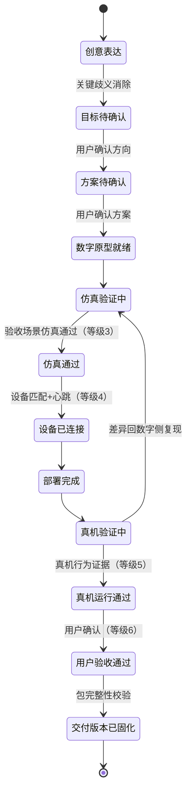

# 掌问创作端 · 信息架构与主流程（PRD 骨架 v0.2）

版本：v0.2
日期：2026-07-30
状态：阶段 A 产物——纳入 2026-07-30 评审意见后的修订版
上游文档：PRODUCT_PROJECT_BOOK.md v1.1（决策 D1–D12，修订 R1–R12）、PRODUCT_REFOUNDATION_DISCUSSION.md
范围：仅 C 端创作端；教学品牌线、平台内核改造不在本文档

---

## 0. v0.2 修订说明

本版根据评审意见完成与 IA 相关的修订，编号与项目书 §16 修订记录（R1–R12）对应：

| 编号 | 修订 | 位置 |
|---|---|---|
| R1 | 验证等级与状态语义统一：部署仅达等级 4；等级 5 必须由真机行为证据达成 | §4.3 |
| R2 | 作品生命周期状态与系统 Job 分离为两层 | §4.1/§4.2 |
| R3 | 阶段页签改为"可查看、受控操作"软门禁 | §5 |
| R4 | 仿真失败按六类归因回退，不再一律重建方案 | §4.5 |
| R5 | 作品目标、验收场景、系统 Job、设备实例升为一等对象；证据链可追踪：目标→方案→代码/参数→仿真→设备/固件→验收人 | §4.7 |
| R6 | 版本依赖与失效传播规则（平台语义在项目书 §4.6，本文为界面含义） | §4.6 |
| R7 | 设备确认通道增加四级风险分级与四条产品契约 | §6.4 |
| R8 | 亲子权限模型（家庭空间/监护人/创作者）进入 IA | §7 |
| R9 | 低保真原型范围扩为 P1–P6 + W1 + W3 + W5 + S1；走查案例改为响应执行类并含失败场景 | §8 |

补充约定（评审讨论中确认）：

- 失败归因 = 系统给出归因建议并附证据，用户可改判；无法归因时默认留在当前阶段，不做破坏性回退；
- 设备操作取消语义分级：越过物理临界点的操作（如固件写入中段）不可取消，必须在确认前明示；
- 监护授权粒度：单次 / 本次会话 / 常驻；
- 等级 2"静态检查通过"不是作品生命周期状态，而是挂在代码版本上的属性。

## 1. 文档目的

把项目书确认的决策落成：1）创作端完整信息架构；2）作品从创意到交付的状态机（进出标准）；3）全局交互规则。本骨架是低保真原型的直接输入，不规定视觉细节与组件样式。

## 2. 信息架构设计原则

| 上游原则 | 对 IA 的具体约束 |
|---|---|
| 项目优先（讨论稿 §4.1） | 不存在"工具导航"。顶层只有两个概念：**我的作品** 与 **一个打开的作品** |
| 一套当前方案（§4.5） | 任意时刻项目内只有一套"当前方案"实体；候选方案是其分支而非并列项目 |
| 对话为主（D3） | 对话流是项目内的常驻主列；工作区作为对话的"展开物"出现 |
| 复杂度就地展开（D8） | 无"普通/专业模式"开关；每个工作区默认收起工程细节，就地逐层展开 |
| 物理动作用户掌控（§4.6） | 一切真实设备动作走统一"确认-执行-反馈"通道，按风险分级（§6.4） |
| 用户始终知道三件事（§10.1） | 每个项目页恒定呈现：作品名、当前状态/验证等级、下一步建议 |
| **状态与任务分离（R2）** | 用户看到的是作品生命周期状态；生成/构建/部署等是系统 Job，另有任务状态 |
| **软门禁（R3）** | 信息可查看，危险动作和状态推进受条件控制；不替用户隐藏信息 |

## 3. 顶层信息架构

```text
掌问创作端
├── 我的作品（首页）
│   ├── 作品列表（状态、验证等级、缩略预览）
│   ├── 新建作品（直接进入对话）
│   └── 模板/官方作品包（社区二期前为官方内容）
├── 作品空间（打开一个项目后）
│   ├── 对话流（常驻主列）
│   ├── 作品状态条（恒定顶部：名称 / 生命周期状态+验证等级 / 下一步）
│   ├── 阶段页签（状态驱动点亮，全部可查看）
│   │   ├── 创意与方案
│   │   ├── 数字原型
│   │   └── 实物运行
│   ├── 工作区（按需展开）
│   │   ├── 方案详情（BOM、接线、供电预算）
│   │   ├── 代码（默认收起）
│   │   ├── 图形调试（传感器/执行器控件）
│   │   ├── 结构（按需，二期重点）
│   │   ├── 参数版本
│   │   └── 证据与交付
│   └── 设备确认通道（统一物理动作确认浮层，按风险分级）
├── 设备包目录（只读浏览 + 我的硬件）
├── 家庭空间（账号、订阅、监护人/创作者权限、分享设置）
└── 社区（二期；一期仅有默认私有的分享链接）
```

### 3.1 关键结构决策

- **阶段页签全部可查看**：未满足条件时展示所需硬件、设备匹配结果、未满足条件清单、原因解释和唯一推荐返回动作（§5）；
- **工作区不隶属阶段页**：同一图形调试工作区在数字原型阶段操作仿真控件、实物运行阶段操作真机控件，数据同源、模式随阶段切换；
- **代码工作区全局默认收起**：从方案、仿真失败、验收证据等任何入口就地展开到相关文件与行；
- **家庭空间是一级入口**：账号/订阅/权限/分享设置统一管理，亲子权限不是设置页的子项（§7）。

## 4. 作品状态机

### 4.1 生命周期状态（用户可见层，R1/R2）



状态链说明：

- 生命周期状态共 12 个，全部由"用户确认"或"证据达成"推进，不由系统任务完成直接推进；
- "交付版本已固化"是**交付完整性状态**，与行为验证等级是两个维度，不新增验证等级；
- 状态可回退（按 §4.5 归因矩阵），回退不丢历史。

### 4.2 系统 Job（任务层，与用户状态分离，R2）

方案生成、数字原型生成、代码构建、静态检查、部署写入等均为系统 Job：

- Job 状态：排队中 / 进行中 / 失败（可重试）/ 已取消；
- Job 触发状态迁移，但 Job 完成 ≠ 状态达成（例：部署 Job 成功 → 进入"部署完成"，验证等级不变）；
- Job 失败时在对话流中给出原因、证据和重试入口，不改变生命周期状态；
- 同一时刻同一项目只允许一个写设备类 Job。

### 4.3 验证等级与状态的映射（R1）

| 等级 | 名称 | 达成主体 | 达成证据 |
|---|---|---|---|
| 1 | 未验证 | — | 默认 |
| 2 | 静态检查通过 | **代码版本**（属性，非生命周期状态） | 语法/静态规则/Mock 检查报告 |
| 3 | 功能仿真通过 | 项目 | 全部验收场景的仿真通过记录 |
| 4 | 设备已连接 | 设备实例 | 设备识别、方案匹配检查、心跳正常 |
| 5 | 真机运行通过 | 项目 × 设备实例 | 全部验收场景的真机行为证据 |
| 6 | 用户验收通过 | 项目 | 用户验收确认记录（谁、何时） |

关键约束：

- **部署完成只证明"写进去了"，不推进等级**；等级 5 必须由真机验收场景证据达成；
- 等级 5 与具体设备实例和固件版本绑定；换设备/升级固件后按 §4.6 规则失效或待复核；
- 任何等级不得凭 AI 文本声明达成。

### 4.4 各状态进出标准

| 状态 | 用户动作 | 系统动作 | 出口标准 |
|---|---|---|---|
| 创意表达 | 自然语言/图片描述 | 提取意图，每次最多问一个关键问题 | 方向性歧义消除 |
| 目标待确认 | 确认/修改目标卡 | 生成目标卡（一等对象） | 用户确认方向 |
| 方案待确认 | 确认/修改方案 | 生成方案 Job；要素齐全且无硬件冲突 | 用户确认方案（冻结方案版本） |
| 数字原型就绪 | 观察场景 | 原型生成 Job；与方案要素一一对应自动校验 | 校验通过 |
| 仿真验证中 | 触发输入、改参数、跑验收场景 | 日志/遥测/曲线；行为修改同步代码+场景；参数存版本 | 全部验收场景仿真通过（等级3） |
| 仿真通过 | 准备实物 | 列出所需硬件与条件检查 | 用户选择连接设备 |
| 设备已连接 | 确认设备、选择通道 | 设备匹配检查、心跳（等级4） | 用户发起部署 |
| 部署完成 | 确认写入（设备确认通道） | 部署 Job：展示写入内容/目标/风险、回读校验 | 校验通过；**等级不变** |
| 真机验证中 | 跑真机验收场景、校准参数 | 原始读数只读；参数版本比较；失联保持安全值 | 全部验收场景真机证据（等级5） |
| 真机运行通过 | 查看对照与证据 | 仿真↔真机差异报告 | 用户发起验收 |
| 用户验收通过 | 确认验收 | 汇总证据链（等级6） | — |
| 交付版本已固化 | 保存/命名 | 固化项目包、凭据扫描、完整性校验 | 校验通过 |

### 4.5 失败分类与回退矩阵（R4）

| 失败类型 | 归因线索 | 回到哪里 |
|---|---|---|
| 阈值、速度、亮度等参数不合适 | 验收场景在边界值失败 | 留在仿真调试/真机验证，调参数版本 |
| 状态机、条件判断等行为逻辑错误 | 行为顺序/分支与预期不符 | 留在当前阶段，就地展开代码或逻辑摘要 |
| 接线或 IO 分配冲突 | 引脚冲突报告 | 方案详情，重新分配 IO |
| 器件能力不足、供电不足 | 能力/功耗预算校验失败 | 方案修改（方案版本+1） |
| 用户目标发生变化 | 用户表达方向改变 | 目标待确认 |
| 仿真能力不覆盖 | 命中仿真边界声明 | 不回退；标记"待真机验证"并展示限制 |

归因原则：系统先给出归因建议（附证据），用户可改判；无法归因时默认留在当前阶段，不做破坏性回退。

### 4.6 版本失效的界面含义（R6）

失效规则本身定义在项目书 §4.6（平台内核语义）。界面层要求：

- 任何被失效影响的证据显示"已过期"标记与原因，不静默消失；
- 状态条上的验证等级随失效自动降级，并给出"重新验证"入口；
- 设备包/固件升级后，相关真机证据进入"待复核"，由用户决定是否重新跑验收场景。

### 4.7 证据链追踪（R5）

新增一等对象：**作品目标**（场景、可观察行为、必须/可选功能、约束、风险偏好、确认记录）与**验收场景**（前置条件、输入、预期行为、安全边界、允许误差、仿真/真机/用户三级结果）。任何一条证据必须能沿链回答：

```text
某个用户目标
→ 由哪个方案满足
→ 对应哪些代码版本和参数版本
→ 通过了哪些仿真验收场景
→ 在哪台设备实例、哪个固件上通过真机验收
→ 由谁、何时完成验收
```

## 5. 阶段页签规则：可查看、受控操作（R3）

- 三个阶段页签任何时候都可打开查看；
- 条件未满足时，页内展示：所需硬件清单、当前设备匹配结果、未满足条件及原因、唯一推荐返回动作；
- **受控动作清单**（条件未满足时禁用并说明原因）：运行验收场景、部署写入、执行器解锁、验收确认；
- 允许提前查看部署风险说明、连接方式与空间要求、历史真机数据（用于仿真↔真机差异排查）；
- 系统在受控页面不主动推送后续操作，避免诱导越级。

## 6. 全局交互规则

### 6.1 对话流行为规范

每次只推进一个最重要动作；低风险可逆细节用推荐默认值并告知；方向性、高风险、真实设备动作必须显式确认；对话可引用工作区对象；项目记忆以结构化事实与版本为主。

### 6.2 复杂度就地展开

L0 当前结果/下一步/必要风险 → L1 卡片展开（BOM/接线/曲线）→ L2 代码与协议（定位到行）→ L3 诊断与内部标识（高级详情抽屉）。真实风险与能力限制恒定可见，不随层级收起。

### 6.3 风险呈现

错误表达面向用户语言（"电机被卡住，已自动停转"），原始诊断码放 L3。

### 6.4 设备确认通道：风险分级与产品契约（R7）

统一入口不变，按风险四级确认：

| 级别 | 动作 | 确认方式 |
|---|---|---|
| 低 | 扫描设备、读取状态 | 每会话首次确认 |
| 中 | 连接、普通代码上传 | 展示目标与影响，单次确认 |
| 高 | 复位、固件恢复、覆盖已有作品 | 二次确认 + 恢复路径说明 |
| 危险 | 电机/加热/强光等执行器解锁 | 监护授权（§7）+ 自动超时 + 急停常驻 |

四条产品契约：

1. **幂等**：设备命令重复执行不产生重复危险动作；
2. **取消语义明示**：可取消的操作说明取消后果；越过物理临界点（如固件写入中段）的操作在确认前明示"开始后不可中断"；
3. **失联安全状态**：由设备包定义，失联/超时/重连/应用重启后保持安全值；
4. **本地审计**：每次真实设备动作产生本地审计记录（谁、何时、什么动作、结果）。

## 7. 亲子与权限模型（R8）

```text
家庭空间
├── 监护人
│   ├── 购买与订阅管理
│   ├── 危险执行器授权（粒度：单次 / 本次会话 / 常驻）
│   ├── 分享与公开权限（默认私有；儿童素材默认更严格）
│   └── 使用时长与内容设置
└── 创作者（可为儿童或成人）
    ├── 创作与仿真（完整能力）
    ├── 安全范围内运行设备（非危险执行器无需逐项授权）
    └── 提交验收申请
```

- 危险动作对创作者账号显示"需监护人授权"，授权请求一键直达监护人设备；
- 分享链接默认私有/受限访问；涉及儿童作品、图片、声音、摄像头素材时默认不含原始媒体；
- 成人个人创客账号退化为单角色，不增加使用负担。

## 8. 页面清单与低保真原型范围（R9）

| # | 页面/工作区 | 职责 | 首版 | 低保真原型 |
|---|---|---|---|---|
| P1 | 我的作品 | 列表、新建、状态一览 | 必须 | ✅ |
| P2 | 作品空间-对话流 | 主入口 | 必须 | ✅ |
| P3 | 作品状态条 | 状态+等级+下一步；失效降级展示 | 必须 | ✅ |
| P4 | 创意与方案阶段页 | 目标卡、方案卡、确认动作 | 必须 | ✅ |
| P5 | 数字原型阶段页 | 场景画布、输入控件、验收场景运行 | 必须 | ✅ |
| P6 | 实物运行阶段页 | 连接、部署、校准、对照；含软门禁态 | 必须 | ✅ |
| W1 | 方案详情工作区 | BOM、接线、供电预算、IO 重分配 | 必须 | ✅ |
| W2 | 代码工作区 | 查看/编辑/Diff，默认收起 | 必须 | 静态示意 |
| W3 | 图形调试工作区 | 控件、曲线、参数 | 必须 | ✅ |
| W4 | 参数版本工作区 | 比较、回滚、应用目标 | 必须 | 静态示意 |
| W5 | 证据与交付工作区 | 证据链、等级、项目包导出 | 必须 | ✅ |
| W6 | 结构工作区 | 参数化生成、3D 预览 | 按需（D10） | 不做 |
| S1 | 设备确认通道 | 四级风险确认浮层 | 必须 | ✅ |
| S2 | 设备包目录 | 能力浏览、我的硬件 | 必须（只读） | 静态示意 |
| S3 | 家庭空间 | 账号、订阅、监护权限、分享设置 | 必须 | 静态示意 |
| S4 | 社区/分享 | 分享链接先行 | 二期 | 不做 |

**低保真走查案例：响应执行类作品**（对安全设计压力最大，覆盖传感器输入、参数调试、执行器安全、仿真、部署、急停、证据与交付）。原型必须完整演示一次：

> 创意 → 方案 → 仿真失败（参数类归因）→ 修改参数 → 仿真通过 → 设备确认 → 部署失败并恢复 → 真机校准 → 验收 → 项目包。

至少包含三个失败场景：仿真参数失败、部署失败恢复、真机与仿真差异处理。只演示成功路径的原型不予通过。

（注：走查案例选响应执行类是验证策略；工程构建顺序仍为感知类先行，见项目书 §6.1。）

## 9. 视觉方向要点

画面主角是作品与器件而非表格状态卡；验证等级用可感知进度语言；阶段推进有过渡感；亲和力优先但不低幼化；错误/风险不使用开发者黑话。

## 10. 与教学品牌线的边界

本 IA 只约束 C 端创作端；两端共享平台内核，不共享界面；教学线的第三方认证设备包不出现在 C 端设备包目录（D11）。

## 11. 本骨架暂不决定

组件级布局与视觉样式；对话与工作区的具体联动手势；社区二期形态；各工作区内部详表（进入正式 PRD 分章）。

## 12. 下一步动作

1. 按 §8 范围制作低保真可点击原型（响应执行类走查案例 + 三个失败场景）；
2. 并行启动设备包最小规范 v0.9，与项目书 §4.6 依赖失效规则同步设计；
3. 原型走查按评审提出的七个问题验证（阶段认知、下一步理由、仿真≠真机、设备动作心理门槛、失败恢复、无代码完成作品、第二人复现）；
4. 走查通过后升级为正式 PRD 分章。
