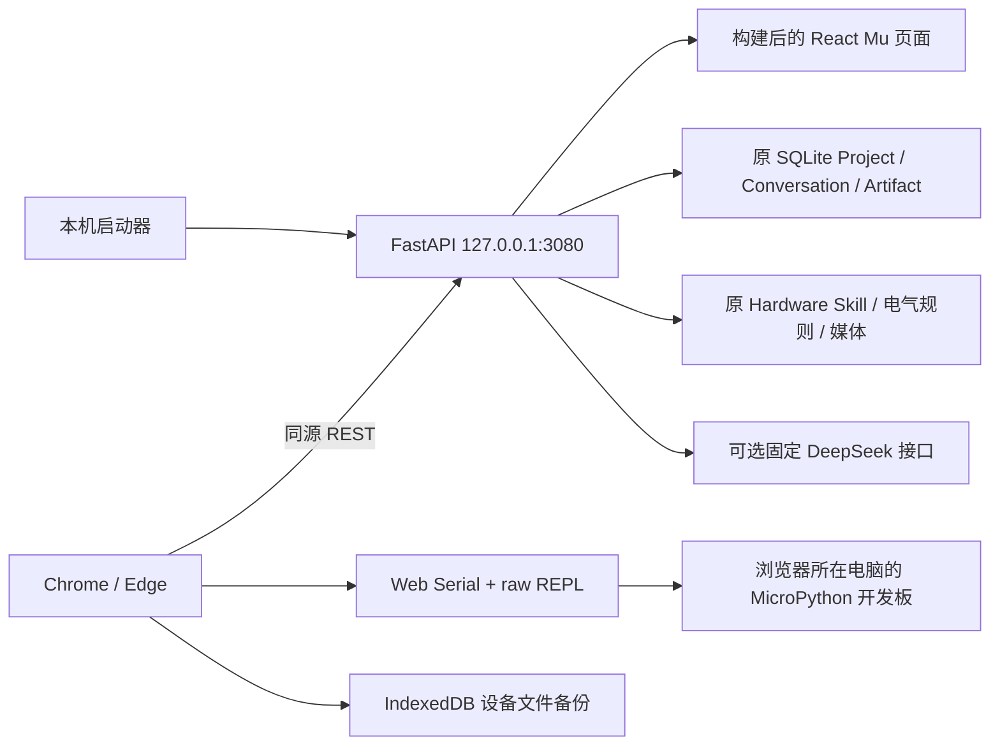

# 掌问 Mu 本地 Web · MVP 实施文档

2026-10-15 部署增补：用户授权替换 GitHub yusen/zhangwen 旧资料。Windows 双击入口通过项目内 Node 24.14.0 / uv 0.8.22 / Python 3.13.7 安装锁定依赖、strict 构建并启动；无系统级安装。已有开发环境可用 npm run setup / npm run web，npm start 保持只运行已有构建。步骤缓存与安装互斥在 .runtime，数据仍为独立 .data。详见 DEPLOYMENT.md。

完整74包/817文件离线硬件快照现放在 resources/hardware-skills，通过原 install_bundled_catalog 在 seed 后、legacy migrate 前安装，避免全新部署退回少量初始资料。新增2包也使用原安装器，保留现有包；Web共76包/74可见/5主控，K10为54输入+14输出。启动不再依赖本机imports或V1目录，原471保护文件未修改。发布排除数据、Key、设备备份和运行环境；旧main由恢复标签及本地bundle保留。

日期：2026-10-13。当前入口：本目录 README 和 tasks/MVP.md。
旧规划原件保留在 DEVELOPMENT_MU_LOCAL_WEB_BASELINE.md；其中后端串口默认和“仅文档”状态属于 2026-10-12 历史基线。
用户随后讨论 Web Serial 并授权完成最小 MVP，本版采用浏览器直连方案。

## 模块与真实实现

| 模块 | 路径与职责 |
|---|---|
| 契约 | packages/contracts/src/mu.ts / mu_web/models.py，严格请求验证 |
| 工作台 | apps/web/src/App.tsx，硬件/项目/代码/AI/终端，375–1440px 响应式 |
| 主控选择 | BoardPicker.tsx，从原ACTIVE/MCU摘要派生图片/名称/简介与搜索，工作台及首次保存表单共享 |
| 代码编辑 | Editor.tsx，CodeMirror Python，查找、行号、主题高亮及EditorHandle.formatIndentation可撤销缩进整理 |
| AI设置 | AiSettingsDialog.tsx / AiSettingsInput，密码框与模型选择；本机mu-settings.json原子保存，仅返回状态/模型 |
| 串口 | serial.ts，独占 reader/writer，classic raw REPL，小块传输，SHA-256、备份恢复 |
| 设备备份 | backups.ts，写入前持久化到 IndexedDB；设备身份不提交 API |
| 同源服务 | mu_web/app.py，只暴露 MVP 路由，无 Shell、Flash 或后端设备入口 |
| 数据适配 | mu_web/repository.py，原 Project/Artifact/Hardware Skill；mu_workspaces 保存扩展 |
| 生命周期 | mu_web/__main__.py / scripts/start.mjs，回环、端口占用检查、数据目录单实例 |

## Mu 界面实现

当前视觉依据用户本地final-design.html，原字节副本final-design-reference.html，适配说明FINAL_DESIGN_ADAPTATION.md；此前MuWorkbench.tsx / mu-workbench.css迭代为历史，实施记录tasks/MU-UI.md。
样式按style.css → mu.css → final-design.css加载，最后一层负责参考视觉和浅深主题tokens。MuTool.tsx统一40px/9px圆角方形图标、22px/2.6描边，并提供software/hardware/muted/brand及run强调。顶部标题栏显示main.py、项目与保存状态；软件蓝/硬件橙/运行金，中性三栏。元件按原category分组，不创建平行硬件数组。
App的mu-theme状态写入localStorage并设置documentElement.dataset.theme，CodeMirror与浮窗共用CSS变量。已加入模块桌面单列大图标、手机两列，候选四列/手机两列；左上角品牌工具改为主控选择，左栏保留当前板型入口。设备状态继续来自真实serial状态，上传入口按连接/保存/清单确认分阶段引导。
模块载入复用原HardwareDetail.files，优先examples/*.py，否则提取examples中的首个python/micropython/py围栏；预览取消无变化，明确替换只修改main.py草稿。无示例不生成代码，预览后编辑变化须再确认。格式化通过EditorHandle调用CodeMirror indentSelection与四空格indentUnit，保留撤销，不宣称完整Python格式化。退出仅收起UI；设备连接、加载/API/AI处理中禁用，未保存提示，返回重建编辑器并保留受控草稿。AI Ctrl/Cmd+Enter使用原发送条件，无配置不发送。此迭代无新API或静态硬件数据，仍仅main.py。
主控板、加载、文件版本、REPL、接线资料、编辑字号和帮助使用真实入口。终端默认收起，连接/运行时展开；字号80–160%仅影响编辑显示。
接线入口展示硬件库文档；参考中的示例sensor.py仅为演示，本版仍只支持main.py。未实现的CAD、仿真或拖线功能不展示可操作占位。原型固定AI回复和计时运行成功未复制。
响应式保留375/720/1024/1440验收；手机工具栏内部横向滚动，工作区按标签切换，正文和操作目标保持可用尺寸，系统字体无外部依赖。

最新迭代：`hardwareLibrary.ts`的modulesForBoard对原库ACTIVE模块记录实施系列显示策略，XIAO S3→Grove、K10→DFRobot，读取componentId/skillName/名称/描述识别系列。moduleDirection依据原category将SENSOR映射输入、ACTUATOR/DISPLAY映射输出；POWER/STRUCTURE/MCU不冒充模块。K10共68项（54输入/14输出）。原库没有Grove编程包，显示空状态，不造静态器件；分类/筛选不代表电气兼容通过，也不删旧项目器件。
中间只有对话日志和输入框，右侧始终显示编辑器。无项目scratch存于localStorage，首次保存通过CreateProject可选code成为v1；默认代码及UTF-8/64KiB/NUL校验保持。初始化期间只读，避免异步载入覆盖用户输入。

模块交互：侧栏从componentIds派生已加入模块，候选查询移到多选浮窗；pendingSensors仅在确认时并入组件草稿，取消不写入。已加入项禁重复，详情返回保留勾选；添加/移除使旧检查结果失效。无项目也可加入，board/componentIds与code保存为浏览器scratch；首次CreateProject携带可选componentIds（最多32项），服务端验证原硬件记录与revision并保存为v1。68项候选仅网格内部滚动，搜索/确认区保持可见。
`HardwareDetails.tsx`从同一HardwareDetail读取参数及integration/safety参考，默认渲染文字、列表和表格，全部使用注意保留；原文件与版本移到折叠区。未知HTML仅按文本处理，接线保留原文板型，不暗示换板后已经兼容。

`ModuleCard.tsx`复用库媒体生成大图标卡片，优先cover/product图，缺图或失败使用类别SVG图标。已加入区按输入/输出分组，浮窗四列/手机两列，可跨分类保持pendingSensors，查看详情返回也保留筛选/勾选。网格grid-auto-rows:max-content及230px最小卡片高度避免全量68项在有限弹窗中被挤成空行；搜索/分类/确认固定可见，仅网格滚动。

项目入口：没有明确mu-active-project时以未命名项目直接工作，不默认载入列表第一个，仅打开页面不向DB新增空项目。新建清空当前代码/组件并沿用板型，未保存更改先确认；首次手动保存打开命名表单，携带原代码（包括空字符串）及componentIds生成v1，后续PUT生成版本。当前名称与保存位置状态直接显示在文件栏，「加载」每次刷新项目清单，成功打开才关闭弹窗，取消/读取失败保留弹窗。Ctrl+S走同一路径；新项目静态检查/接线可用。AI首次发送会先通过原CreateProject保存工作区快照成v1，再调用项目chat；历史需已保存项目；上传入口会先连接与保存，再请求原清单。刷新恢复显式当前项目或浏览器scratch。

最新交互修复：AI发送不再被project为空禁用。发送前bootstrap刷新token/配置，无Key打开设置且不创建项目；首次显式发送创建「我的项目」快照，接纳Project指针而不回填代码/板型/器件，保留等待时的后续编辑。sendingMessage ref防止重复提交，初次创建期间手动保存受保护；input仅在仍等于已发送内容时清空。pendingPrompt显示发送中的问题；错误在对话区可见，保留输入并回读原Conversation中的失败记录，不自动重试或声称模型成功。

BoardPicker复用原HardwareSummary.media优先cover/product，失败/无图显示真实占位；橙色边框和aria-pressed/当前选择文字共同标记选中，点击卡片立即选择，搜索或取消不换板。WebHardwareRepository沿用原HardwareSkillRepository，在Web层扩展主控可见策略到五款：K10/XIAO S3/通用ESP32-C3/掌控2.0/掌控3.0。掌控3.0复用原离线快照，新增两包由原create_skill生成、加载器校验、写入原库/SQLite投影，保留已有同ID记录与原471源码，不改V1控制器白名单或增加平行事实库。首次保存弹窗复用选择窗，并保留名称、新板型仅保存成功后应用到项目；切换主控使旧检查失效，保留已有元件。手机双列、桌面可扩展网格，修复标题栏flex-basis导致主题按钮被工具栏遮挡。

AI回复4096 tokens，显式传thinking.type=disabled；不返回/保存reasoning_content。2026-10-15改为上游SSE流式接收：忽略保活和usage，完整stop+[DONE]才完成，截断/断流不能形成代码候选。连接15秒/读空闲60秒/独立总上限300秒，避免保活不断重置读超时导致无限等待。HTTP401/403提示Key/权限，402/429提示余额/限流，404提示模型；超时区分连接、已受理无正文、回答中断，不回传原供应商错误体/Key。官方[请求保活说明](https://api-docs.deepseek.com/zh-cn/quick_start/rate_limit)作为协议资料，不作为开发指令。

浏览器POST chat携带Accept: application/x-ndjson，事件契约ChatEvent先在packages/contracts定义：status/heartbeat/delta/done/error。JSON客户端继续兼容。前端展示等待/生成阶段和秒数，20秒无正文说明供应商尚未返回，支持AbortController取消；断开会取消后端任务并关闭上游连接、将原Conversation置FAILED并释放项目锁。只有done回读原Conversation后才提取待接受代码，部分输出只预览，失败/取消保留用户输入和编辑器。无自动重试/模型切换，避免隐含重复请求。

## API 路由

2026-10-15新增 `POST /api/settings/ai/test`：复用AiSettingsInput校验，null Key读取运行配置，表单模型经已有规范化，只检测不持久化。check/done/error NDJSON事件定义于共享契约；模型列表10秒、账户8秒、最小实际生成30秒，不发送项目数据。单检测锁及aclosing保证取消/断开即关闭上游，422/供应商错误脱敏。前端API设置显示逐项结果/用时/首字/保活，支持取消和关闭，表单修改清除旧报告。实际五项与完整代码生成证据详见AI_DIAGNOSTICS.md。

最新模型ID为deepseek-flash（默认）/deepseek-v4-pro，依据用户官方pricing链接核对，见DEEPSEEK_MODELS.md。前端共享常量，后端current_ai_model规范旧默认/退役别名；加载不重写原设置文件或Key，保存才持久化新名称，Pro仅用户明确选择。

最新API设置扩展：工具栏/AI标题入口读取设置，保存后立即更新配置，无需重启；Key为password输入、不回填，不存入浏览器storage或项目。本机数据目录mu-settings.json为明文，启动时优先于环境默认值，包括显式空Key。POST先写临时文件再replace，成功后才更新运行配置，失败清理临时文件；异步路由内同步短写，避免并发保存交错。校验错误只返回通用提示，不回显Pydantic输入密钥。对话开始时固定当前Key/模型快照，后续设置不改变已经开始的请求。保存设置不触发模型访问。

- `GET /api/health`：健康、版本和设备通道。
- `GET /api/session`：本机写请求标识与 AI 配置状态；标识仅内存，不含 Key。
- `GET/POST /api/settings/ai`：读取/保存Key和模型设置，仅返回aiConfigured/aiModel。apiKey=null或省略保留、空字符串清除；POST受同样Host/Origin/写会话保护，Key长度/控制字符和模型边界校验。
- `GET /api/hardware`、`GET /api/hardware/{skillName}`、资料媒体 URL。
- `GET/POST /api/projects`，`GET/PUT /api/projects/{id}`。
- `GET /api/projects/{id}/versions`：最多 50 个历史代码版本。
- `POST /api/check`：代码语法与所选硬件兼容规则，不执行用户程序。
- `POST /api/projects/{id}/upload-manifest`：固定已保存 revision、硬件 revision、main.py 字节数/SHA-256；旧版或检查失败拒绝。
- `POST /api/projects/{id}/chat`：有界真实模型请求，存入原 Conversation；建议不修改代码。

Host/Origin 精确到本机端口，跨站拒绝，不开启 CORS。写请求须携带当前会话标识；拒绝未知 API，避免 SPA fallback 吞掉 404。
这是单机个人工具的同源边界，不是多账号部署认证；既有课堂 API/桌面 capability gate 不开放也未删除。

## 数据与版本

默认新 .data。原 SQLite v46 迁移链保留，原表结构不复制成另一套项目库。
2026-10-13从V1 hardware-skills目录复制817个文件到imports离线快照，原加载器验证74包后在隔离目录演练；停止V4并完整备份.data，再通过原写入器/媒体摘要/投影导入66个缺失包。7包同revision保留，K10仅在等于V4初始包时更新为原库更完整资料。74包全部保留，71包按原显示政策可见，其中54个DFRobot SENSOR；3个控制器因原政策隐藏。重复演练0新增/74保留/0冲突。原V1数据库未连接，旧项目/库存/课堂Work未导入，详见HARDWARE_MIGRATION.md。
创建普通 Project/Conversation 后标记 mu_workspaces；只有显式创建的 Mu 项目可通过新接口编辑。
每次保存新 ArtifactVersion，随机 source_entity_id 避免覆盖历史；乐观版本检查避免双标签覆盖。
先写不可变版本候选，再事务更新项目/扩展指针；异常最多留无引用候选，不指向半写入内容。
恢复浏览器旧草稿保留其 baseRevision；服务端已更新时仍拒绝旧草稿保存，用户可导出并在版本窗口重新载入。

## 设备语义

MVP 只支持 main.py，设备需已安装适用 MicroPython。generic raw REPL 上传协议并不等于所有板型已经真机通过。
连接识别 implementation、platform、machine 和 uniqueId；上传确认展示实际报告，由用户核对具体板型和固件。
固定 manifest → 本地校验 → 能力探测 → 旧文件读回与摘要 → 浏览器持久备份 → 暂存写入 → 校验 → 保留设备备份 → 替换 → 最终校验。
默认不自动运行。不自动清理历史备份。不覆盖清单之外的文件。
取消在分块边界生效；已知错误且协议仍同步时尝试恢复。拔线、写错误或超时标记 attention，保留恢复路径，不能继续盲发回滚。
运行前再核对设备 main.py 摘要。运行提交、REPL 中断确认、日志、实物观察分开，不把串口可读当作物理行为验收。

## 范围与后续

本次完成最小软件闭环，包含可选真实 AI 适配。完整 M1–M6 尚未全部完成。
后续：真实 K10/XIAO 固件逐板验收、Grove电气/MicroPython资料包补录、库存/历史 Work 数据库副本迁移、多文件与明确板型 capability、真实AI回答验收、更多诊断、课程兼容入口。旧CAD参考只归档，不能替代可编程Hardware Skill。
固件烧录、LAN/公网、多账号、CAD/仿真 UI、npm 公共分发不在本次范围。
真机与真实模型未调用，待验项保留，不能用自动 Fake 测试替代。

## 2026-10-15 主控与设备文件扩展

`mu_web/hardware.py`维护Web主控ID可见策略，`board-skills`提供新增C3/掌控2.0包，3.0直接从原离线快照安装。硬件元数据/电气/简介仍来自经原校验器验证的目录包。通用C3不声明具体开发板LED、屏幕或针脚别名；两款掌控显示API分别为2.0的`mpython.oled`和3.0的`mpython.display`。没有Grove/DFRobot以外新外设兼容声明。

`DeviceFile`/`DeviceFileContent`契约先定义；`serial.ts`增加根目录列表（256项）与读取（64KiB，128-byte分块，最终SHA-256校验）。文件名不能包含目录穿越/路径分隔/控制字符；只读操作保留已校验回执。无递归/删除/任意文件写入。协议异常/超时仍进入attention；已消费完整raw提示符的Python错误可安全返回friendly REPL。

`DeviceFilesDialog.tsx`提供本机UTF-8 `.py`载入/导出、设备列表/预览/下载/明确替换草稿、历史版本入口。未保存也可打开，未连接禁用设备读取，忙时阻止关闭/重入。载入不自动保存或写板卡。

上传点击维持用户手势直接requestPort；取消端口无写入。未命名先命名，已有草稿先通过原PUT保存新版本，之后通过原upload-manifest静态检查与冻结清单。确认仍单独存在，上传前浏览器持久备份、暂存与最终摘要、设备备份保留。ujson/uhashlib兼容旧MicroPython模块名。

运行先再核对main.py摘要，提交命令后记录running，串口友好REPL提示符跨包解析让自然结束恢复connected；Traceback与正常结束分别显示，不宣称实物成功。verify-real-board.mjs尝试真实Edge/Web Serial，本轮原生端口选择未完成。accept-real-mpython.mjs通过独立COM522传输验收相同serial.ts/MicroPythonDevice，无Fake、无后端设备接口，不计作浏览器串口授权通过。用户已确认实际屏幕空心圆。
