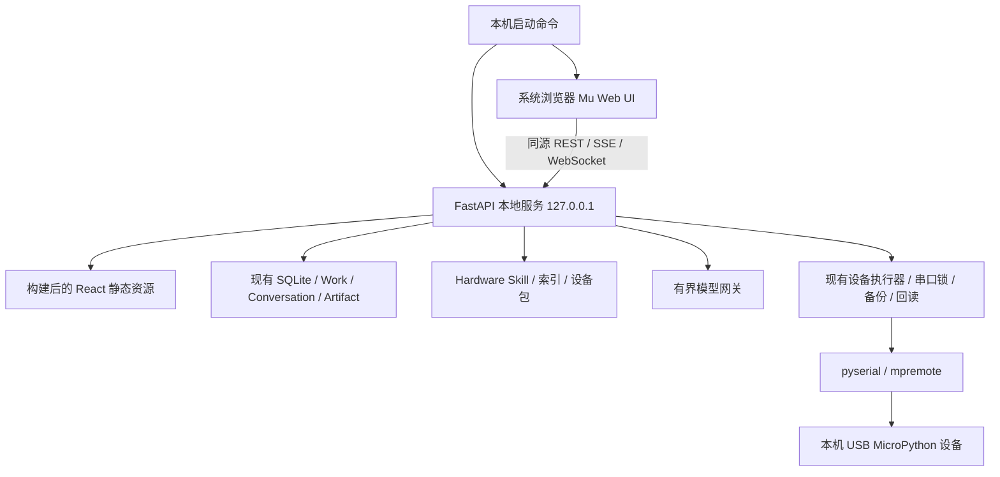

# 掌问 Mu 本地 Web 开发文档

版本：1.0 · 日期：2026-10-12 · 任务：`ZW-MU-WEB-001`

状态：新产品与开发基线已定义，代码迁移尚未开始。本文中的目标命令、接口和里程碑不代表当前已经实现。

## 1. 产品方向与权威

掌问是本机部署、浏览器访问的 AI MicroPython 编程与硬件工作台。用户从硬件库选择开发板和器件，
在同一项目中与掌问协作编辑代码、查看接线、上传到已安装 MicroPython 的设备，并通过串口观察和调试。
Mu 迁移包提供工作台布局参考；所有保存、生成、检查、上传和连接状态必须来自实际服务结果。

本次用户明确要求：

1. 正式产品使用本地部署 Web，停止以桌面应用作为必需入口。
2. 参考 deepseek-harness 的本机服务、浏览器界面与命令启动方式。
3. 保留已经完成的硬件数据库内容。
4. 使用 MicroPython 编程和上传。

本文成为新方向的统一产品、架构和实施入口；`tasks/ZW-MU-WEB-001-local-web-micropython.md` 记录实施计划。
旧教育平台、统一创作平台、V1/V2/V3、桌面和“Web 仅用于无设备开发”的文档保留作历史、兼容和迁移依据。
硬件 Skill 格式继续遵循 [Hardware Skill 规范](D:/ZW_V1/docs/HARDWARE_SKILL_AI_AUTHORING_GUIDE.md)。
实时与能力包、设备安全等已有契约在与本文一致的范围内复用；部署宿主与授权入口按本文迁移。

此次授权是整理开发文档。本文不授权立即覆盖 Mu 包、删除旧模块、改数据库或执行真实设备操作。

## 2. deepseek-harness 参考事实与采用方式

2026-10-12 核对仓库默认分支 `master`，参考提交为
`d743267388641bc76f17c45ce8b4c231aed1d32c`（`0.2.1-alpha.2` 发布合并）。

可核验来源：

- [固定提交 README](https://github.com/deepseek-ai/deepseek-harness/blob/d743267388641bc76f17c45ce8b4c231aed1d32c/README.md)
- [固定提交 Web 使用指南](https://github.com/deepseek-ai/deepseek-harness/blob/d743267388641bc76f17c45ce8b4c231aed1d32c/docs/user/guide/index.md)
- [仓库](https://github.com/deepseek-ai/deepseek-harness)

| 上游已核实事实 | 掌问采用方式 |
|---|---|
| `npx @deepseek-ai/dsh web` 启动本机 Web UI，默认 `127.0.0.1:3080` | 提供统一本机启动命令，默认仅回环监听，启动完成后打开浏览器 |
| 支持 `--no-open`；SSH 场景打印地址而不打开浏览器 | 支持无浏览器启动和清楚的服务地址；首版硬件只面向运行服务的本机 |
| 源码运行依次安装、构建，再 `pnpm dsh web` | 安装/构建与日常启动分离，启动不重复安装和编译 |
| 开发态有独立 `dev:web` 入口 | 热更新开发与正式静态资源运行分开 |
| Web UI 选择工作区，在设置中配置模型 | 掌问使用受控项目工作区与服务端模型配置，不给模型任意主机路径权限 |
| 上游是 Cordis 插件架构、MIT、developer preview | 借鉴部署体验；不把上游运行时、插件系统或任意命令工具作为本次迁移依赖 |

上游命令只用于解释参考，未在本项目执行。上游没有在所核实文档中提供掌问硬件库、MicroPython 串口上传
或电路能力，这些仍由掌问实现。掌问仍有 Python/FastAPI 依赖，不能把“上游只需 Node.js”的安装说明直接照搬。

## 3. 首版范围与保守默认

### 3.1 必须完成的闭环

```text
启动本机服务 → 浏览器打开掌问 → 建立/打开项目
  → 选择硬件库中的板型与器件 → AI 协作或手工编辑 MicroPython
  → 保存代码版本 → 静态/语法/硬件约束检查
  → 选择并连接本机 USB 设备 → 查看上传清单并点击上传
  → 文件备份、上传与摘要回读 → 显式启动/停止 → 串口观察 → 修改再上传
```

- AI 可生成和解释代码，但手工编程、保存和上传不依赖模型服务可用。
- 同一项目复用唯一 Work/Conversation/代码版本和设备执行器，不创建 Mu 专用项目数据库。
- 默认 MicroPython + USB 串口文件级部署。每个具体板型按设备包声明和实测记录开放能力。
- K10/XIAO 的现有资料优先复用；Mu 包中的掌控板不能因有按钮就视为已经支持。
- S3/C3 是芯片目标，不能替代具体板型的引脚、电压、固件和上传验证。

### 3.2 保留但不作为独立编程的前置门禁

课程、班级、方案书、提交、评审、CAD、仿真、MQTT 和 ESP-Claw 的数据与服务资产保留。
首版工作台不要求个人独立编程先完成教师审核、自研仿真或结构制作。
这属于新首版的保守范围建议，后续可按用户需求恢复入口；不允许据此删除历史内容。

旧课程 Work 必须保留 Assignment/Policy 和审核记录：新增明确执行策略，例如
`LOCAL_MICROPYTHON` 与 `COURSE_POLICY`，由共享契约和服务端决定；不得仅靠路由或前端开关解除旧课程限制。
禁止把旧课程 Work 静默转换为无约束项目。受约束项目在新模式尚无适配时提供只读和明确提示。

仿真作为后续可选能力，保留原证据定义。当前缺原生 MicroPython host 分发，不阻塞独立真机编程上传；
也不得据此把演示定时器或参考 Worker 结果标为正式仿真通过。

### 3.3 首版不纳入

桌面安装器、Tauri/WebView、自动更新、固件一键安装、Flash 擦除、Lua/ESP-Claw 主流程、
公网或局域网多用户部署、远程浏览器操作客户端 USB、全外设仿真、必须先生成 CAD 才能上传。
这些功能可保留兼容代码，删除必须另有范围和验证依据。

## 4. Mu 工作台信息架构

正式页面围绕项目与编程组织：项目列表、项目工作台、硬件库、设备连接、模型与本机设置。
项目切换不得丢失已保存内容和服务端草稿。暂不移动 `apps/desktop` 目录；目录名不决定产品宿主。

| 区域 | 职责 | 数据来源 |
|---|---|---|
| 顶部 | 项目、主控板、打开/保存、检查、上传、运行/停止、电路、终端、设置 | Work、能力包、连接和操作快照 |
| 左栏 | 搜索、筛选、器件资料、加入项目、查看电气/接线/示例 | 已激活 Hardware Skill 和持久索引 |
| 中栏 | 同一掌问对话、生成建议、解释、诊断和待接受代码修改 | Conversation/Turn，真实 Provider 或明确不可用状态 |
| 右栏 | 文件树/标签、代码编辑、修改差异、检查结果 | 项目文件清单、草稿、不可变代码版本 |
| 下方面板/弹层 | 串口日志、REPL、上传进度；按需电路与结构资料 | 真实操作事件和遥测 |

“保存”“上传”“运行”“停止”必须是不同命令：保存不操作设备，上传不等于开始执行，运行结果不等于实物验收。
上传后运行可作为用户明确选择的选项，并在同一次授权计划中固定；默认先完成上传回读。
同一按钮在运行中变为“停止”时必须调用取消/中断接口，不能再次启动任务。

AI 生成的代码以差异或新草稿展示，用户接受后才成为当前文件版本；不能悄悄覆盖用户编辑或自动上传。
新增器件使用真实端口定义，切换板型重新校验 IO/电压/运行时，显示冲突并禁止错误部署。
电路连线必须保存真实端点关系；若首版只完成接线说明，应如实显示只读说明，不展示虚假的拖线能力。
3D、绘图等未接入时隐藏或明确标为不可用，不能显示伪完成状态。

Mu 包的 1180px 最小宽度、8～10px 正文、固定成功文案和说明弹层不能作为最终实现。
目标在 1440/1024px 可正常编辑，720px 将侧栏收为抽屉，375px 按单栏切换编辑/AI/硬件；
正文建议至少 14px，主要操作至少 44px，键盘焦点可见。弹层支持 Escape、焦点圈定和返回焦点；
默认使用本地或系统字体，生产不依赖 Google Fonts/CDN。

## 5. 目标架构



### 5.1 部署进程

- 正式运行使用 FastAPI 同时提供 `/api`、实时连接和已构建的 SPA 静态资源，默认单 Origin、单 HTTP 端口。
- API/WS 路由优先匹配，未知 `/api/*` 返回真实 API 404；不能被 SPA fallback 吞掉。
- 开发态使用 Vite，`/api`、SSE、WebSocket 代理到回环 FastAPI，使用精确开发 Origin 白名单。
- 启动器管理一个 FastAPI 进程树、就绪检测和退出清理。它不提供第二套业务服务或设备执行器。
- Python 必须直接在拥有 USB 的主机运行。首版优先 Windows 原生进程；Docker/WSL 不作为默认 USB 部署路径。
- 浏览器不直接调用 `navigator.serial` 作为正式上传通道；已有实验性 Web Serial 保留隔离，防止与后端争用串口。
- 多个浏览器标签共享后端设备锁和事实，不能各自创建串口所有权。

### 5.2 现有模块的变化

| 模块 | 当前事实 | 目标 |
|---|---|---|
| `App.tsx` / `UnifiedApp` | 登录后进入教育壳 | 同一账号和 Work 下进入 Mu Web；历史项目按策略只读/适配 |
| `src/platform` | `web/tauri`，默认 Web 无设备权限 | 依据本机服务授权的能力声明显示按钮，不依赖 Tauri 全局对象 |
| `host.py` | 桌面 capability 或桥接 lease 可授权 | 本机 Web 会话、精确 Origin、能力 lease；禁止伪装 Tauri 绕过检查 |
| `local_bridge` | claim 可在 Web，但 start/管理依赖桌面授权 | 复用 lease/审计，新增无桌面 bootstrap 和本机授权入口 |
| `devices` | 已有扫描、锁、文件上传、回读、恢复和终端 | 复用执行器，适配新入口与代码快照，保持文件级安全 |
| `hardware` / `inventory` | Skill 真源、索引/投影和库存分层 | 全量保留，在 Mu 搜索/详情/项目绑定中消费 |
| Event/Telemetry | SSE、WS、持久事件与有界样本 | 继续共用，断线从快照恢复 |
| Tauri/installer | 现有宿主和打包脚本 | 新 Web 产品无需运行；保留历史回退至替代验收完成 |

## 6. 安装、启动和生命周期

### 6.1 首版交付形式

源码/版本化本地部署目录，使用 Node.js 20+、pnpm 9+、Python 3.11+，具体版本与依赖锁以实现验证为准。
不要求 Rust/Tauri。首次准备环境后，日常运行只启动本机服务和浏览器。

建议新增命令如下；**当前 `package.json` 尚未提供这些新增命令**：

```powershell
# 首次准备：只在用户主动安装/更新时运行
pnpm install --frozen-lockfile
py -3.11 -m venv .venv
.venv\Scripts\python.exe -m pip install -r services/local-api/requirements-lock.txt

# 以下为待实现命令，不能当作现在可运行的部署步骤
pnpm build:web
pnpm start:web
pnpm start:web -- --no-open
pnpm start:web -- --port 8100 --data-dir <已确认的数据目录>
pnpm dev:mu
```

现有 Python venv 可通过兼容检查后复用；示例不授权覆盖已有 venv。后续可精简 CAD 等可选依赖，
但必须先证明旧数据/功能的兼容性，不在宿主切换时顺手升级或删除依赖。
后续如提供 npm CLI，可采用 `npx <正式发布的包名> web` 体验；本次未发布 npm 包，
Python 运行时的来源/校验/离线依赖也尚未实现，不能宣传“仅 Node 即可”。

### 6.2 启动器契约

1. 检查配置、Python、静态资源版本、数据目录权限、锁和端口。
2. 明确打印将使用的数据目录与回环地址；发现多个历史数据根时停止自动选择并要求显式配置。
3. 端口占用时只探测身份/版本，不能杀死未知进程或接入未知服务。实例锁绑定数据根和服务身份。
4. 启动固定 argv 的本机 API，等待有界健康检查确认可用后才打开浏览器。
5. 正式启动不重新安装依赖、不自动构建、不自动迁移到另一个空数据库；缺资源给出可执行修复说明。
6. 浏览器关闭不等于服务停止。终端 Ctrl+C/明确停止命令回收所拥有的进程树，释放端口和串口。
7. 中断上传时先记录真实状态，尝试有界恢复；退出超时留下“需检查”，不得伪报回滚成功。
8. 仅支持默认回环绑定；LAN/公网部署不在首版，不能静默绑定 `0.0.0.0`。

开发态继续复用 FastAPI/Vite，不允许同时启动 Tauri 托管和 Web 启动器争用 8100。
持久数据根必须显式配置 `ZHANGWEN_DATA_DIR` 并稳定跨工作目录；已有 config 的默认位置与根 `.data/`
可能不同，迁移前核实实际生效目录，不能靠猜测创建新的“空项目库”。

## 7. 硬件数据库和资料保留

保留范围覆盖硬件事实、媒体、机械资料、规则、示例、库存和项目引用，不只复制一个 SQL 表。

| 资产 | 现有位置/形态 | 保留方式 |
|---|---|---|
| 用户 Hardware Skill | `<实际 data_dir>/hardware-skills`，SKILL/manifest/references/examples/media | 保留完整目录、ID、revision、来源、哈希和激活/隔离状态 |
| 查询投影 | 原项目 SQLite 的 `hardware_components` 等 | 沿既有迁移链保留；可从当前 Skill 重建，不当作第二权威 |
| 库存和项目硬件选择 | 既有 inventory/Work binding/项目引用 | 保留用户归属、数量、引用和历史；不合并为组件技术事实 |
| 电气规则 | 电压、电平、电流、总线、IO/I2C 等确定性规则 | 沿用，增加 Mu 的可读诊断，不能由 AI 文本覆盖规则 |
| 内置器件 | `bundled-hardware-catalog/hardware-skills` | 当前六个包：dfr0029-button、dfr0486、dfr0523、regulated-5v-3a-power、sen0193、sen0388 |
| K10 资料 | `bundled-hardware-skills/k10`、`board-skills/unihiker-k10` | 保留包及 API/示例，区分通用器件资料与板级运行时能力 |
| XIAO 资料 | `board-skills/xiao-esp32s3-sense` 与设备声明 | 保留具体板型信息和能力限制 |
| 设备包 | `devices/device_packages.py`、能力包平台 | 保留部署/运行时声明；首版展示真实 MicroPython 支持情况 |
| 机械、图片与许可 | Hardware Skill、assets、来源和摘要 | 完整保留；即使首版暂不显示 CAD，也不删除机械资料 |

迁移前生成无敏感内容的清单：包数、组件 ID 映射、revision/digest、库存和项目引用计数、隔离包及缺失资料。
读取生产数据必须按明确配置路径、最小权限；本次文档工作没有读取用户数据库内容。
先做一致性备份（包括 SQLite WAL 一致性和外部 Skill/media），再在副本上演练前向迁移。
迁移后核对数量、引用、外键、哈希和实际加载器可读性；禁止 seed 覆盖用户包或根据 Mu 静态数组重建硬件库。

搜索使用既有持久索引，选中后才加载有界详情；新增/更新包标记索引过期并明确刷新状态。
AI 仅接收当前项目选中包的受控资料片段，保留来源和不确定项，不上传整个本机库。

## 8. MicroPython 编程、上传和串口调试

### 8.1 代码版本

复用既有 CodeRun/CodeBundle/Artifact 持久化，通过适配层形成编辑快照；不另建 `mu_projects` 或第二代码事实库。
支持主文件与模块文件。UI 展示 `main.py` 不要求破坏性重命名历史 `src/main.py`；
源路径到设备路径由版本化 manifest 明确映射，入口由设备包和项目确认。

本地保存包含文件集、摘要、父 revision、作者和时间；并发修改返回冲突，不能覆盖新版本。
语法检查不在主机 import/执行用户脚本；规则检查不把“语法通过”写成“设备运行成功”。
AI 修改采用受约束文件补丁，禁止云端指定主机绝对路径、任意 Shell 或直接发起串口操作。

### 8.2 上传前条件

项目可编辑；代码已保存并通过适用检查；当前用户有本机上传能力；设备 session/身份匹配；
串口空闲；manifest 路径和文件大小合法；确认当前文件版本、目标设备和预期动作。
独立编程项目不需要原生仿真核；课程项目仍检查其显式策略。

设备未安装或无法识别 MicroPython 时明确失败，不自动烧固件。
已确认的未知板型只可在包声明的通用能力范围内操作，不能猜测引脚或提升为逐板验收通过。

### 8.3 文件级执行流程

1. 固定 Work、代码 manifest、设备包 revision、设备 session、文件摘要、幂等键和本次确认。
2. 取得设备互斥锁，暂停与上传冲突的 REPL/日志写入，重新确认设备仍是原目标。
3. 校验受控设备相对路径，拒绝路径穿越、绝对路径、敏感系统区域和未声明文件。
4. 对将被覆盖的项目文件做可回读备份；未纳入 manifest 的用户文件保持原样。
5. 比较摘要，跳过相同内容；通过已有 `mpremote`/transport 文件级上传，限制超时/取消/进程树。
6. 逐文件回读或等价可核验摘要验证。仅操作完成且全部回读一致，才记录“文件上传已验证”。
7. 用户显式选择运行时才执行受控 soft reset/入口命令；原子记录与上传不同的运行/观察状态。
8. 失败/断线/取消进入恢复流程，确认恢复结果；未知状态显示“需检查”，不盲目重试写入。

严禁递归删除设备根目录、整片擦除、覆盖 NVS、上传未列文件或把固件烧录当普通上传。
固件维护留在独立流程，需操作时确认、板型/镜像摘要/影响展示和专门权限；首版不提供该入口。

### 8.4 REPL、日志与运行

- 终端默认只读。用户明确连接/解锁后才可发送输入，输入受限流和有界缓冲控制。
- 静态检查、文件上传回读、程序启动、串口输出、实物功能确认分开显示。
- REPL 语句本身可控制执行器，不能因为“只是终端”绕过授权或当前课程策略。
- 上传、终端输入、重启和固件操作共享一个设备锁；日志读流不会阻塞执行器。
- 有限脚本可以正常退出；无限循环不能因仍存活就标“功能通过”。停止需真实中断/确认，超时显示未能停止。
- 刷新后根据持久 operation 和 session 快照恢复；串口拔出、端口重编号、身份不匹配时重新选择/连接。
- 服务重启后旧 lease/session 失效，未完成 operation 进入核查/恢复，不自动再次上传。

## 9. 本机 Web 安全与授权

本地部署不等于浏览器可无条件操作本机。新设计复用现有认证、权限、能力 lease、串口锁和审计，
把授权源从 Tauri 移至受信本机启动与登录流程。

1. API 仅监听回环；校验 Host、精确 Origin 和客户端来源，防止其他网页跨站调用和 DNS 重绑定。
2. 复用本机账号/所有权。首次创建本机所有者需启动器终端显示的一次性配对码或等价本机证明；
   码限时、限次、一次使用，POST 正文提交。普通网页不能自行创建本机授权挑战。
3. 目标 Web 会话使用 HttpOnly、SameSite=Strict、host-only cookie，并为状态修改校验 CSRF token 和 Origin；
   回环 HTTP 不虚假声明 Secure cookie，非回环部署必须另行设计 HTTPS。旧 Bearer API 经适配继续验证所有权。
   现有认证 middleware、API Client 与 CORS 配置需一起适配 cookie；正式同源无需放开跨域，开发代理不得扩大信任范围。
4. 账号会话与设备能力分离：本机能力 lease 绑定用户、Origin、项目/设备、能力、启动实例和有效期；
   上传需对应确认。登录成功不自动取得 Flash、任意 Shell、全盘文件或 LAN 权限。
5. 复用 `local_bridge` 的校验/审计，改造 pairing/start 和 session 管理的信任根，不能直接删掉 host gate。
6. 开发代理要校验浏览器真实 Origin，不能由代理把任意来源重写成受信来源；禁止 `allow_origins=*`。
7. SSE/WS 校验会话和作用域；会话/lease 不进入 URL。跨站 WebSocket、注销和过期会话立即被拒绝。
8. Key 由服务端环境或 OS 凭据读取；首版可只提供环境/安全本机配置。若后续 Web 表单录入，需额外凭据管理授权，
   只通过受信同源 POST 传到服务端，不进入 Vite 环境、浏览器持久存储、日志、事件或项目导出。
9. Windows Credential Manager 作为现有平台适配继续复用，不要求 Tauri。跨平台使用明确安全适配，禁止静默明文回退。
10. 外部上传、模型输入、导出和日志脱敏沿用既有边界；AI 不能授予权限、执行命令或代签设备/人工成功。

上述 bootstrap/cookie/新授权属于待实现契约，不能把已有桌面 token 注入浏览器来冒充完成迁移。

## 10. 共享契约与 API 规划

先更新 TypeScript/Pydantic 边界与失败测试，再实现适配。以下为目标能力与建议路由，不是已存在接口承诺。
优先适配 `/api/works`、现有 code/device API 与 operation，避免重复建立同义路由和状态机。

| 能力 | 建议边界 | 核心约束 |
|---|---|---|
| 本机状态 | `GET /api/local-runtime/status` | readiness、版本、静态资源、能力可用原因；不返回秘密 |
| 本机首次配对 | `POST /api/local-runtime/bootstrap/claim` | 本机挑战、限次、精确 Origin、只建立本人会话 |
| 能力授权 | 现有 bridge lease 的无桌面适配 | 作用域、到期、撤销、重启失效；不能自授权限 |
| 硬件查询/详情 | 复用 hardware/package/inventory API | 包 revision、来源、状态、分页/有界详情 |
| 项目与代码草稿 | `/api/works/{id}` 与既有 code/Artifact 适配 | base revision、明确文件 manifest、冲突、所有权 |
| AI Turn | 复用统一 Conversation/Turn | 固定 Provider/包 revision、流式取消、草稿补丁待接受 |
| 检查 | 既有 code/electrical validator 适配 | syntax/electrical 结果分层，不执行主机脚本 |
| 扫描/连接 | 复用 devices API | 本机 lease、真实探针、脱敏端口引用与锁 |
| 上传计划/执行 | 现有 device operation + 新项目策略适配 | 固定 manifest/target/confirm/幂等键，回读与恢复 |
| 运行/中断/终端 | 既有 transport/terminal operation 适配 | 上传与运行分离，输入授权，串口互斥 |
| 状态/日志 | 既有 `/api/events`、`/api/telemetry` | SSE 持久事实、WS 有界遥测、快照恢复 |

内部区分：代码 `DRAFT/SAVED`，检查 `NOT_RUN/PASSED/FAILED`，连接、上传 operation、运行与观察各有状态。
具体枚举以共享 contracts 为唯一来源，不在 UI/Python 复制字符串。
变更请求使用 base revision/幂等键；相同键换内容拒绝。上传请求不接受任意 Shell 字符串或主机文件绝对路径。
用户文案应能说明“尚未保存/设备未连接/上传已回读/程序已启动/需实物观察”。

## 11. 迁移与回退

当前分支 `codex/edu`、HEAD `ae9d39d` / `zw-edu-001-e9`；E10 有 43 个已跟踪文件改动，
以及四个相关未跟踪新文件。用户 `prototype/` 和评估输出不属于生产迁移输入。

1. 实施前清点并保存既有工作区归属，建立包含所需未提交改动的可恢复检查点；不能只从 E9 创建分支后遗漏 E10。
   本次文档工作不提交、不清理或重置这些改动。
2. 生成硬件/项目/文件/引用/版本清单，在一致性备份副本演练；不复制第二套生产数据库。
3. 建立本机 Web 启动与安全适配，沿用现有执行器，再接入 Mu 视图。
4. 并行保留受控旧入口作为迁移回退，明确唯一默认入口；Mu 包旧 App/main 不能直接覆盖。
5. 验证真实保存、AI 补丁、设备上传与恢复，最后切换正式 Web 默认命令。
6. 在无 Tauri 的环境完成验收后，才精确退役桌面生产依赖和安装入口；不得在替代授权未完成时删掉旧检查。
7. 旧课程/提交/仿真结果仍可读且证据级别不提升；Wokwi 保持兼容导入和旧行读取，不恢复 Cloud 路径。
8. 回退应使用兼容版本和备份，在停止服务后恢复；禁止把旧代码直接指向不兼容的新 schema 或静默降级数据库。

## 12. 实施里程碑

| 阶段 | 可观察交付 | 退出条件 |
|---|---|---|
| M0 文档与基线 | 本文、复用清单、权威/交接、ExecPlan | 参考可核验，事实/目标分开，数据与未提交改动受保护 |
| M1 本机 Web 运行 | 静态 UI+API 同源、启动/停止、健康/版本/实例锁 | 无 Rust/Tauri 可启动，不重复构建，端口冲突不杀未知进程 |
| M2 认证与设备授权 | 无桌面 bootstrap、会话、lease、Origin/CSRF/WS 约束 | 合法本机会话可授权，恶意网页/伪 Host/过期会话被拒绝 |
| M3 硬件与工程保存 | Mu 搜索/详情、项目文件集、草稿/版本/冲突 | 原包、库存和引用保留，刷新/重启恢复，假保存被移除 |
| M4 AI 编程与检查 | 真实模型流、补丁接受、语法/电气诊断 | 失败可恢复，手工路径独立可用，未经接受不覆盖代码 |
| M5 MicroPython 闭环 | 扫描/探针、上传计划、锁、备份、回读、运行/停止/REPL | Fake 故障矩阵通过；明确标注真实板型验收结果 |
| M6 发布与收口 | 本地部署说明、迁移/恢复报告、最终 Web 回归 | 真实 Windows 浏览器+设备验收；桌面不再是依赖，历史可读 |

M0 是此次文档任务范围；M1～M6 是未来实现计划，尚未开始。真实串口写入、凭据变更、Flash、LAN 和公开发布
在实施时遵守相应授权与确认要求，不能把本次文档请求当作已经执行这些操作的授权。

## 13. 验收矩阵

| 类别 | 必测场景 |
|---|---|
| 部署 | 缺 Python/资源、端口被占、重复启动、只开浏览器失败、no-open、Ctrl+C、子进程崩溃、数据目录锁 |
| 无桌面依赖 | 干净环境不装 Rust/Tauri，不设置桌面 token，正常登录并授权本机操作；构建不导入已删除旧壳 |
| 安全 | 非白名单 Origin/Host、CSRF、跨用户/项目、伪造客户端 Host 标识、code 暴力尝试、lease 到期/撤销、跨站 WS |
| 硬件保留 | 旧 schema、全量 Skill/media 哈希、索引重建、库存归属、项目引用、缺失/隔离包、seed 不覆盖用户数据 |
| 编辑 | 多文件、src/main.py 映射、未保存提示、刷新/重启、双标签冲突、AI 补丁与用户并发编辑 |
| 模型 | 无 Key、无网、超时、结构无效、取消；均不自动假回复，且手工保存上传仍可用 |
| 上传 | 未装 MicroPython、板型不符、路径穿越、同键重放/换内容、端口忙、备份失败、摘要跳过、部分写入/回读失败 |
| 恢复 | 拔线、重新枚举、取消、服务退出/重启、恢复失败、进程树回收、未纳入 manifest 的用户文件保持 |
| 运行/终端 | 上传不自动运行、运行无限循环、停止超时、终端抢锁、日志背压、刷新恢复、操作与物理观察分层 |
| UI | 375/720/1024/1440、缩放、键盘/焦点/弹层、草稿保留、无外部字体依赖、真连接/保存/完成状态 |
| 兼容 | 旧课程策略、提交/评审只读、旧方案/代码/仿真、Wokwi 导入、原项目包与许可证 |

自动测试使用 Fake/Mock transport，不访问真实串口、付费模型或系统凭据。硬件测试标记 `hardware`。
至少一个已有板型先完成真实文件级上传/摘要回读/运行/停止；其他板型逐包验收，不以一个通过推断所有通过。
真机验收前保留独立文件作为“未纳入 manifest 的用户文件”，确认上传后摘要不变，不使用真实隐私内容作测试材料。
最终记录具体浏览器/OS、板型包/固件版本、代码 revision、动作和证据；未执行项保留未验证。

## 14. 本次文档工作证据与决定

- Mu 包已隔离审查：六个文件摘要一致，三个组件交互测试通过；它没有证明真实 AI、保存、执行、CAD 或入口兼容。
- 已核实当前 hardware 真源/投影、内置器件、板级资料、设备执行器和授权依赖；没有读取用户硬件数据库内容。
- deepseek-harness README 和 Web 指南按固定提交通过 GitHub contents API 读取，没有安装或运行上游代码。
- 当前生产实现仍为教育桌面基线；本地 Web、同源静态服务、无桌面授权和 Mu 业务接入均属未来改造。
- 保守决定：先保留全部已有硬件与历史项目；默认 USB MicroPython；课程等模块保留兼容，个人编程不强制教育门禁。
- 首版不引入第二数据库、第二设备执行器、Cordis 迁移、Docker USB 或新 npm 分发依赖。
- 普通文件上传保持备份、锁、幂等、回读和恢复；固件烧录继续独立确认。

详细进度、验证命令与下一步见 [实施计划](D:/ZW_V1/tasks/ZW-MU-WEB-001-local-web-micropython.md) 和 [交接](D:/ZW_V1/HANDOFF.md)。
