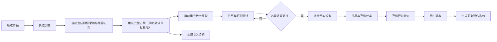

# 掌问创作端 V3 产品需求文档

版本：v1.0

日期：2026-07-31

状态：正式产品基线；`ZW-CREATOR-001` M0–M7 已实施，M8 外部验收待完成

产品入口名称：掌问创作端

原型来源：`zhangwen_product_interactive_prototype_v3.html`（2026-07-30 用户确认）

## 0. 文档权威与适用范围

本文是掌问创作端 V3 的产品、信息架构和交互基线，覆盖现有创作端的页面布局与交互约束。

权威顺序如下：

1. 本文定义创作端 V3 的产品目标、生命周期、界面与用户交互；
2. `tasks/ZW-CREATOR-001-creator-workbench-rebaseline.md` 定义实施顺序、工程边界与验收；
3. 设备、凭据、权限、串口、Flash 和执行器安全继续以现有安全契约和本地执行边界为准；
4. `PRODUCT_PROJECT_BOOK.md` 的市场、商业、自研硬件和双品牌决策继续有效；
5. `CREATOR_PRD_IA.md`、`PRODUCT_REFOUNDATION_DISCUSSION.md`、`PRD_V2.md` 和
   `UI_CONTRACT.md` 仅作为历史输入。发生创作端 UI/UX 冲突时，以本文为准。

本文不要求立即删除旧教学端或历史项目。旧界面在 V3 完成迁移验收前作为受控回退入口存在，
但不得继续决定 V3 的产品结构。

## 1. 产品定义

### 1.1 一句话定义

> 掌问创作端帮助用户把一个想法逐步变成经过数字验证、可以运行到真实硬件、能够被再次复现的实体作品。

### 1.2 产品结果

用户使用掌问不是为了得到一段聊天、代码或接线图，而是为了完成一个作品。完整结果必须包含：

- 被用户确认的作品目标与成功标准；
- 一套当前有效的硬件、逻辑、代码、结构和验证方案；
- 根据方案自动生成的数字原型；
- 可追溯的仿真、真机和用户验收证据；
- 可保存、比较、回滚和同步的参数版本；
- 可恢复的真实设备部署过程；
- 包含依赖、限制和恢复方法的可复现作品包。

### 1.3 核心用户

首要用户是家庭、亲子、情侣、个人创客和潮玩玩家。用户可以描述想法，但不应被要求先理解
开发板、编程语言、专家、Agent、Skill、Job 或工具链。

教学品牌继续服务教师、学生和工作坊，与创作端共享平台内核，但拥有独立体验，不再决定
创作端的 UI/UX。

## 2. 产品不可变原则

### 2.1 作品优先

顶层只有“我的作品”和“一个打开的作品”。聊天、代码、CAD、仿真、串口和参数不是互相独立的
产品入口，而是完成当前作品所需的能力。

### 2.2 一套当前方案

前台始终有一套正在制作的当前方案。方案同时描述行为逻辑、硬件、IO、供电、代码、结构、
仿真边界和验收方式。候选方案可以保存为历史或分支，但不能与当前方案争夺主操作。

### 2.3 先数字验证，再执行实物

方案确认后自动建立数字原型。功能仿真未通过时，可以查看实物阶段的要求和风险，但不能执行
连接后的部署、执行器解锁或验收操作。

### 2.4 仿真由项目自动生成

用户不需要重新手工搭建电路。场景、器件、连线、传感器输入、执行器表现、媒体夹具、故障注入
和验收场景均由已确认方案生成。

### 2.5 对话持续存在，但不是唯一画布

项目内左侧对话持续挂载并保留消息、草稿、附件和滚动状态；右侧阶段工作区承载方案、仿真、
3D 和实物任务。查看或切换阶段不得清空对话状态。

### 2.6 保留三师专业模式，复杂度就地展开

Creator 工作台保留可切换的“三师专业模式”。普通模式使用统一的“掌问”对话入口，不暴露 Agent、
Skill、模型和工具链细节；专业模式展开问题引导师、智能工程师和结构工程师的路由、独立对话和专业
设置。两种模式共享同一个作品、目标、方案、代码、证据和设备状态，切换模式不得复制或丢失数据。
当前结果、下一步和真实风险始终可见；代码、协议、Hash、日志和诊断仍在相关工作区就地逐层展开。

### 2.7 真实设备动作由用户掌控

云端模型不直接操作文件、shell、串口或设备。扫描、连接、部署、复位、固件恢复和执行器解锁
由本地执行器完成，并遵守风险提示、确认、互斥、回读、取消和恢复契约。

### 2.8 设备能力来自设备包

创作端不复制板型字符串或写死两块参考板。K10 与 XIAO Sense 是首批代理验证设备包；未来自研
硬件通过同一设备包契约加入，不改主工作台。

### 2.9 成功必须有证据

AI 文本、任务完成提示和部署成功均不能单独提升验证等级。每一级必须由对应对象、版本和证据支撑。

## 3. 顶层信息架构

```text
掌问创作端
├── 我的作品
│   ├── 作品列表
│   ├── 新建作品
│   ├── 复制 / 归档 / 导入
│   └── 设备包目录
└── 作品工作台
    ├── 作品状态条
    ├── 左侧持续对话
    ├── 四个阶段工作区
    │   ├── 创意与方案
    │   ├── 数字原型
    │   ├── 3D 结构
    │   └── 实物运行
    ├── 按需工作抽屉
    │   ├── 方案详情
    │   ├── 代码
    │   ├── 图形调试
    │   ├── 参数版本
    │   └── 证据与交付
    └── 设备确认通道
```

### 3.1 我的作品

作品首页使用卡片呈现：

- 作品封面或当前数字原型预览；
- 名称和一句话行为摘要；
- 当前生命周期状态；
- 验证等级；
- 最近更新时间；
- 进入作品的主操作；
- 复制、归档和导出等二级操作。

空态以“开始一个新作品”为主操作。新建后直接进入作品对话，不先要求选择板型、语言或专家。

### 3.2 作品状态条

打开作品后顶部恒定展示：

1. 返回“我的作品”；
2. 作品名称与当前生命周期状态；
3. 当前验证等级及文字说明；
4. 唯一建议下一步和主按钮。

建议下一步由服务端状态投影生成，前端不能通过消息文案或本地条件猜测。

### 3.3 项目双栏

- 桌面宽屏：左侧持续对话占可用工作区约三分之一，右侧阶段工作区占约三分之二；
- 中等宽度：左侧可收窄，但输入区和消息仍完整可用；
- 窄屏：对话在上、阶段工作区在下，阶段栏允许自身滚动，不能产生页面级横向溢出；
- 阶段、抽屉、确认弹窗切换期间，对话组件不得卸载。

### 3.4 立项书、方案与代码入口

- 问题引导师信息收集完整后必须自动生成并同步目标草稿与唯一推荐方案，不再展示“生成方案”
  “继续下一步”或对话内“确认方案”动作；
- 方案是创意阶段进入数字原型的唯一确认对象；确认方案不得自动生成立项书，也不得再要求用户
  单独确认目标或重复确认一份内容相同的文档；确认方案命令在同一事务中确认其目标基准；
- 立项书是创意与方案区内的可选生成产物。用户点击“生成立项书”后，服务端根据当前已确认
  Goal/Solution 与验收场景生成不可变文档投影；方案修订后旧立项书标记为过期，不反向覆盖方案；
- 历史项目的已确认推荐方案或立项书必须无损投影为 Creator 的已确认目标与当前方案，保留来源 ID
  和版本语义，不要求用户重复确认；
- “代码”入口始终可达：已有 `CodeRun` 时直接展示真实文件树、编辑器、Diff 和验证结果；尚未生成
  代码时明确显示“尚未生成”、阻塞原因和生成路径，不用软件策略摘要冒充代码。

### 3.5 阶段可查看、操作受控

四个阶段始终可查看。条件未满足时必须展示：

- 阶段要完成什么；
- 所需硬件、文件或验证条件；
- 当前未满足条件与原因；
- 唯一推荐返回动作。

运行验收场景、真实部署、执行器解锁和最终验收等动作根据状态失败关闭，不以隐藏页面代替解释。

## 4. 生命周期、任务和验证等级

### 4.1 三类状态必须分离

1. **生命周期状态**：用户当前在作品旅程中的位置；
2. **系统任务状态**：生成、构建、仿真、部署等 Job 的排队/运行/失败/完成；
3. **验证等级**：由证据支撑的作品可信程度。

系统任务完成不自动等于验证通过。例如部署 Job 成功只说明写入和回读完成，不等于真机行为正确。

### 4.2 生命周期状态

```text
创意表达
→ 方案待确认
→ 数字原型就绪
→ 仿真验证中
→ 仿真通过
→ 设备已连接
→ 部署完成
→ 真机验证中
→ 真机运行通过
→ 用户验收通过
→ 交付版本已固化
```

状态可以因用户修改或证据失效而回退，但历史版本和证据不得删除。

### 4.3 验证等级

V3 使用 0–6 级，修正旧文档把“未验证”与等级 1 混用的问题：

| 等级 | 名称 | 达成证据 |
|---|---|---|
| 0 | 尚未验证 | 尚无被确认的目标 |
| 1 | 目标已确认 | 用户确认的目标版本和成功标准 |
| 2 | 静态检查通过 | 当前方案快照的 BOM、IO、供电、结构与代码静态报告 |
| 3 | 功能仿真通过 | 当前版本全部必需仿真验收场景通过 |
| 4 | 设备已连接 | 精确设备身份、方案匹配与心跳证据 |
| 5 | 真机运行通过 | 指定设备实例和固件上的真机行为证据 |
| 6 | 用户验收通过 | 用户身份、时间和验收确认记录 |

部署完成不提升等级。更换设备、固件、方案、代码或关键参数后，下游证据按依赖图过期或待复核。

### 4.4 系统任务

方案生成、数字原型生成、代码构建、静态检查、CAD 构建、仿真运行和设备部署均使用统一任务模型：

- `QUEUED`：等待执行；
- `RUNNING`：正在执行；
- `WAITING_CONFIRMATION`：等待用户确认；
- `SUCCEEDED`：任务成功，不代表业务验证自动通过；
- `FAILED`：显示原因、影响和可恢复动作；
- `CANCELED`：说明取消发生在哪个安全点。

同一项目同时只能有一个会修改真实设备的任务。

## 5. 主用户旅程



### 5.1 创意与方案

用户用自然语言、图片或参考资料描述作品。掌问每次只询问一个会改变方向的关键问题；已确认信息
齐全后立即生成目标草稿和唯一推荐方案，不再询问是否继续或是否生成。目标卡包含：

问题引导师应以产品经理式连续访谈推进：用户每次回答后，先用一句自然语言确认新获得的事实；
若仍存在无法安全默认且会改变方案的缺口，直接提出下一个具体决策问题。不得询问“是否继续”
“接下来怎么继续”或“是否还要补充需求”，也不得提供“继续补充需求”按钮让用户管理访谈流程。

- 使用场景；
- 可观察行为；
- 必须功能和可选功能；
- 结构需求；
- 成功标准；
- 预算、尺寸、供电、联网和安全约束；
- 待验证项。

当前方案必须同时包含：

- 工作逻辑和状态变化；
- 主控、传感器、执行器、交互和供电；
- BOM、替代件、IO Map、接线和供电预算；
- 代码运行时和版本来源；
- 3D 结构需求、包络和制造建议；
- 仿真覆盖与真实性边界；
- 安全策略和验收场景。

用户可以“要求修改”或“确认方案并建立数字原型”。确认动作冻结方案版本，并触发数字原型、代码和
必要结构草案的生成任务；同一动作也把该方案引用的当前目标草稿确认为基准，不再提供独立“确认目标”。

### 5.2 数字原型

数字原型根据方案自动生成，工作区包含：

- 器件、供电、服务与真实拓扑连线画布；已确认 IO 使用实线，方案推导但待复核的连接使用虚线；
- 由当前方案验收场景投影的项目特有传感器输入，不默认铺开板卡全部无关传感器；
- 执行器视觉、声音或状态表现；
- 摄像头、麦克风、扬声器和存储媒体夹具；
- 实时日志、遥测、曲线和状态；
- 断线、超时、越界和急停等故障注入；
- 项目特有的验收场景。

场景、仿真会话和证据必须显式绑定同一 `solutionRevisionId` 与 `codeRunId`。创建会话时若页面、
场景或代码任一版本不一致，必须刷新当前数字原型并失败关闭，不能退回旧立项书 ID 或项目中任意
最新代码猜测绑定。

Wokwi Elements 只负责器件外观与交互，计算由功能模型或受控 QEMU 运行器完成。界面必须标识
当前是功能仿真、固件仿真还是仅 UART 启动检查，不夸大精度。

调试控件使用单一渐进式面板，同一时刻只显示“项目输入 / 执行器 / 参数”之一；默认收起，不能让
三组长表单同时挤压画布与 UART 终端。

若已确认方案明确要求“本地、离线、局域网或内网 MQTT”，场景自动增加本地 MQTT 功能节点和消息
链路；功能仿真只使用进程内消息总线，不监听真实网卡。方案只写“MQTT”但未确定 Broker 位置时，
必须回到方案澄清；真实 LAN Broker 的启动、端口、访问控制和持久化属于实物部署确认项。

### 5.3 图形调试与参数

- 模拟传感器可以使用滑块、数值、开关、波形和媒体夹具输入；
- 真机原始传感器读数只读；
- 阈值、校准、采样、滤波和业务参数可修改；
- 执行器遵守范围、刷新率、安全值、自动锁定和急停；
- 参数修改形成不可变版本，可比较、说明和回滚；
- 保存参数后，用户明确选择“应用到仿真”或“同步到设备”；
- Wi-Fi 密码、令牌和端点不进入参数版本。

### 5.4 3D 结构

“3D 结构”作为四个可见阶段之一。没有结构需求的作品显示“不需要结构”，且不阻塞仿真或实物运行；
有结构需求时提供：

- 当前结构版本和 3D 预览；
- 尺寸、深度、壁厚和旋转查看；
- 器件包络、接口、采光、走线、散热和装配约束；
- 干涉、壁厚和可制造性检查；
- 不可变结构修订；
- 真实 STL、STEP 和结构清单输出。

CSS 假模型和“模拟导出”只属于原型演示，不进入正式产品验收。

### 5.5 实物运行

仿真通过后解锁真实操作：

1. 扫描并识别精确设备；
2. 校验设备包、方案、主控、模块、IO 和运行时；
3. 选择“USB”或“ESP-Claw”等设备包声明的代码部署通道；
4. 展示代码版本、参数版本、目标、影响、风险和恢复方法；
5. 用户确认后执行部署并回读；
6. 进入真机校准和验收场景；
7. 对比仿真和真机差异；
8. 记录等级 5 证据后进入用户验收。

USB 与 ESP-Claw 是当前参考设备的同级代码部署方式。固件初始化或恢复属于维护流程，不得伪装成
日常“运行到设备”。

### 5.6 用户验收与交付

验收页对照目标展示：

- 仿真和真机行为结果；
- 安全边界和失败记录；
- 当前设备、固件、代码和参数版本；
- 仍未覆盖的限制；
- 需要重新验证的项目。

用户明确确认后达到等级 6。交付任务随后生成机器可读作品包，包含目标、方案、设备包、BOM、IO、
代码、依赖、参数、仿真、结构、真机证据、限制和恢复方法，并执行凭据扫描与完整性校验。

## 6. 通用工作抽屉

阶段工作区顶部提供以下按需入口：

| 抽屉 | 默认内容 | 高级展开 |
|---|---|---|
| 方案详情 | BOM、接线、供电、IO、风险 | 设备包版本、来源和兼容诊断 |
| 代码 | 当前版本和行为摘要 | 文件树、编辑、Diff、静态诊断 |
| 图形调试 | 当前可调输入与参数 | 通道绑定、刷新率和协议细节 |
| 参数版本 | 当前值、历史、比较和回滚 | 绑定的代码/固件/设备版本 |
| 证据与交付 | 验证等级、证据链和交付状态 | Hash、原始报告和审计详情 |

抽屉打开时不卸载对话或阶段工作区。窄屏抽屉覆盖显示，并保留明确关闭和返回位置。

## 7. 设备确认通道

所有物理动作使用统一确认弹窗，至少包含：

1. 将做什么；
2. 目标设备或执行器；
3. 风险与不可取消点；
4. 失败恢复方式。

风险等级：

- 低：扫描、读取状态；
- 中：连接、普通代码部署、参数同步；
- 高：复位、固件恢复、覆盖已有作品；
- 危险：电机、加热、泵、强光等执行器解锁。

执行中显示真实进度、当前步骤、是否可取消和恢复状态。不能用固定计时器伪造完成。失联、超时、
重连和应用重启后，执行器保持设备包声明的安全值，不自动恢复危险输出。

## 8. 设备包体系

设备包是软硬件共同事实源：

```text
设备包
├── 身份、型号和硬件修订
├── 能力、引脚、电平、功耗和总线约束
├── 主控与外围组件关系
├── 驱动、代码模板和运行时
├── 数字原型与图形控件描述
├── 参数、遥测和调试协议
├── 部署通道
├── 安全值、限幅、失联和恢复策略
├── 自动测试与验收场景
└── 固件、兼容矩阵和来源
```

### 8.1 参考硬件

`dfrobot/dfrobot_k10` 与 `seeedstudio/xiao_esp32s3_sense` 作为首批代理验证设备包：

- 验证从方案、仿真到真机的完整链路；
- 继续服务教学品牌；
- 不在创作端导航和状态机中硬编码；
- 不形成平台永久白名单。

### 8.2 自研硬件

原型中的 `ZW-Core-01` 是目标产品概念。在真实设备包、硬件身份和安全握手实现前，只能显示为设计中
或模拟设备，不能显示真实串号、心跳或“已连接”。未来自研硬件通过设备包注册加入同一工作流。

### 8.3 第三方硬件

C 端首期不开放任意第三方主控插件。平台契约保持通用，教学品牌可以继续管理认证第三方设备包。

## 9. 数据与服务边界

### 9.1 一等对象

- `Work`：作品生命周期；
- `GoalRevision`：被确认的目标版本；
- `SolutionRevision`：当前实现方案；
- `AcceptanceScenario`：输入、预期、安全边界和允许误差；
- `DigitalPrototypeRevision`：数字原型及能力声明；
- `CodeRevision`：代码与依赖；
- `StructureRevision`：3D 结构；
- `ParameterRevision`：不可变参数版本；
- `DevicePackageRevision`：设备能力事实；
- `DeviceInstance`：具体设备及固件；
- `EvidenceRecord`：版本化验证证据；
- `DeliveryRevision`：可复现交付版本；
- `CreatorJob`：生成、验证和执行任务。

### 9.2 统一工作台投影

客户端从服务端读取统一 `CreatorWorkspace` 投影，至少包含：

- 作品摘要；
- 生命周期状态、当前阶段和验证等级；
- 唯一下一步；
- 当前目标、方案、数字原型、结构和实物运行摘要；
- 参数版本和证据；
- 当前任务与受控动作能力。

前端不能以 `localStorage` 作为项目事实源，不能通过消息文本推断状态，也不能自行提升验证等级。

### 9.3 命令而非直接改状态

确认方案、保存参数、运行仿真、连接设备、部署、解锁、验收和交付均为显式命令。目标基准由确认方案
命令在同一事务中确认，不再暴露独立确认命令。所有命令包含项目版本、幂等键和必要确认信息；
服务端校验前置条件并返回新投影。

## 10. 失败、回退与证据失效

失败先归因，再决定回退：

| 失败类型 | 默认处理 |
|---|---|
| 参数边界不合适 | 留在当前仿真或真机阶段，生成新参数版本 |
| 行为逻辑错误 | 留在当前阶段，就地展开逻辑或代码 |
| IO、接线或供电冲突 | 回到当前方案修改 |
| 器件能力不足 | 修改方案或设备包绑定 |
| 用户目标改变 | 生成新目标版本并使下游证据过期 |
| 仿真能力不覆盖 | 保留限制，标为待真机验证，不伪造通过 |
| 部署失败 | 恢复上一可运行版本并回读；无法确认时失败关闭 |

依赖变化后的证据显示“已过期”或“待复核”，不得静默消失。验证等级根据当前有效证据自动降级。

## 11. 迁移与双产品关系

### 11.1 新前端目录，不新建独立后端

V3 在同一仓库和桌面应用中建立隔离的 `creator/` 前端模块，复用项目、AI、硬件、CAD、仿真和设备
安全服务。不得复制第二套 SQLite、设备执行器或凭据存储。

### 11.2 历史项目

- 旧项目转换为作品卡；
- 可映射的阶段、方案、硬件、代码、参数和证据只读迁移；
- 缺少正式目标或证据时显示“待整理”或等级 0，不编造状态；
- 原数据保留，迁移可重跑、可回滚；
- 不支持的旧硬件仍可查看，但真实操作按设备包能力失败关闭。

### 11.3 教学品牌

旧 V1/V2 UI 和双板教学流程在迁移窗口内作为教学/开发回退入口。V3 主路径验收后再决定独立安装包、
品牌和最终物理目录；本任务不复制平台内核。

## 12. 首版范围

### 12.1 必须完成

- 作品首页、新建和历史项目迁移；
- 四阶段工作台、持续对话、状态条和唯一下一步；
- 目标与当前方案确认；
- 自动数字原型、图形调试、参数版本和验收场景；
- 按需 3D 结构、真实预览与输出；
- 设备包体系和 K10/XIAO 代理适配；
- USB 与 ESP-Claw 同级代码部署；
- 真机校准、安全执行、证据与交付；
- 感知类正式 MVP、响应执行类受控 Beta、视觉/音频类技术预览。

### 12.2 明确不做

- 任意第三方主控和无限插件生态；
- 周期、电气、射频或真实物理环境精确仿真；
- 通用 EDA、PCB、CAE、PLM 或完整专业 CAD 替代；
- 自动构建任意 ESP-IDF 工程；
- 无确认的真实设备动作；
- 危险执行器无人值守控制；
- 仅凭 AI 声明成功；
- 首版完整社区广场和作品市场。

## 13. 非功能要求

### 13.1 可用性与响应式

- 390、720、1280 宽度下全部主操作可达；
- 不出现页面级横向溢出；
- 所有状态同时有文字，不只依赖颜色；
- 键盘可以完成导航、抽屉、弹窗和确认；
- 弹窗具备焦点圈定、Escape 规则和返回焦点；
- 对话草稿、附件和滚动在阶段切换后保持。

### 13.2 性能

- 作品首页和工作台先呈现持久数据，再加载重型 3D、Monaco、Wokwi 和设备模块；
- 抽屉和重型工作区按需加载；
- 遥测、图表和日志有背压与内存上限；
- 模拟器和设备任务崩溃后可靠清理。

### 13.3 隐私与安全

- 凭据不进入日志、参数、项目包、测试夹具或遥测；
- 真实设备标识在普通视图脱敏；
- 所有设备动作本地审计；
- 危险动作保留用户确认和急停；
- 测试默认使用 Fake Provider、Mock transport 和受控模拟器。

## 14. 成功指标

- 从表达创意到第一次可观察数字行为的时间；
- 目标和方案确认率；
- 仿真必需场景通过率；
- 第一次真实部署成功率；
- 仿真到真机行为一致率；
- 失败恢复成功率；
- 从新建到等级 6 的作品完成率；
- 交付包证据覆盖率；
- 第二位用户复现成功率；
- 历史项目迁移成功率和数据零丢失率。

指标事件、属性、隐私边界和基线阈值已冻结在 `docs/CREATOR_METRICS.md`；不能等 MVP 完成后再补埋点，
指标也不得驱动作状态或替代工程证据。

## 15. 产品验收故事

首个纵向样板必须走通以下过程：

1. 用户新建响应执行类作品；
2. 对话形成目标草稿并自动生成推荐方案；
3. 方案同时给出硬件、逻辑、代码、结构和验收，用户只确认一次完整方案；
4. 方案确认同时确认目标基准，并自动生成代码变体、数字原型与结构草案；
5. 参数不合适导致一次仿真失败，系统正确归因；
6. 保存新参数版本后仿真通过；
7. 查看实物阶段并完成设备确认；
8. 至少模拟一次部署失败和恢复；
9. 真机校准与仿真产生差异并被正确记录；
10. 真机验收通过后由用户明确确认；
11. 生成无凭据、可复现的作品包；
12. 第二个测试用户依据作品包完成复现检查。

## 16. 已确认决定

- 2026-07-31：采用交互原型 V3 的“作品首页 + 双栏工作台 + 四阶段 + 抽屉 + 设备确认通道”。
- 2026-07-31：创作端不继承固定右侧三 Tab 和图标轨；保留 Creator 内的三师专业模式，普通/专业
  共享作品事实，专业模式仅展开三师路由及工程细节。
- 2026-07-31：桌面双栏按约 1:2 分配对话与阶段工作区；已确认立项书与当前方案同步投影，代码入口
  有真实代码时打开编辑器、无代码时显示明确空状态和生成路径。
- 2026-07-31：新 UI 在现有仓库中隔离建设，不复制后端；旧 UI 先保留回退，验收后删除。
- 2026-07-31：验证等级改为 0–6；部署成功不等于真机运行通过。
- 2026-07-31：3D 结构作为可见阶段；对无结构需求项目不形成硬门禁。
- 2026-07-31：创作端以设备包而非板型白名单组织硬件；K10/XIAO 仅作代理验证。
- 2026-07-31：设备与凭据安全不因 UI 重构而放宽。
- 2026-08-01：普通模式的目标与方案采用对话自动同步的只读卡片，修改通过对话完成；三师专业
  模式才展开结构化编辑。方案是唯一确认对象；立项书只在用户点击后按同一 Goal/Solution 修订生成，
  不形成第二套真值，也不阻塞数字原型。
- 2026-08-01：澄清选项提交后立即退出卡片；已持久化答案的后续生成失败只能重试回复，不能重复
  询问。低完整度且无问题属于结构化输出失败，不再使用固定通用问题兜底。
- 2026-08-01：数字原型采用 Wokwi 式代码/画布/UART 工作区；桌面默认保持对话 1/3、阶段 2/3，
  并提供只隐藏视觉、不卸载对话的专注模式。
- 2026-08-01：数字画布必须显示器件间实际拓扑；测试输入由项目验收场景决定，调试区使用单一抽屉。
  明确要求本地/离线 MQTT 的方案加入仿真消息服务，但绝不因此自动开放真实 LAN Broker。
- 2026-08-01：实物运行以 USB/ESP-Claw 同级部署与终端为首屏。普通模式终端只读；专业模式可按
  会话解锁输入，输入不持久化。固件和运行时恢复仍属于维护入口。
- 2026-08-01：旧创作壳不直接删除，先冻结为教学端构建入口；Creator 与 Teaching 共享同一平台
  内核。自研硬件准备止于设备包、虚拟包和迁移契约，不进入 EVT/DVT/PVT。
- 2026-08-02：问题引导师在信息齐全后自动生成并同步推荐方案；Creator 不再提供独立目标确认、
  对话内方案确认、对话内立项书询问或泛化“继续”按钮。唯一承诺点是“创意与方案”中的方案确认。
- 2026-08-02：问题引导师采用产品经理式连续访谈；服务端结构化边界拒绝“是否继续/怎么继续/
  是否还要补充”类元问题，要求模型修复为当前项目的下一个具体产品决策。
- 2026-08-02：数字场景优先绑定当前 Creator Solution，而不是历史已批准 Proposal；仿真启动和
  证据同时校验场景修订、Solution 修订和 CodeRun，旧绑定不得冒充当前仿真。

## 17. 待实施阶段验证的开放问题

- 创作端与教学品牌最终是同一安装包的两个入口，还是两个独立安装包；
- 自研硬件 `ZW-Core-01` 的正式名称、身份协议和首批模块；
- C 端设备包目录是否展示价格、库存和购买入口；
- 家庭/亲子监护授权是否进入首个软件 MVP；
- 云同步和分享链接进入 M7 还是后续独立任务；
- 视觉品牌是否沿用原型紫色，或在工业设计确定后统一更新。

这些问题不得阻塞 M0–M2 的架构和壳层建设；需要外部商业或硬件决定的部分使用明确占位，不编造事实。

## 18. M0–M7 实施结论

截至 2026-07-31，仓库内软件路径已经完成作品首页、持续对话与四阶段工作台、严格 Creator
投影、0–6 等级、自动数字原型、功能仿真、参数版本、真实 CAD 产物边界、USB/ESP-Claw 同级部署、
独立真机行为记录、显式用户验收、三种交付包、导入重置和第二用户复现回执。

交付格式、隐私检查、依赖失效和复现规则见 `docs/CREATOR_DELIVERY.md`。K10/XIAO 仍是代理验证设备包，
不构成 Creator 永久 UI 白名单。自动测试使用 Mock/Fake，不能替代 M8 的真人响应式走查、真实 K10/XIAO
确认点、安装包冷启动和发布验收；旧 V1/V2 壳因此仍保留为迁移/教学回退入口。
