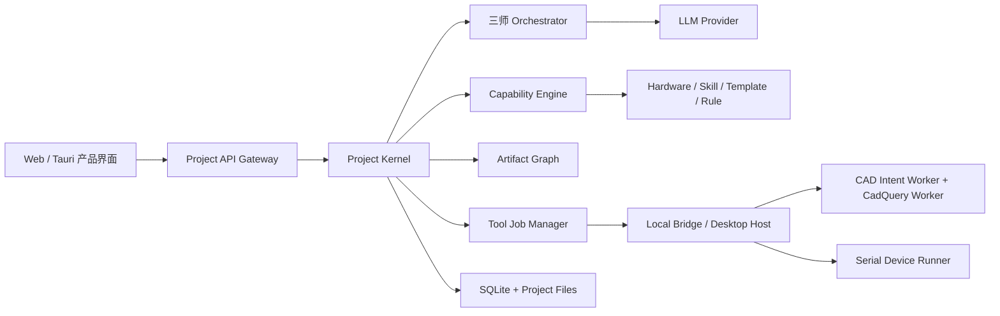

# 掌问 V2 PRD

> **Legacy Creator UI（冻结）**：自 2026-07-31 起，本 V2 PRD 仅供教学端、历史项目读取与迁移
> 参考；不得继续作为掌问创作端的产品实现依据。Creator V3 的权威需求见
> `docs/PRD_CREATOR_V3.md`，设备与凭据安全边界仍持续有效。

版本：v2.0-implementation.2

日期：2026-07-28

状态：M0-M5 与 ZW-UX-009 M6-M7 软件实现和自动验收完成；真实设备、安装包与发布验收仍按外部门禁执行

产品名：掌问

副标题：AI 创客工程工作台

实施说明：M0-M5 已把本 PRD 的契约、Project Kernel、V2 UI Shell、CAD Intent Worker、设备运行态接管和 Web Local Bridge 落入代码。自动测试只证明软件与模拟边界；真实 Provider、真实 CadQuery 环境、实体设备、安装包和公开发布仍按 M6 分别验收，不以模拟结果替代。

### 2026-07-28 M7 产品体验覆盖

普通模式默认采用“掌问主动推进 + 对话即首页”。用户描述想法后，三师替用户完成所有
可逆、低风险细节；缺失但不阻塞制作的信息进入验证项；只有会改变产品方向的信息才提出
一个问题。问题以普通掌问消息出现，用户在主输入框直接回答，不显示题号、进度或表单。

普通模式左侧只保留“对话 / 项目 / 连接 / 设置”，右栏默认收起；代码、3D 和测试结果在
对话中各只提供一个自然动作。完整工作区、版本、来源、运行任务和诊断字段保留在专业模式。
真实设备扫描、连接、上传、复位和 Flash 仍必须由用户明确触发。本覆盖不改变 V1 feature
flag、SQLite、聊天协议、CAD 本地执行或 Web Local Bridge 能力边界。

## 1. 文档定位与优先级

掌问 V2 以 `docs/PRD.md` 的 V1.1 产品、数据和工程能力为基础升级，不建立与 V1 平行的新产品。

V2 的输入基线：

- V1 权威 PRD：`docs/PRD.md`。
- V2 架构输入：用户提供的《掌问 AI Creator OS V2 系统架构设计说明书》文档。
- V2 CAD 行为基线：用户提供的本机 `ZW-CAD-intent` 源码目录（2026-07-26 审计快照）。
- 当前代码、数据库 schema v26、三师领域模型、Artifact、Hardware Skill、设备和安装包能力。

冲突时按以下优先级执行：

1. 用户在 2026-07-26 明确确认的 V2 决策。
2. 本 V2 PRD。
3. V1 PRD 中未被 V2 覆盖的数据、安全、兼容和工程规则。
4. 具体阶段的任务文件、共享 contracts、测试和实现文档。

V2 允许中央舞台在对话与实际工作页面之间切换，但 `CenterChat` 必须始终保持单一挂载；
右侧一级 Tab 继续固定为“工作 / 产物 / 设备”。产品名称、本地执行安全、云端 LLM 不直接
操作本机、普通模式隐藏内部工具链、危险操作必须确认等规则继续有效。

## 2. 产品升级结论

V1 已经完成从想法、三师协作、硬件、代码、CAD、Artifact 到模拟设备部署的纵向闭环。V2 不重复建设这些能力，而是解决四个结构性问题：

1. 对话容易退化成模型给选项、用户做选择，创意受到现有模板和模型猜测能力限制。
2. 项目事实、专家状态、Artifact 和执行 Job 已存在，但缺少统一 Project State、Change Set、Diff、Project Version 和 Release。
3. 现有 CAD 能力与重新验证的 `ZW-CAD-intent` 工作流没有统一，结构修改仍缺少项目源码副本、自然语言补丁、特征/对象索引和完整修订体验。
4. 设备原程序运行时，连接阶段可能先被 identity probe 卡住，导致后续上传接管逻辑根本没有机会执行。

V2 的产品定义：

> 掌问是一个由对话驱动、由项目状态记忆、由受信能力执行的 AI 创客工程操作系统。

“对话即创造”不表示 LLM 可以从零生成任意可靠工程结果，而表示：用户可以自由表达意图；系统把意图转换成可检查的 Change Set；受信模板、Skill、规则和本地工具负责执行；能力缺口必须诚实显示。

## 3. V2 目标

### 3.1 产品目标

1. 用户从自由自然语言开始，不要求先从固定功能、硬件或结构选项中选择。
2. 对话中的新增、修改和撤销可以直接投影到实际工程页面，并在提交前显示影响和 Diff。
3. 问题引导师、智能工程师、结构工程师可以独立工作，也可以按跨领域影响动态协作。
4. 项目只有一套当前推荐方案和一个权威 Project State，但允许保留提案、版本和历史修订。
5. 将硬件、代码模板、Agent Skill、工程规则、CAD 模板、结构件母版和本地工具统一纳入 Capability Engine。
6. 采用 `ZW-CAD-intent` 的工作流和安全修改机制，形成可持续修改的真实 3D 结构闭环。
7. 日常 MicroPython 上传即使面对正在运行或难以中断的旧程序，也提供分级、可恢复、可确认的接管路径。
8. Web 与桌面共享一套产品；Web 在连接本地桥接服务后可以安全使用本地设备和 CAD。
9. 保留 V1 账号、项目、对话、硬件知识、产物、设备记录和历史 CAD 的兼容读取与迁移能力。

### 3.2 非目标

- 不承诺任意自然语言都能生成可制造、可认证的通用 CAD。
- 不允许 LLM 编造硬件、尺寸、接口、坐标、上传成功或制造验证结果。
- 不允许普通网页获得任意 Shell、任意本机路径或不受控进程执行权限。
- 不自动擦除 Flash、重刷固件、修改系统凭据或执行不可逆数据删除。
- 不把三位工程师重新拆成三个相互割裂的聊天产品。
- 不在 V2 首期同时建设云端 CAD 集群、在线切片、CAE、CNC 或完整 PLM。

## 4. 产品原则

### 4.1 创意宽、执行窄

- 创意阶段允许自由输入、图片、资料和模糊描述。
- 系统可以提供快捷选项，但任何时候都保留自由文本和“按我的方式修改”。
- 工程阶段把自由表达转换成结构化事实、约束、Change Set 和可执行 Job。
- 确定性规则和本地验证是执行边界，LLM 只能提出建议或补丁。

### 4.2 项目优先，不以专家为入口

- 用户进入的是项目，不是三个聊天窗口。
- 三师是项目内的专业责任域，不是三个互相竞争的产品入口。
- 普通模式由系统选择当前主责工程师；专业模式允许用户指定或查看协作关系。

### 4.3 实际页面优先

- 对话负责创建和修改，工程页面负责呈现真实结果。
- 硬件、代码、设备、3D、验证和发布必须有可操作页面，不用长 Markdown 代替产品界面。
- 每个页面都能打开同一 AI 协作面板，当前页面上下文自动进入本轮意图。

### 4.4 所有正式变化可解释、可回滚

- AI 输出先形成 Proposal/Change Set。
- Change Set 明确列出影响的项目事实、BOM、代码、结构、Artifact 和设备 Job。
- 提交后产生 Project Event；关键节点产生 Project Version。
- Release 固化版本、能力快照、Artifact 集合和验证结果。

## 5. 目标用户与核心任务

V2 延续 V1 的教师、学生、创客和嵌入式原型开发者，并重点覆盖：

- 从模糊想法快速形成可实现的项目定义。
- 在不被固定模板限制的情况下逐步收敛硬件、代码和结构。
- 直接看到并修改代码、BOM、3D 模型和设备运行结果。
- 基于经过验证的模板快速完成项目，同时清楚知道哪些部分是模板、哪些是本次修改。
- 在 Web 中进行设计，在连接本地桥接服务后完成本机 CAD 和设备部署。

## 6. V2 信息架构与 UI

### 6.1 总体布局

桌面与 Web 使用相同信息架构：

```text
┌──────────────┬──────────────────────────────────┬──────────────────┐
│ 项目与版本    │ 当前工程工作区                   │ AI 协作面板       │
│ 项目列表      │ 概览 / 工程 / 结构 / 交付        │ 单一项目对话      │
│ 版本与活动    │ 实际产品页面                     │ 当前主责工程师    │
│ 项目资源      │                                  │ Change Set 预览   │
└──────────────┴──────────────────────────────────┴──────────────────┘
│ 可折叠：本地任务、构建、上传、日志与错误恢复                         │
└─────────────────────────────────────────────────────────────────────┘
```

- 中央区域用于当前实际工程页面，不再永久锁定为聊天。
- AI 协作面板在所有工作区保持同一项目对话和草稿，可折叠或在窄屏变成抽屉。
- 项目切换、工作区切换和页面内预览不得丢失对话草稿、待确认 Change Set 或运行中的 Job。
- 普通模式只显示产品动作、工程结果和必要风险；专业模式展开对象 ID、版本、能力来源、工具 Trace 和高级参数。

> 2026-07-28（ZW-UX-009 M6）简洁交互修订：壳继续采用深色图标轨＋中央舞台＋右侧栏＋
> 底部状态栏，但左侧图标轨成为唯一工作区主导航，顶部不再复制“对话/概览/工程/结构/
> 交付”。右侧一级 Tab 固定为“工作 / 产物 / 设备”；“工作”合并当前内容、待确认修改、
> 已确认信息和正在处理事项，“设备”按需挂载且折叠不销毁。普通模式隐藏 Change Set、
> CAD Intent、Worker、Job、Artifact、Project Version、Release、hash 和原始状态码，
> 专业模式保留排障信息。生效契约以 `docs/UI_CONTRACT.md` 同日修订为准。

### 6.2 四个一级工作区

#### 项目概览

主责：问题引导师。

页面包含：

- 原始创意与 Intent Brief。
- 当前推荐方案和成功标准。
- 已确认约束、待确认问题和能力覆盖率。
- 项目模式：标准、探索或仅方案。
- 里程碑、最近 Change Set、Project Version 和风险。

问题引导师每轮最多优先提出一个高影响问题；系统可以展示建议答案，但必须允许用户自由补充或完全改写。

#### 工程实现

主责：智能工程师。

页面内二级视图：

- 硬件：BOM、器件来源、供电预算、接线、接口、缺件和兼容性。
- 代码：项目文件树、编辑器、模板来源、Diff、静态检查和测试。
- 设备：发现、附加、运行态、上传、终端、验证和恢复。
- 验证：软件、模拟、硬件证据和失败项。

硬件推荐不限制创意。库内缺少能力时，页面显示缺口、可替代项、补充资料入口或探索模式，不允许伪造器件继续。

#### 结构设计

主责：结构工程师。

页面包含：

- 中央真实 3D 视口：整体、爆炸、单零件、硬件参考和打印件过滤。
- 对象/特征树：模板部件、结构件、开孔、固定结构、刻字和修订。
- 属性面板：尺寸、安装面、方向、间隙、圆角/倒角和参数来源。
- Change Set/Diff：修改前后对象、尺寸、体积、包围盒、零件数和受影响 Artifact。
- 构建与验证：CadQuery、STEP/STL、mesh、连通性、壁厚、干涉和失败恢复。

用户可以直接说“把这里加厚 1mm”“把字改成两行”“给这个传感器开孔”。系统负责从当前页面上下文解析对象，不要求用户填写内部 ID；存在歧义时显示可视候选并追问。

#### 成果交付

主责：跨三师。

页面包含：

- 当前 Release 和 Project Version。
- 立项书、BOM、接线、代码、测试、CAD、教案和设备报告。
- Artifact 依赖、版本、过期原因和重新生成入口。
- 导出格式、制造注意事项、验证覆盖和未解决风险。

### 6.3 对话到页面的交互

```text
用户自由表达
→ 当前工程师理解意图
→ 生成结构化 Proposal/Change Set
→ 页面即时预览候选变化
→ 本地能力与规则校验
→ 用户确认高影响变化
→ Project Kernel 原子提交
→ 页面、Artifact 和版本同步更新
```

- 选项是快捷输入，不是允许范围。
- 创意草稿和无副作用页面参数可以即时预览并撤销。
- BOM、代码正式版本、结构实体、文件写入和设备操作必须进入 Change Set/Job。
- 高影响结构变化、设备复位、文件覆盖和所有 Flash 操作必须明确确认。

## 7. 三师独立工作机制

### 7.1 问题引导师

读取：原始创意、用户画像、项目资源、已确认事实、能力覆盖摘要。

写入提案：Intent Brief、目标、成功标准、范围、约束、项目模式和当前推荐方案。
不得直接写入：代码文件、CAD 源码、设备或硬件事实源。

独立工作闭环：

```text
接收想法 → 提取原始意图 → 识别最大不确定性 → 单个高影响追问
→ 形成当前推荐方案 → 能力覆盖检查 → 确认项目定义
```

### 7.2 智能工程师

读取：Project State、当前方案、Hardware Capability、结构接口、设备摘要。

写入提案：BOM、接线、供电、代码、测试、部署计划和设备验证。
不得直接写入：结构工程师拥有的正式 CAD 源码；需要时提交结构影响请求。

独立工作闭环：

```text
读取项目定义 → 绑定硬件能力 → 生成/修改代码 → 静态与模拟验证
→ 形成部署计划 → 本地设备接管与上传 → 运行证据 → 工程 Artifact
```

### 7.3 结构工程师

读取：Project State、BOM、机械 profile、交互面、接口和现有 CAD 修订。

写入提案：结构需求分析、布局、模型源码修订、构建和制造 Artifact。
不得直接修改：硬件事实源、代码正式版本和设备状态。

独立工作闭环：

```text
识别结构意图 → 绑定受信硬件/模板/结构件 → 生成 2D/参数草案
→ 用户确认 → CadQuery 构建 → STEP/STL/mesh 验证
→ 自然语言修改 → 源码哈希补丁 → Diff/确认 → 新 CAD 修订
```

### 7.4 按需协作

- 单领域变化只启动一位工程师。
- 修改硬件导致代码或结构失效时，Project Kernel 创建跨域影响项并启动双师协作。
- 项目定义、硬件、代码和结构同时变化时才启动三师协作。
- 协作共享 Project State、事实和 Artifact 摘要，不复制完整私有对话。
- 前台始终呈现一个项目、一条对话时间线和一个当前推荐方案。

## 8. V2 系统架构



### 8.1 Project Kernel

Project 是唯一业务聚合。Project Kernel 负责：

- Project State 读取投影。
- Proposal、Change Set、Diff 和确认。
- 跨领域事务、事件、幂等和版本。
- Artifact 依赖及失效传播。
- 工程师读写权限和协作触发。
- Tool Job 创建，不直接执行 Shell、串口或 CAD。

Project State 是领域契约，不是另一套巨大 JSON 真值。V1 关系表、Artifact、Hardware Skill 和领域仓储继续保存权威数据；`project_state_snapshots` 是带 schema/hash 的可再生一致性投影。所有新写入逐步收口到 Project Kernel 事务入口，避免双重真值。

### 8.2 Change Set

最小字段：

```text
id / project_id / base_project_version
author_type / owner_domain / intent_summary
operations[] / affected_facts[] / affected_artifacts[]
capability_bindings[] / validation_results[]
risk_level / confirmation_policy
status / created_at / committed_at
```

Change Set 状态：`DRAFT → VALIDATING → READY → CONFIRMED → COMMITTED`，失败或取消进入 `REJECTED/CANCELED`。提交时必须复核基础版本和关键输入哈希。

### 8.3 Project Version 与 Release

- Project Version 固化 Project State hash、Change Set、能力快照、Artifact 版本集合和验证摘要。
- Release 是可交付 Project Version，额外包含导出清单、兼容性、未验证项和发布说明。
- 回滚通过新的 Change Set 恢复目标版本，不删除历史。

## 9. Capability Engine

Capability 不等于单一 Skill。统一分为：

1. `RESOURCE`：开发板、器件、结构件母版、CAD 模板。
2. `PROCEDURE`：需求分析、BOM 选择、代码生成、布局、验证和导出流程。
3. `EXECUTION`：本机串口、CadQuery、Python、Node Worker、文件和云端服务可用性。
4. `COMPOSITE`：经过验证的“硬件 + 代码 + 结构 + 执行”组合方案。

生命周期：`SUGGESTED / DRAFT / VERIFIED / DEPRECATED / INVALID`。

现有 Hardware Skill、Board Skill、Agent Skill、机械 profile、代码模板和 CAD 模板通过 Adapter 注册，不立即迁移或复制事实源。Capability Engine 负责关系、版本、验证来源、运行宿主、风险和覆盖计算。

项目模式：

- 标准项目：关键能力全部由 VERIFIED Capability 覆盖。
- 探索项目：存在未验证能力，允许继续设计，但必须显示缺口并限制自动执行。
- 仅方案项目：当前没有可执行宿主或关键资源，只交付方案与缺口清单。

## 10. `ZW-CAD-intent` 融合方案

### 10.1 审计结论

本轮对用户指定目录进行只读审计：

- 排除 `node_modules` 后共有 149 个文件、8,392,462 bytes。
- 路径与文件哈希清单的组合 SHA-256：
  `c6054bcb0a3c106f931583eb931babd1c0cf846b03f08343aafdb509a3a852ee`。
- 46 个 `server/public` JavaScript 文件通过 `node --check`。
- 当前拷贝没有 `server/*.test.js`，`npm test` 实际执行 0 tests。
- README 提到的 `packaging/` 目录在当前拷贝中不存在。

因此，该目录作为 V2 CAD 的功能与行为权威基线，而不是已经具备完整生产验证证据的可直接发布包。正式融合前必须补齐可重复测试、来源快照、打包和安全验证。

### 10.2 行为权威范围

以下能力以 `ZW-CAD-intent` 为准：

- `conversation_route` 和结构任务阶段路由。
- 需求—功能—硬件—库匹配分析与缺口反馈。
- 确定性产品模板、盒体、独立结构件和选定硬件建盒分支。
- profile、方向、可行性、布局和设计验证。
- 项目 CadQuery 源码副本、源码 SHA-256、暂存修改、确认、修订和撤销。
- `model_edit` 精确补丁、安全 AST、风险分级和构建后提交。
- 表面刻字、真实 STEP/STL、逐件导出、mesh 验证和失败不降级原则。

以下能力继续以掌问 V1/V2 平台为准，不采用独立模块的重复实现：

- 账号、项目所有权、Project State、三师对话和权限。
- LLM Provider 与凭据管理。
- Hardware Skill 和 Capability Engine。
- Artifact、版本、依赖、过期传播和 Release。
- Tool Job、日志、取消、审计和本地宿主授权。
- 全局 UI 和项目生命周期。

### 10.3 目标集成形态

首期保留 `ZW-CAD-intent` 的 Node 领域逻辑，改造成受控 `CAD Intent Worker`：

- 不绑定独立 HTTP 端口，不携带独立前端。
- 不拥有独立账号、模型源、硬件库和项目列表。
- 通过 stdin/stdout 或受控 IPC 接收类型化请求并返回结果。
- 只读取 Project Kernel 提供的不可变 Project/Capability/Hardware/CAD 快照。
- 只写 Local Bridge 分配的 staging 目录；不能接收调用方任意路径。
- 正式文件由现有 Artifact Service 原子发布。
- CadQuery 运行继续放在隔离 Worker，设置 CPU、内存、时间、输出数量和文件大小上限。

核心请求：

```text
CadIntentRequest
  projectId / baseProjectVersion
  prompt / routeContext
  capabilitySnapshot
  hardwareProfileSnapshot
  currentCadRevision / sourceSha256 / objectIndex
  allowedOperations / requestedOutputs
```

核心返回：

```text
RequirementAnalysis | CadDraft | CadChangeSet
CadArtifactManifest | CadValidationReport | CadExecutionTrace
```

Worker 不直接提交 Project State。Project Kernel 校验基础版本、能力 revision、源码 hash、Artifact manifest 和风险策略后提交。

### 10.4 CAD 迁移步骤

1. 对指定目录建立排除 `node_modules`、本地配置和运行产物的只读来源快照与 hash manifest。
2. 恢复/重建缺失自动测试，建立确定性模板、结构件、model edit、刻字、失败恢复和安全边界 golden。
3. 将独立 JSON 硬件库映射到 Capability/Hardware Skill；不得建立第二套硬件真值。
4. 将独立 task/project-store 映射到 Project ID、CAD ArtifactVersion 和 Project Version。
5. 将独立模型源配置替换为掌问 Provider Gateway。
6. 接入结构设计新页面和统一 Change Set。
7. 对 V1 CAD Artifact 保持只读兼容；首次修改时生成 V2 CAD revision，不覆盖旧文件。

## 11. 设备连接与代码上传 V2

### 11.1 当前根因

现有上传链已经有端口锁、停止只读终端、Ctrl-C、备份、`mpremote resume`、逐文件 SHA-256 回读和 `soft-reset + import main`。但连接流程会先执行 `resume exec` identity probe，只有成功后才创建 READY session；如果旧 `main.py` 正在运行，用户可能在进入上传阶段之前就连接失败，上传内部的 `INTERRUPT_RUNTIME` 没有机会执行。

此外，合作式 Ctrl-C 不是绝对可靠：程序可以捕获 `KeyboardInterrupt`、调用 `micropython.kbd_intr(-1)` 禁用 Ctrl-C，或长时间阻塞在原生代码；当前实现还只识别精确 `>>> ` 提示符，且多个独立 `mpremote` 进程反复开关 Windows 串口会增加端口竞争和重枚举风险。

### 11.2 会话模型调整

把“发现并附加端口”和“进入可管理 MicroPython REPL”拆开：

```text
DISCOVERED
→ ATTACHED_UNVERIFIED
→ RUNTIME_BUSY | MANAGED
→ UPLOADING
→ RUNNING | ERROR
```

- 附加设备只基于用户选择和受信 USB 元数据建立非写入会话，不要求立即执行 Python。
- identity probe 移入上传或显式诊断 Job，在运行态接管成功后执行。
- 写入前仍必须验证目标板身份和当前项目硬件要求；无法验证时失败关闭。

### 11.3 运行态接管阶梯

```text
0. 停止终端、取得唯一端口租约
1. 合作式接管：连续有界 Ctrl-C，识别 friendly/raw REPL 多种提示
2. 接管失败：返回 RUNTIME_TAKEOVER_REQUIRED
3. 用户确认“复位运行态并继续”
4. 受控硬件 reset + 端口重枚举 + 启动窗口连续 Ctrl-C
5. 成功进入 REPL 后验证身份、备份、上传、回读和启动
6. 仍失败：停止并给出物理 RST/安全启动说明，不自动 Flash
```

第 4 层是中风险、可恢复的运行态复位，不擦除文件、不擦除 Flash、不烧录固件；由于执行器和电机可能瞬时改变状态，必须显示影响并由用户确认。Flash 擦除和固件烧录继续使用独立高风险流程。

### 11.4 部署事务

- 一个上传 Job 在一个本地 Runner 中持有端口，不允许终端或第二个 `mpremote` 并发抢占。
- 设备重枚举后按 VID/PID、可用序列信息和用户选择关联，不把真实标识写入云端或测试。
- 先备份旧文件；空间允许时写入临时文件、回读 hash 后再重命名；否则沿用备份/恢复事务。
- 只有文件回读一致并成功启动 Python 入口才标记部署完成。
- 串口终端用于观察 Traceback 和业务日志，但“能启动”不等于业务效果验证。
- 生成代码默认禁止 `micropython.kbd_intr(-1)`；循环必须有可中断点、超时和执行器安全默认态。确需占用 REPL 字符流时必须进入专业模式明确授权。

### 11.5 验收指标

- 正常运行中的 `main.py` 可以从附加设备直接进入上传，不再先被连接 identity probe 阻断。
- 合作式接管成功率、平均耗时和失败阶段可观测。
- Ctrl-C 被禁用/捕获的模拟场景进入受控复位确认，不循环超时。
- 端口重枚举、终端占用、Sidecar 退出、取消和上传中断均有自动测试。
- 所有自动测试使用模拟器/Fake transport；真机 K10 验收单独记录。

## 12. Web、桌面与本地能力

### 12.1 当前 Web 为什么不能执行

当前限制是主动的产品与安全设计，不是 Web 技术上绝对不可能：

- 前端 `WEB_CAPABILITIES` 把串口、设备上传和本地 CAD 标记为 false。
- FastAPI 只接受 Tauri 启动时生成的 capability token，本地副作用 API 对普通 Web Host 返回 409。
- 当前没有 Web 与本地 Sidecar 的安全配对协议。
- 浏览器自身不能直接启动 `mpremote`、Python、Node 或 CadQuery 进程，也不能任意读取本机目录。

Web Serial 可以在支持的 Chromium 浏览器中访问串口，但要求安全上下文、用户手势和逐设备授权，且不是所有浏览器都支持；它也不能直接复用现有 `mpremote` 子进程。File System Access 同样只允许用户明确授予的文件/目录句柄，不能替代受控本地 CAD Runner。

### 12.2 V2 Host 模型

| 宿主 | 项目/对话 | 云端 LLM | 本地 CAD | 串口与上传 | 适用场景 |
|---|---|---|---|---|---|
| 纯 Web | 支持 | 支持 | 不支持或使用未来云端 CAD | 不支持 | 设计、查看、协作 |
| Web + Local Bridge | 支持 | 支持 | 支持 | 支持 | V2 Web 完整工程模式 |
| Tauri Desktop | 支持 | 支持 | 内置支持 | 内置支持 | 离线/完整本地模式 |
| Web Serial Direct（实验） | 支持 | 支持 | 不支持 | 仅受支持浏览器的简单串口流程 | 教学和轻量设备实验 |

推荐主路径是 Web + Local Bridge，而不是把完整设备协议和 CadQuery 塞进浏览器。

### 12.3 Local Bridge 安全契约

- 只监听本机回环地址，不接受局域网连接。
- 首次配对使用短期挑战码、用户确认和 Origin allowlist。
- 每个项目和 Job 使用短期 capability lease；页面刷新、退出或超时后失效。
- API 只接受类型化 CAD/设备操作，不接受任意 shell command、任意路径或 LLM 原文作为命令。
- Bridge 验证 Project ID、用户会话、Job hash、风险级别和确认凭据。
- 所有输出进入 staging，经 Artifact Service 校验后发布。
- Web 页面只能看到脱敏设备摘要、Job 进度和允许的 Artifact，不读取凭据或任意本机日志。

## 13. 数据与兼容迁移

V2 在 schema v26 基础上向前迁移，禁止全量重写数据库。

建议新增：

- `project_state_snapshots`
- `project_events`
- `project_change_sets`
- `project_versions`
- `project_releases`
- `capabilities`
- `capability_relations`
- `project_capability_bindings`
- `tool_jobs`（逐步统一 CAD/设备 Job 的公共外壳）
- `local_bridge_sessions`

迁移规则：

- V1 Project、Conversation、SharedFact、Decision、Artifact、CodeRun、CadRun、DeviceOperation 和账号所有权保持原 ID。
- 首次打开 V1 项目时生成 Project State projection，不回写或删除旧记录。
- V1 专家独立线程继续作为内部审计记录；V2 UI 聚合成同一项目对话。
- V1 CAD Artifact 只读保留；V2 修改产生新 CAD revision 和依赖关系。
- V1 上传记录保留旧枚举兼容；新接管阶段使用新事件和 verification 字段。
- 每个迁移步骤可重复、可审计、失败回滚；升级前生成数据库备份。

## 14. API 与事件方向

建议 API 组：

```text
/api/v2/projects/{id}/state
/api/v2/projects/{id}/changesets
/api/v2/projects/{id}/versions
/api/v2/projects/{id}/releases
/api/v2/projects/{id}/capability-coverage
/api/v2/projects/{id}/cad/*
/api/v2/projects/{id}/device-jobs/*
/api/v2/local-bridge/*
```

核心事件：

```text
PROJECT_STATE_PROJECTED
CHANGE_SET_PROPOSED / VALIDATED / CONFIRMED / COMMITTED / REJECTED
CAPABILITY_BOUND / INVALIDATED
ARTIFACT_OUTDATED / ARTIFACT_VERSION_CREATED
CAD_JOB_STARTED / CAD_REVISION_CREATED / CAD_VALIDATION_FAILED
DEVICE_ATTACHED / RUNTIME_TAKEOVER_REQUIRED / RUNTIME_TAKEN_OVER
DEVICE_UPLOAD_VERIFIED / DEVICE_RUNTIME_STARTED
PROJECT_VERSION_CREATED / RELEASE_CREATED
```

所有写 API 支持幂等键、基础版本或输入 hash；SSE/WebSocket 事件必须带 project、request、job 和 version 关联，防止旧流串线。

## 15. 安全与隐私

- 云端 LLM 只能读取经过 ContextAssembler 脱敏和裁剪的 Project/Capability 摘要。
- LLM 不直接访问文件、Shell、串口、Local Bridge 或系统凭据。
- CAD Worker 和设备 Runner 不读取项目数据库，不持有 Provider Key。
- CAD 模型补丁必须绑定项目、源码 hash、目标文件和允许操作；高影响修改确认后提交。
- 设备附加、复位、上传、Flash 和固件分别分级，不用一个“确认”覆盖所有风险。
- 用户自定义硬件最初为 DRAFT Capability；未验证尺寸不能作为标准项目的制造依据。
- 项目导出扫描账号、端口、序列号、凭据、绝对路径和原始设备日志。

## 16. V2 实施路线图

### P0：基线与契约

- 冻结本 PRD、V2 UI 信息架构、Project State/Change Set/Capability contracts。
- 对 `ZW-CAD-intent` 建立来源快照、缺失测试清单和行为 golden。
- 建立 V1 数据迁移与回滚策略。

### P1：Project Kernel 与 Capability Facade

- 建立 Project State projection、event、Change Set、Project Version。
- 用 Adapter 聚合现有 Hardware/Board/Agent Skill、机械 profile、CAD 模板和本地宿主能力。
- 不先迁移事实源，优先建立统一查询、绑定和覆盖报告。

### P2：V2 UI Shell

- 实现“概览 / 工程 / 结构 / 交付”四工作区。
- 把项目对话改为全局 AI 协作面板。
- 建立页面上下文、Change Set 预览、Diff、活动/Job 抽屉和普通/专业模式。
- 使用 feature flag 保留 V1 UI 回退，直到 V2 验收完成。

### P3：CAD Intent 融合

- 将 `ZW-CAD-intent` 改造成受控 Worker 并接入 Provider、Capability、Project 和 Artifact Adapter。
- 完成结构设计页面、对象/特征索引、自然语言修改、确认、撤销和真实导出。
- 覆盖盒体、选定硬件建盒、独立结构件、确定性模板和表面刻字。

### P4：设备接管与可靠上传

- 拆分附加与管理态，修复 identity probe 前置阻断。
- 实现合作式接管、受控 reset 升级、重枚举和单 Runner 端口租约。
- 补齐模拟器、恢复、取消、终端和真机验收脚本。

### P5：Web Local Bridge

- 实现安装、发现、配对、短期 lease、Origin 校验和能力矩阵。
- Web 复用同一 CAD/设备 Job API，不复制业务逻辑。
- Web Serial Direct 仅作为实验能力，不作为完整产品前提。

### P6：首个纵向样板与发布门槛

首个样板复用 V1 自动浇花项目与 `ZW-CAD-intent` 的智能浇花模板：

```text
自由创意
→ Intent Brief
→ K10 + 土壤湿度 + 水泵/驱动 + 独立供电
→ Hardware/Code/Structure 三页面
→ 真实 CAD 构建与修改
→ 运行态接管、上传和日志证据
→ Project Version/Release
```

发布前必须通过：

- V1 数据迁移和回滚。
- Project/Change Set 并发与幂等。
- CAD Worker golden、安全、真实 STEP/STL/mesh 和失败恢复。
- 设备模拟器全覆盖及至少一套受控真机验收。
- Web + Local Bridge 配对、权限撤销和跨 Origin 拒绝。
- 三档桌面尺寸、主流 Chromium Web 和无障碍验收。
- 不含真实凭据、串口标识、绝对路径或本地源目录。

## 17. 产品指标

- 从首次输入到确认项目定义的中位时间。
- 未使用固定选项、通过自由文本成功形成项目定义的比例。
- Capability 覆盖报告准确率和探索模式误判率。
- CAD 首次真实构建成功率、自然语言修改成功率和回滚成功率。
- 设备附加后上传成功率、合作式接管成功率、受控 reset 使用率和恢复成功率。
- Project Version 可复现率、Artifact 过期传播准确率。
- Web Local Bridge 配对成功率、权限撤销成功率和本地任务断线恢复率。

## 18. 冻结决定

1. V2 UI 可以全方位重构，不受 V1 中央对话和固定三 Tab 限制。
2. V2 仍是 V1 的升级，不新建平行产品，不丢弃 V1 项目数据。
3. `ZW-CAD-intent` 是 CAD 功能/行为基线；平台账号、项目、硬件、Artifact 和安全继续使用掌问统一底座。
4. 当前 CAD 目录缺少自动测试和 packaging 证据，必须先建立可重复 golden，再进入生产集成。
5. 设备连接不再以可执行 identity probe 作为建立会话的前提；上传采用分级接管。
6. 受控硬件 reset 可以作为用户确认后的运行态接管手段，但不得自动升级为 Flash 擦除或固件烧录。
7. Web 可以通过 Local Bridge 执行本地设备和 CAD；纯网页默认仍失败关闭。
8. 对话自由度与工程可靠性通过“自由意图 → Change Set → 确定性能力执行”同时满足。

## 19. 参考资料

- MicroPython `mpremote`：https://docs.micropython.org/en/v1.26.0/reference/mpremote.html
- MicroPython reset/boot：https://docs.micropython.org/en/v1.25.0/reference/reset_boot.html
- Web Serial specification：https://wicg.github.io/serial/
- Chrome Web Serial：https://developer.chrome.com/docs/capabilities/serial
- Chrome File System Access：https://developer.chrome.com/docs/capabilities/web-apis/file-system-access
