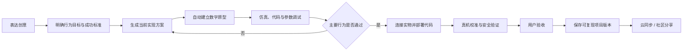

# 掌问项目书

版本：v1.1
日期：2026-07-30
状态：基于《掌问平台重新定义讨论稿 v0.1》与三轮决策确认形成的项目立项书；v1.1 纳入同日评审修订（R1–R10，见 §16）
上游文档：PRODUCT_REFOUNDATION_DISCUSSION.md（产品立意与原则以此为准，本文档补齐战略决策、商业与执行层）

---

## 1. 项目概述

### 1.1 一句话定义

> 掌问是一套帮助用户把一个想法逐步变成"经过验证、可以在指定硬件上运行、能够再次复现的实体作品"的创作与交付平台。

### 1.2 项目背景

现有掌问已积累项目、AI、硬件知识、代码、CAD、设备、仿真、参数、产物和安全执行等能力，但按工程模块组织，用户感受不到"作品正在一步步成为真实物体"。本项目在保留平台内核的前提下，重新定义产品立意、目标用户、商业路径与自研硬件体系。

### 1.3 项目目标

1. 建立一个以"作品完成"为核心度量（而非消息量、代码生成次数）的创作平台；
2. 打通"创意 → 方案 → 数字原型 → 仿真 → 真机 → 验收 → 可复现版本"的完整闭环；
3. 建立"主控核心 + 标准模块"的自研硬件体系，设备包成为软硬件共同事实源；
4. 形成"硬件套件 + AI 创作订阅"的可持续商业模式；
5. 让第二位用户能凭项目交付版本独立复现同一作品。

---

## 2. 已确认战略决策

以下 12 项决策已于 2026-07-30 经讨论确认，是本项目书的地基。后续 PRD 不得与之冲突；如需变更，须回到决策记录修订。

| # | 议题 | 决定 | 备注 |
|---|---|---|---|
| D1 | 核心用户 | **家庭 / 亲子 / 情侣 / 个人创客 / 潮玩玩家（C 端优先）** | 偏离讨论稿原建议的教育切口；教育转为独立品牌线 |
| D2 | 首期作品 | **感知类、响应执行类、视觉/音频类全部要做** | 按风险排序实施：感知 → 响应执行 → 视觉/音频 |
| D3 | 主交互 | **对话为主入口 + 按需展开画布** | 仿真、3D、代码作为可展开工作区，不挤入对话旁栏 |
| D4 | 自研硬件形态 | **主控核心 + 标准模块体系** | 必须以"防错连接 + 预组装入门套装"交付，见 §7.2 |
| D5 | 商业模式 | **硬件套件销售 + AI 创作订阅** | 定价假设见 §9 |
| D6 | 教学端关系 | **独立品牌继续运营，共享平台内核** | 教育线独立品牌、独立体验；不主导 C 端产品 UI/UX |
| D7 | 仿真深度 | **基础 IO + I2C/SPI/UART 总线 + 媒体夹具 + 故障注入（全量）** | 分期实施，顺序见 §8.2 |
| D8 | 代码可见度 | **默认隐藏，按需查看与编辑** | 行为修改以对话和参数为主；代码是高级工作区 |
| D9 | 账号与云 | **账号体系 + 云同步 + 社区分享平台** | 社区分期建设；设备动作保持本地权威 |
| D10 | 结构设计 | **按需出现；后续升级为主卖点之一重点投入** | 首版基础能力，二期加大投入 |
| D11 | 第三方硬件 | **仅对 B 端 / 教学线开放；C 端保持封闭** | C 端只做自研硬件 + K10/XIAO 代理验证 |
| D12 | 部署入口 | **统一表达为"运行到设备"；USB 与 ESP-Claw 同级；OTA 面向未来** | 沿用讨论稿结论 |

### 2.1 决策间的两个张力及其处理

**张力一：模块化硬件 × 家庭/亲子用户。** 拼装体系天然有接线门槛。处理：硬件交付形态为"预组装入门套装（开箱 10 分钟内可玩）+ 防错模块接口（磁吸/防反插/keyed 连接器）+ 扩展模块包"，模块体系是扩展路径，不是入门门槛。此为硬性产品要求（§7.2）。

**张力二：社区平台 × 首版工程量。** 社区内容供给与合规（亲子/未成年人）成本高。处理：分三期建设——账号+订阅授权（首版）→ 项目包云同步与分享链接（阶段 C 后期）→ 社区广场与作品市场（阶段 D/E，结合自研硬件发布）。

---

## 3. 市场与用户

### 3.1 目标用户（决策 D1）

| 用户层 | 描述 | 核心价值点 |
|---|---|---|
| 首要 | 家庭 / 亲子 | 亲子共同完成一件"真的会动的作品"；安全可控、开箱即玩 |
| 首要 | 个人创客 / 潮玩玩家 | 把创意做成可展示的实体作品；可分享、可复现、可个性化 |
| 次要 | 情侣 / 礼赠场景 | 共同创作、情感化作品（灯光、声音、互动摆件） |
| 独立品牌线 | 教师 / 工作坊 / 学生 | 项目制课程、统一硬件、可评价闭环（教学品牌承接，见 §5.2） |
| 暂不服务 | 专业原型开发人员 | 作为长期机会保留，不让专业复杂度主导首版体验 |

### 3.2 竞争格局与定位

| 类别 | 代表 | 局限 | 掌问的差异 |
|---|---|---|---|
| 开源硬件生态 | Arduino、micro:bit + MakeCode | 工具链碎片化，用户自己整合硬件/代码/结构 | 一个项目贯穿到底，AI 完成整合 |
| 教育编程平台 | 编程猫、童心制物、DFRobot Mind+ | 偏课程与编程教学，弱实体交付与复现 | 以"作品完成与证据"为终点 |
| 在线仿真 | Wokwi、Tinkercad Circuits | 仿真与真机脱节，无部署与校准闭环 | 仿真由项目自动生成，且与真机同一版本链 |
| 消费创作硬件 | 乐高 SPIKE、Sony toio 等 | 封闭玩具生态，创作自由度有限 | 开放创作 + 自研模块体系 + AI 协作 |
| 3D 打印消费模式 | 拓竹（硬件+模型生态） | 无电子与交互行为 | "硬件套件 + 内容/订阅"模式可借鉴 |

**定位结论**：掌问不替代 IDE、EDA、CAD 或聊天机器人；竞争力在于"跨硬件、软件、仿真和实体调试的整合与交付"，C 端以"人人都能完成一件真实作品"为品牌主张。

### 3.3 为什么是现在

- 端侧与云端 AI 成本下降到消费级产品可承载区间；
- 消费硬件（3D 打印、桌面机器人）已验证"硬件 + 内容订阅"模式；
- 自研主控 + 模块供应链成熟，小团队可完成 EVT→PVT；
- 现有平台内核（项目/设备包/仿真/安全执行）已具雏形，重定义成本低于从零起步。

---

## 4. 产品定义

### 4.1 核心价值（用户真正购买的东西）

- 想法被整理成可实现的作品目标；
- 一套彼此兼容的硬件、代码和结构方案；
- 接触实物前验证主要行为；
- 同一份项目可靠运行到真实设备；
- 可调试、可校准、可定位失败并安全恢复；
- 最终保存一份别人也能再次完成的项目。

### 4.2 完整用户旅程（主路径）



（在主路径基础上，按决策 D9 增加分享环节；社区广场分期开放。）

### 4.3 核心对象模型

| 对象 | 含义 |
|---|---|
| 项目 | 一个从创意到实体作品的完整生命周期 |
| 当前方案 | 当前正在制作的一套硬件、逻辑、代码和验证方案 |
| 设备包 | 对主控或模块能力、驱动、仿真、安全和测试的统一描述（事实源） |
| 数字原型 | 根据当前项目方案自动生成的功能仿真场景 |
| 代码版本 | 与方案、设备包和参数绑定的可运行代码 |
| 参数版本 | 可比较、可回滚、可应用到仿真或真机的调试配置 |
| 证据 | 静态检查、仿真、连接、真机运行和用户验收的可追溯结果 |
| 项目交付版本 | 固化方案、文件、设备兼容性、证据和限制的可复现版本 |
| 作品目标（R5） | 使用场景、可观察行为、必须/可选功能、约束、风险偏好与用户确认记录（需求基线，一等对象） |
| 验收场景（R5） | 前置条件、输入、预期行为、安全边界、允许误差，及仿真/真机/用户三级结果（一等对象） |
| 系统 Job（R2） | 方案生成、原型生成、构建、部署等系统任务（排队/进行/失败可重试/已取消），与作品生命周期状态分离 |
| 设备实例（R5） | 一台具体设备及其硬件修订、固件版本、连接状态与审计记录 |

### 4.4 验证等级

1. 未验证 → 2. 静态检查通过 → 3. 功能仿真通过 → 4. 设备已连接 → 5. 真机运行通过 → 6. 用户验收通过。

关键语义（R1/R2）：

- 等级 2 是**代码版本的属性**（静态检查报告），不是作品生命周期状态；
- **部署完成只证明"写入成功"，不推进等级**——等级 4 由设备识别+方案匹配+心跳达成，等级 5 必须由真机验收场景的行为证据达成；
- 等级 5 与具体设备实例、固件版本绑定；换设备或升级固件后按 §4.6 失效或进入"待复核"；
- "交付版本已固化"是**交付完整性状态**，与行为验证等级是两个维度，不新增等级；
- 任何等级不得凭 AI 文本声明达成，必须由对应证据支撑。

### 4.5 可复现项目包规范（R11）

项目包必须包含机器可读 manifest：

```text
项目和方案版本 / 设备包及版本 / 硬件修订版本 / 固件版本
代码依赖锁定 / BOM 与允许替代件规则 / IO Map 与连接说明
结构文件版本 / 校准参数 / 仿真验收结果 / 真机验收结果
已知限制 / 安全约束 / 失败恢复步骤 / 复现验收脚本
```

项目包分三类：**可查看分享包**（仅展示，默认私有）；**可复现项目包**（允许他人复制运行）；**模板包**（清除设备身份与个性化参数后供再创作）。凭据（Wi-Fi 密码、令牌等）永不进入任何包。

### 4.6 版本依赖与失效传播规则（R6）

平台内核必须维护对象间依赖图；某对象变化后，下游证据按下表失效（失效 = 标记"已过期"并可追溯，不是删除）：

| 变化 | 自动失效的结果 |
|---|---|
| 更换传感器型号 | 接线、驱动、仿真结果、真机证据 |
| 修改行为逻辑 | 静态检查、仿真证据、真机证据、验收 |
| 仅修改界面名称 | 通常不影响验证证据 |
| 修改阈值参数 | 相关验收场景结果与真机证据 |
| 设备包升级 | 依据其兼容声明决定是否重新验证 |
| 固件升级 | 真机运行证据进入"待复核" |

失效沿依赖图传播到验证等级，等级自动降级并提示"重新验证"。设备包最小规范 v0.9 必须与本规则同步设计（依赖声明是设备包的必备字段），不能只定义硬件描述字段。

---

## 5. 产品体系

### 5.1 掌问创作端（C 端主产品，本项目主体）

- 面向家庭/亲子/创客/潮玩用户与自研硬件体系；
- 对话为主入口，画布按需展开（决策 D3）；
- 默认使用掌问认证设备包；界面与流程从零设计，不继承现有桌面壳；
- 代码默认隐藏，随任务就地展开（决策 D8）；
- 账号 + 云同步 + 社区分享（分期，决策 D9）。

### 5.2 掌问教学品牌（独立运营，决策 D6）

- 现有项目演进为独立教育品牌，继续服务 K10/XIAO 课程、工作坊；
- 保留 MicroPython、ESP-Claw、设备实验室与教学内容；
- 承接 B 端/教学渠道的第三方硬件认证（决策 D11）；
- 与 C 端共享平台内核，不复制两套后端；不主导 C 端 UI/UX。

### 5.3 共享平台内核

两端共享：项目与版本、AI 与项目事实、设备包与硬件规则、代码/CAD/仿真引擎、设备安全执行、参数与证据、项目包/权限/隐私。

---

## 6. 首版功能范围（创作端）

按讨论稿 §7 功能体系裁剪，标注首版/二期：

| 功能域 | 首版（阶段 C MVP） | 二期（阶段 D/E） |
|---|---|---|
| 创意与项目定义 | 自然语言+图片输入、目标提取、关键澄清、方案生成 | 草图/参考资料增强 |
| 硬件方案与设备包 | 自研主控+首批模块、K10/XIAO 代理包、BOM/IO Map/冲突规则 | 模块目录扩展、兼容矩阵完整化 |
| 数字原型与仿真 | 自动生成场景、基础 IO、总线功能级、媒体夹具、故障注入、验收场景 | 仿真能力边界扩展（仍不做电气/射频精确） |
| 代码与运行 | 代码生成、版本/Diff、静态检查、USB+ESP-Claw 部署、失败恢复 | 安全 OTA（随自研硬件） |
| 图形化调试 | 传感器/执行器控件、校准参数、解锁/急停、参数版本、仿真↔真机比较 | 差异分析自动化 |
| 结构设计 | 按需出现：参数化模板生成、3D 预览、STL/STEP 导出 | **升级为主卖点重点投入（决策 D10）** |
| 证据与交付 | 六级验证、可复现项目包、凭据扫描 | 教学版本生成、社区作品页 |
| 云与社区 | 账号、订阅授权 | 云同步、分享链接 → 社区广场/作品市场 |
| AI 协作 | 单一"掌问"形象、责任域内部化、单动作推进、分级确认 | 项目记忆增强 |

### 6.1 首期三类锚点作品（决策 D2，阶段 C 内分级验收 R10）

不改变 D2"三类都要做"的战略决定，但阶段 C 内按三级成熟度验收，避免被高风险能力整体拖延：

1. **感知类：正式 MVP**——完整走通创意、方案、自动原型、仿真、真机、校准、交付与第二人复现；
2. **响应执行类：受控 Beta**——完成安全状态机、急停、失联保护与有限执行器集合；
3. **视觉/音频类：技术预览**——验证媒体夹具、数据替换与真机差异流程，不要求广泛设备覆盖。

每类都必须从创意走完仿真、代码、实物、参数与交付，不接受单页面完成作为验收。低保真原型的走查案例选用响应执行类（对安全设计压力最大），与工程构建顺序（感知类先行）是验证与构建两个维度，不冲突。

---

## 7. 自研硬件产品定义

### 7.1 形态（决策 D4）：主控核心 + 标准模块体系

- **计算核心/主控产品**：承载运行时、设备身份、安全恢复；
- **标准化连接方式**：防错（磁吸/防反插/keyed）、带供电约束；
- **模块族**：传感器、执行器、显示、音频、视觉、通信；
- 每款硬件同时交付完整**设备包**（身份/电气约束/驱动/仿真模型/参数定义/安全策略/验收场景/固件与兼容矩阵）。

### 7.2 C 端交付硬性要求（张力一的处理）

- 入门套装**预组装**，开箱 10 分钟内完成第一个可观察行为；
- 所有用户可触接口防错设计；危险执行器随套装提供物理限位/防护；
- 亲子场景：儿童操作 + 家长控制（执行器解锁、急停、使用时长）为标配功能；
- 外观与工业设计按消费电子产品标准，而非开发板标准。

### 7.3 K10 / XIAO 定位

仅作参考验证硬件：验证完整流程、服务教学端、在自研硬件完成前担任真实硬件代理；不构成平台永久板型边界。

---

## 8. 数字原型与仿真

### 8.1 原则

- 仿真由项目方案**自动生成**，不让用户手工重建电路；
- 追求功能行为一致，不宣称周期/电气/射频/物理环境精确；
- 仿真结果形成证据；仿真、代码、设备、调参同属一条项目版本链。

### 8.2 首版范围与实施顺序（决策 D7）

1. 基础 IO（GPIO/ADC/PWM/按键/灯）——三类作品共同依赖；
2. 故障注入与安全场景（断线/超时/越界/急停）——亲子安全故事的核心证据；
3. I2C/SPI/UART 总线功能级桥接——外接传感器与屏幕；
4. 摄像头/麦克风/扬声器媒体夹具——视觉/音频类作品，真机差异最大，排最后。

---

## 9. 商业模式（决策 D5）

### 9.1 收入结构

| 来源 | 内容 | 定价假设（待验证） |
|---|---|---|
| 硬件 | 入门套装（预组装主控+基础模块）、扩展模块包 | 套装 ¥499–799；模块包 ¥49–199 |
| 订阅 | AI 创作能力（方案生成、仿真、调参、结构生成额度） | ¥25–35/月 或 ¥199–299/年；免费层可体验闭环小样例 |
| 内容（二期） | 官方/达人作品项目包、课程包 | 单购或订阅内含 |
| B 端（教学品牌） | 课程套装、师训、认证设备包 | 独立品牌定价体系 |

### 9.2 关键商业假设

- 硬件毛利覆盖获客与渠道；订阅覆盖 AI 推理与云成本；
- 免费层的"第一个作品成功"是转化率核心指标；
- 社区作品供给（UGC 项目包）是二期复购与拉新引擎。

---

## 10. 路线图与里程碑

> 周期为规划假设，需在阶段 A 结束时按团队实际情况修订。

| 阶段 | 内容 | 关键交付 | 假设周期 |
|---|---|---|---|
| A 产品定义 | 核心用户确认、代表作品选定、低保真原型、信息架构、设备包最小规范、自研硬件能力目标 | 正式 PRD、交互原型、视觉方向 | ~2 个月 |
| B 平台解耦 | 冻结 K10/XIAO 教学基线、抽取 UI 无关的项目与设备客户端、通用设备包注册与能力模型 | 平台内核 v1、教学品牌独立基线 | ~3 个月 |
| C 创作端 MVP | 主路径全通：创意→方案→数字原型→仿真→运行到设备→验收版本；三类锚点作品按 §6.1 分级验收 | 创作端 MVP、感知类完整证据、响应执行类 Beta、视觉音频类技术预览 | ~6 个月 |
| D 自研硬件 EVT | 虚拟设备包先行、bring-up、驱动、恢复、工厂测试、代理板→自研板迁移 | EVT 样机 + 项目迁移报告 | ~6 个月 |
| E DVT/PVT 与生态 | 可靠性、结构与制造验证、批量烧录与追溯、标准模块族、社区上线 | 量产就绪 + 社区平台 | ~6–9 个月 |

### 10.1 近期行动（阶段 A 启动清单）

1. 编写正式 PRD 与信息架构（基于本决策集）；
2. 低保真原型：对话主入口 + 三类作品旅程；
3. 设备包最小规范 v0.9；
4. 自研主控能力目标书（输入给硬件预研）；
5. 品牌与命名：C 端主品牌与教学独立品牌的关系确认。

---

## 11. 成功指标

以"作品完成"为度量核心：

- 从表达创意到第一次可观察仿真行为的时间（免费层关键转化指标）；
- 项目方案确认率；仿真主要行为通过率；
- 第一次真机运行成功率；仿真到真机行为一致率；
- 平均排障次数与恢复成功率；
- 从开始到用户验收的项目完成率；交付版本证据覆盖率；
- **第二人复现成功率**（社区与口碑的底层指标）；
- 商业：套装转化率、免费→订阅转化率、订阅留存；
- 教学品牌线：课程完成率、教师准备时间。

**指标落地要求（R12）**：阶段 A 必须同步输出《指标与埋点规范》，包含——1）漏斗定义（创意表达→首次仿真行为→设备连接→真机通过→验收→复现）；2）事件模型（事件名、属性、触发时机）；3）各项指标的基线测量方式与 MVP 验收阈值。不允许 MVP 完成后才补埋点再判断产品是否有效。

---

## 12. 风险登记册

| 风险 | 等级 | 说明 | 缓解 |
|---|---|---|---|
| 仿真自动生成的可行性 | 高 | 从方案自动生成场景+夹具是最大技术不确定点 | 阶段 A 原型先行验证；锚点作品限定范围逐类攻克 |
| 媒体夹具与真机差异 | 高 | 视觉/音频类最易"仿真过、真机挂" | 排期最后；差异比较工具纳入首版；明确仿真边界声明 |
| C 端获客成本 | 高 | 消费硬件获客贵，免费层转化不确定 | 潮玩/亲子社群种子运营；分享机制内置；小批量验证 |
| 硬件周期与资金 | 中高 | EVT→PVT 12–15 个月，资金占用大 | 代理硬件先行承载软件收入；套装分批投产 |
| 未成年人合规 | 中高 | 亲子场景涉及儿童隐私与内容合规 | 家长控制标配；社区分期并先审后放；凭据不出本地 |
| AI 成本失控 | 中 | 订阅定价与推理成本倒挂 | 额度制+本地轻量模型分流；免费层限额 |
| 双品牌资源分散 | 中 | C 端与教学线争夺平台内核资源 | 内核单一团队；教学品牌复用不定制 |
| 社区冷启动 | 中 | 无供给量的社区不成立 | 官方作品包先行；达人共创；二期再开放广场 |

---

## 13. 范围外（首版明确不做）

- C 端任意第三方主控与无限插件生态（第三方认证仅 B 端/教学线）；
- 通用电子设计自动化与完整 PCB 设计平台；
- 周期精确、模拟电气、射频或真实物理环境仿真；
- 替代专业 IDE、EDA、通用 CAD、CAE 或 PLM；
- 在用户电脑上自动构建任意 ESP-IDF 工程；
- 无确认的设备扫描、连接、上传、复位或固件操作；
- 对危险执行器的无人值守自动控制；
- 仅凭 AI 文本声明项目、仿真或真机成功；
- 首版即上线完整社区广场与作品市场（分期）。

---

## 14. 资源需求估算（粗粒度，待阶段 A 细化）

| 职能 | 阶段 A–B | 阶段 C | 阶段 D–E |
|---|---|---|---|
| 产品/设计 | 2–3 | 3 | 3 |
| 客户端/前端 | 2 | 4 | 4 |
| 平台/后端/云 | 2 | 3 | 4 |
| 仿真引擎 | 1 | 2–3 | 2 |
| AI 工程 | 1–2 | 2–3 | 3 |
| 硬件（EE/固件/结构/测试） | 1（预研） | 2 | 4–6 |
| 测试/质量 | 1 | 2 | 3 |
| 合计（约） | 10–12 | 18–21 | 23–28 |

---

## 15. 待后续确认事项

以下事项本项目书不决定，按讨论稿 §18 进入各自文档：

- 新前端技术框架与仓库策略；API/数据库具体改造；
- 自研硬件芯片、PCB、连接器与 BOM 选型；
- C 端主品牌与教学品牌的命名与视觉体系；
- 定价的最终数值与免费层额度；
- 开发时间表、人员到位与发布版本的正式承诺；
- 旧 PRD、旧 UI 契约的归档方式。

## 16. 决策记录

| 日期 | 议题 | 结论 | 来源 |
|---|---|---|---|
| 2026-07-30 | 核心用户 / 首期作品 / 主交互 | D1/D2/D3 | 讨论第 1 轮 |
| 2026-07-30 | 硬件形态 / 商业模式 / 教学端 / 仿真深度 | D4/D5/D6/D7 | 讨论第 2 轮 |
| 2026-07-30 | 代码可见度 / 账号与云 / 结构设计 / 第三方硬件 | D8/D9/D10/D11 | 讨论第 3 轮 |
| 2026-07-30 | 部署入口、验证等级、核心对象、六项产品倾向 | D12 等 | 沿用讨论稿 §5/§15 |
| 2026-07-30 | v1.1 评审修订 R1–R12：R1 验证等级语义、R2 状态/Job 分离、R3 软门禁、R4 失败回退矩阵、R5 核心对象扩展、R6 版本失效规则、R7 设备风险分级、R8 亲子权限、R9 原型范围扩展、R10 阶段 C 分级验收、R11 项目包 manifest、R12 指标埋点规范 | 修订条目 | 用户评审意见；IA 相关部分同步至 CREATOR_PRD_IA v0.2 |
