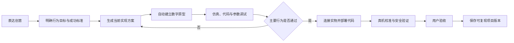

# 掌问平台重新定义讨论稿

版本：v0.1
日期：2026-07-30
状态：产品讨论草案，尚未形成实施需求
产品名：掌问
副标题：AI 创客工程工作台

> 本文档用于重新讨论掌问的产品立意、用户价值、完整流程和功能边界。
> 它不继承现有 PRD 的页面布局、三师展示方式、固定右栏、普通/专业模式或双板永久白名单，
> 也不作为当前代码的实施任务。只有经后续讨论确认的内容，才会进入新的正式 PRD 和 ExecPlan。

---

## 1. 为什么重新开始

现有掌问已经积累了项目、AI、硬件知识、代码、CAD、设备、仿真、参数、产物和安全执行等能力，
但这些能力目前主要按照工程模块组织。用户进入软件后容易看到多个工具和工作区，却不容易感受到
“我的作品正在一步步成为真实物体”。

重新开始不是删除现有工程，而是先停止用现有页面结构定义产品，重新回答三个问题：

1. 掌问到底替用户完成什么结果？
2. 用户从想法到实体作品，最自然的过程是什么？
3. 自研硬件、仿真、代码和 AI 应该怎样组成一套产品，而不是四套工具？

## 2. 产品核心定义

### 2.1 一句话定义

> 掌问是一套帮助用户把一个想法逐步变成“经过验证、可以在指定硬件上运行、能够再次复现的实体作品”的创作与交付平台。

### 2.2 用户真正购买的价值

用户不是为了获得一段聊天、一份代码、一张接线图或一个仿真页面而使用掌问。用户真正希望得到：

- 一个想法被整理成可实现的作品目标；
- 一套彼此兼容的硬件、代码和结构方案；
- 在接触实物前能够验证主要行为；
- 将同一份项目可靠地运行到真实设备；
- 能够调试、校准、定位失败并安全恢复；
- 最终保存一份别人也能再次完成的项目。

掌问的核心竞争力应当是“跨硬件、软件、仿真和实体调试的整合与交付”，而不是单独替代 IDE、
电子仿真器、CAD 软件或聊天机器人。

## 3. 目标用户与首要场景

### 3.1 建议的核心用户

> 已经知道自己大致想做什么，但不会系统整合硬件、代码、结构和调试过程的创作者。

典型用户包括：

- 想把创意做成实体作品的学生和个人创客；
- 需要组织项目制课程的教师和工作坊；
- 需要快速完成概念样机的产品、设计和技术人员；
- 未来使用掌问自研硬件体系进行创作的普通用户。

### 3.2 建议的首个市场切口

首个切口建议放在“项目制创客教育、工作坊和标准硬件套件”。原因是：

- 项目目标和完成标准相对清晰；
- 可以使用统一硬件降低变量；
- 仿真、实物、教案和评价能够形成完整闭环；
- 适合用 K10、XIAO 和后续自研硬件逐步验证；
- 能够积累高质量的设备包、案例和验收证据。

专业原型开发者可以作为第二层用户，但不应让专业工程工具的复杂度主导第一版体验。

## 4. 产品基本原则

### 4.1 项目优先，不以工具为入口

用户进入的是一个作品项目，不是聊天、代码、CAD、仿真和串口五个互相独立的工具。

### 4.2 创意自由，执行受控

用户可以自由描述创意；系统必须把自由表达转化为受硬件事实、能力规则和验证结果约束的执行方案。
AI 可以建议和生成，但不能编造硬件能力、接线安全、仿真通过或真机成功。

### 4.3 默认先数字验证，再进入实物

推荐过程为：先明确实物目标，再建立数字原型和功能仿真；主要行为验证通过后，再连接实物、部署代码和校准。
仿真不能替代电气、功耗、机械、环境和真实传感器验证。

### 4.4 仿真由项目自动生成

仿真不是让用户重新手工搭一次电路。系统应根据已确认的作品方案、硬件组合、接口和行为目标，自动生成
与项目对应的数字原型、输入夹具、执行器表现和验收场景。

### 4.5 一套当前方案，一条连续路径

前台默认保持一套当前推荐实现方案。需要探索替代方案时可以建立候选，但用户始终知道当前正在制作哪一套。

### 4.6 物理动作由用户掌控

扫描、连接、上传、复位、固件恢复、执行器解锁和其他真实设备动作必须有清楚的用户触发与状态反馈。
云端 AI 不直接操作文件、串口、Flash 或设备。

### 4.7 能力描述独立于具体板卡

项目首先描述“需要感知什么、如何响应、怎样交互”，再由设备能力完成绑定。K10、XIAO 和未来自研硬件
是设备实现，不是掌问的产品定义。

### 4.8 默认简单，复杂度按上下文展开

普通用户只看到当前结果、下一步和必要风险。代码、协议、Hash、Job、工具链等内容只在真正需要编辑、
诊断或追溯时出现，不再依赖整套“专业模式”切换用户身份。

## 5. 从创意到实体作品的完整过程



### 5.1 表达创意

- 使用自然语言描述想做的作品；
- 可补充图片、草图、参考资料、已有器件或使用环境；
- 不要求用户先选择开发板、编程语言、专家或工具；
- 掌问只询问真正会改变作品方向的关键问题，每次优先一个。

### 5.2 明确作品目标

系统协助形成：

- 作品要解决的问题；
- 使用者和使用场景；
- 可观察行为；
- 必须实现与可选功能；
- 成功标准；
- 预算、尺寸、供电、联网和安全约束；
- 仍待验证的信息。

这里不必使用正式、行政化的“立项审批”体验，但在进入实际制作前，用户需要明确确认作品方向。

### 5.3 生成当前实现方案

方案必须同时包含：

- 工作逻辑和状态变化；
- 主控、传感器、执行器、交互和供电；
- BOM 与替代件；
- 接口、IO 和接线关系；
- 软件运行时和代码结构；
- 是否需要结构件或外壳；
- 仿真能覆盖什么、不能覆盖什么；
- 主要风险和验证方法。

### 5.4 自动建立数字原型

确认方案后，掌问自动创建当前项目的数字原型：

- 主控和外围器件的可视场景；
- 已确认连线和接口关系；
- 传感器输入控件；
- 执行器的视觉或声音表现；
- 摄像头图片/视频夹具；
- 麦克风波形/WAV 夹具；
- 屏幕、灯光、按钮、音频等交互；
- 项目特有的验收场景和故障情形。

数字原型首先追求“功能行为一致”，不宣称周期精确、电气精确、射频精确或真实物理环境精确。

### 5.5 仿真、代码和参数调试

- 代码与数字原型使用同一项目版本；
- 修改行为时同步更新代码、参数和仿真场景；
- 提供日志、状态、遥测和实时曲线；
- 传感器可以通过滑块、开关、数值、波形或媒体夹具输入；
- 执行器必须遵守范围、刷新率、安全值和停止策略；
- 参数保存为可比较、可回滚的版本；
- 仿真结果形成证据，不只显示“运行成功”。

### 5.6 连接实物并运行

当数字验证达到要求后：

- 识别或确认精确设备；
- 检查设备与项目方案是否匹配；
- 选择适合的代码部署通道；
- 显示将写入的内容、目标和风险；
- 部署后读取日志、遥测和运行状态；
- 对照仿真行为与真实行为；
- 失败时提供恢复路径，不虚报成功。

在当前参考硬件阶段，USB 串口和 ESP-Claw 是同级代码部署入口。固件安装或恢复属于设备维护，
不等同于日常代码上传。未来自研硬件可以增加安全 OTA 或其他通道，但用户面对的仍应是统一的
“运行到设备”动作。

### 5.7 真机校准与图形调试

- 真机原始传感器读数只读；
- 可修改校准值、阈值、采样周期、滤波和业务参数；
- 执行器控制先解锁，并持续提供停止入口；
- 断线、超时、重连和应用重启保持安全值；
- 参数先保存为项目版本，再明确同步到设备；
- 比较仿真参数、设备参数和当前项目版本；
- Wi-Fi 密码、令牌等凭据不进入参数版本或项目包。

### 5.8 验收与交付

掌问不只保存最终文件，还保存完成证据。建议采用以下验证等级：

1. 未验证；
2. 静态检查通过；
3. 功能仿真通过；
4. 设备已连接；
5. 真机运行通过；
6. 用户验收通过。

最终交付应包含：

- 原始目标和当前方案；
- BOM、供电、接线和装配说明；
- 代码与运行时要求；
- 参数版本；
- 仿真场景和仿真证据；
- 真机日志、遥测和验收结果；
- 结构文件（如需要）；
- 已知限制；
- 恢复与重新部署方法。

## 6. 平台核心对象

新产品讨论建议围绕以下对象，而不是围绕页面或专家名称组织：

| 对象 | 含义 |
|---|---|
| 项目 | 一个从创意到实体作品的完整生命周期 |
| 当前方案 | 当前正在制作的一套硬件、逻辑、代码和验证方案 |
| 设备包 | 对主控或模块能力、驱动、仿真、安全和测试的统一描述 |
| 数字原型 | 根据当前项目方案自动生成的功能仿真场景 |
| 代码版本 | 与方案、设备包和参数绑定的可运行代码 |
| 参数版本 | 可比较、可回滚、可应用到仿真或真机的调试配置 |
| 证据 | 静态检查、仿真、连接、真机运行和用户验收的可追溯结果 |
| 项目交付版本 | 固化方案、文件、设备兼容性、证据和限制的可复现版本 |

## 7. 功能体系

### 7.1 创意与项目定义

- 自然语言、图片、草图和资料输入；
- 目标、使用场景和成功标准提取；
- 关键问题澄清；
- 当前方案生成和修改；
- 约束、风险和待验证项管理；
- 项目历史、复制、归档和恢复。

### 7.2 硬件方案与设备包

- 自研硬件、参考硬件和外围模块目录；
- 能力、供电、电平、总线、引脚和冲突规则；
- BOM、替代件和成本信息；
- IO Map、接线和供电预算；
- 驱动、代码模板和示例；
- 仿真模型、图形控件和媒体夹具；
- 参数描述和运行时绑定；
- 安全范围、失联策略和验收用例；
- 来源、版本和兼容矩阵。

### 7.3 数字原型与仿真

- 从项目方案自动生成场景；
- 板卡、模块、连线和交互可视化；
- GPIO、ADC、PWM、I2C、SPI、UART 等功能级桥接；
- 传感器输入和执行器表现；
- 摄像头、麦克风、扬声器、显示和存储夹具；
- 场景快照、暂停、重启和故障注入；
- 日志、遥测、曲线和背压控制；
- 自动验收场景；
- 清楚标识仿真能力和真实性边界。

### 7.4 代码与运行

- 根据当前方案和设备包生成代码；
- 代码编辑、版本、Diff 和来源追踪；
- 语法、静态规则、Mock 和仿真检查；
- 代码接受和可运行版本固化；
- 与仿真场景、参数和设备目标绑定；
- USB、ESP-Claw、未来 OTA 等部署通道；
- 上传进度、取消、日志、回读和失败恢复；
- 固件初始化/恢复与日常代码部署严格区分。

### 7.5 图形化调试

- 项目自动生成的传感器和执行器控件；
- 实时数据、曲线、事件和状态；
- 阈值、校准、采样和滤波参数；
- 执行器解锁、限幅、限速、急停和看门狗；
- 参数版本比较、说明和回滚；
- 明确“应用到仿真”或“同步到真机”；
- 仿真与真机差异比较。

### 7.6 结构设计

结构设计是按项目需要出现的能力，不是所有项目的必经页面：

- 从硬件布局和使用场景提取结构需求；
- 外壳、安装、开孔、按键、屏幕和接口约束；
- 受控参数化生成和自然语言修改；
- 3D 预览、修订比较和确认；
- STEP、STL、装配和制造说明；
- 尺寸、干涉、壁厚和可制造性验证；
- 无结构需求的项目不被 CAD 流程阻塞。

### 7.7 项目证据与交付

- 项目全过程版本和事件；
- 文件和参数之间的依赖；
- 过期和需要重新验证的内容；
- 仿真、真机和用户验收证据；
- 可复现项目包；
- 隐私和凭据扫描；
- 分享、复制和教学版本生成。

### 7.8 AI 协作

- 普通用户只与“掌问”协作；
- 内部可以保留需求、工程、结构等专业责任域；
- 系统根据当前项目状态自动选择处理责任；
- 每次优先推进一个最重要动作；
- 对低风险、可逆细节使用推荐默认值；
- 对方向性、高风险或真实设备动作要求确认；
- AI 建议、硬件事实、本地执行和验证证据相互分离；
- 项目记忆以结构化事实和版本为主，不依赖无限聊天历史。

## 8. 自研硬件体系在产品中的位置

### 8.1 K10 和 XIAO 的定位

`dfrobot/dfrobot_k10` 与 `seeedstudio/xiao_esp32s3_sense` 仅作为参考验证硬件：

- 验证从项目到仿真再到实物的完整流程；
- 验证屏幕、摄像头、音频、传感器、存储和外围扩展；
- 服务教学端和入门案例；
- 在自研硬件完成前承担真实硬件代理；
- 不构成未来掌问平台的永久板型边界。

### 8.2 自研硬件不应只是一块开发板

建议把自研硬件定义为一套可被掌问直接理解和交付的体系：

- 计算核心或主控产品；
- 标准化、具备防错和供电约束的连接方式；
- 传感器、执行器、显示、音频、视觉和通信模块；
- 模块身份与能力描述；
- 驱动和代码模板；
- 仿真模型和调试控件；
- 安全升级、恢复和设备身份；
- 工厂测试、版本追溯和兼容矩阵。

### 8.3 设备包是软硬件共同交付物

每个自研主控或外围模块应同时交付：

```text
设备包
├── 设备身份、型号和硬件修订版
├── 电气、接口、引脚和功耗约束
├── 能力与运行时描述
├── 驱动、代码模板和示例
├── 仿真模型和图形交互
├── 参数与遥测定义
├── 安全策略和失联行为
├── 自动测试与验收场景
└── 固件、恢复包和兼容矩阵
```

设备包应成为掌问自动选型、自动生成仿真、生成代码和图形调试的共同事实源。

## 9. 产品版本关系

### 9.1 掌问创作端（未来主产品）

- 面向自研硬件和正式实体作品交付；
- 强调从创意到数字原型、实物运行和可复现版本；
- 默认使用掌问认证设备包；
- 界面和流程从零设计，不继承当前桌面壳。

### 9.2 掌问教学验证端（保留现有项目）

- 继续使用 K10、XIAO 和课程器件；
- 保留 MicroPython、ESP-Claw、设备实验室和教学内容；
- 用于课程、工作坊、硬件回归和功能验证；
- 可以保持较多工程说明，但不再决定主产品的 UI/UX。

### 9.3 共享平台内核

两个产品端共享：

- 项目与版本；
- AI 与项目事实；
- 设备包和硬件规则；
- 代码、CAD 和仿真引擎；
- 设备安全执行；
- 参数与证据；
- 项目包、权限和隐私。

## 10. UI/UX 重新设计方向

本文档不确定具体页面结构，但建议遵守以下体验目标：

### 10.1 用户始终知道三件事

1. 我现在正在做什么作品；
2. 它现在做到什么程度；
3. 下一步最值得做什么。

### 10.2 界面围绕作品状态变化

建议重点探索三种连续场景，而不是固定工程后台导航：

- 创意与方案：表达、理解、预览和确认作品方向；
- 数字原型：看到作品行为、修改代码和参数、完成仿真；
- 实物运行：连接设备、部署、校准、验证和保存证据。

结构、代码、日志、器件详情和版本记录根据当前任务按需展开，不要求用户先进入所属部门页面。

### 10.3 对话是协作能力，不预先规定为唯一画布

对话可以持续存在并保留草稿和上下文，但不应强迫所有代码、仿真、3D 和设备工作挤入对话旁边。
中央区域是否固定为对话、作品画布或随阶段切换，需要通过新原型和用户测试重新决定。

### 10.4 渐进呈现工程细节

- 不使用一键切换整套“普通/专业模式”作为唯一分层方式；
- 与当前操作相关的细节就地展开；
- 诊断、协议和内部标识进入高级详情；
- 真实风险和能力限制始终可见；
- 一个页面优先突出一个主要动作。

### 10.5 视觉语言服务实体创作

新的视觉系统应让用户持续看到作品、器件、行为和验证结果，而不是以大面积表格、状态卡和内部任务面板为主。
设计重点应包括：

- 作品预览和行为反馈；
- 数字与实物状态对照；
- 清晰的阶段变化；
- 可感知的成功证据；
- 适合教学和创作环境的亲和力；
- 错误和风险不使用只有开发者理解的原始代码表达。

## 11. 首期建议证明的三类作品

第一阶段不需要证明“任何作品都能做”，建议用三类代表性项目验证平台：

### 11.1 感知类

传感器输入、数据曲线、阈值、校准、记录和报警。

### 11.2 响应与执行类

灯光、声音、电机或其他执行器，验证状态机、安全限制、急停和断线行为。

### 11.3 视觉或音频类

摄像头、麦克风、屏幕和扬声器，验证媒体夹具、项目逻辑、数字原型和真机差异。

每类项目都必须从创意走完仿真、代码、实物、参数和交付，不以单个功能页面完成作为验收。

## 12. 首期明确不做的内容

- 任意第三方主控板和无限插件生态；
- 通用电子设计自动化和完整 PCB 设计平台；
- 周期精确、模拟电气、射频或真实物理环境仿真；
- 替代专业 IDE、EDA、通用 CAD、CAE 或 PLM；
- 在用户电脑上自动构建任意 ESP-IDF 工程；
- 无确认的设备扫描、连接、上传、复位或固件操作；
- 对危险执行器的无人值守自动控制；
- 仅凭 AI 文本声明项目、仿真或真机已经成功；
- 为了兼容所有用户而在第一版同时提供所有工程细节。

## 13. 建议的开发阶段

### 阶段 A：产品重新定义

- 确认核心用户和首个代表性作品；
- 确认完整用户旅程；
- 制作低保真交互原型；
- 定义新的信息架构和视觉方向；
- 定义设备包最小规范；
- 定义自研硬件第一款产品的能力目标。

本阶段不修改现有正式 UI，不创建实现任务。

### 阶段 B：平台与教学端解耦

- 冻结当前 K10/XIAO 教学验证基线；
- 把双板限制从平台永久类型调整为教学发行策略；
- 抽取与 UI 无关的项目和设备客户端；
- 建立通用设备包注册和能力模型；
- 保持旧项目和教学端可运行。

### 阶段 C：新创作端 MVP

- 在同一平台内建立新的创作端应用；
- 完成“创意 → 当前方案 → 自动数字原型 → 仿真 → 运行到设备 → 验收版本”主路径；
- 继续用 K10/XIAO 作为代理硬件验证；
- 不复制本地 API、项目库和设备安全系统。

### 阶段 D：自研硬件 EVT

- 先用虚拟设备包定义自研硬件；
- 在打样前运行数字原型和项目场景；
- 完成硬件 bring-up、驱动、恢复和工厂测试；
- 让同一批项目从代理板迁移到自研板；
- 对照仿真、代理硬件和自研硬件行为。

### 阶段 E：DVT、PVT 与生态

- 设计验证和可靠性；
- 结构与制造验证；
- 批量烧录、身份、工厂测试和追溯；
- 标准外围模块；
- 教学内容与自研硬件正式整合。

## 14. 成功指标

建议用“作品完成”衡量产品，而不是只看消息、代码生成次数或页面访问量：

- 从表达创意到第一次可观察仿真行为的时间；
- 项目方案确认率；
- 仿真主要行为通过率；
- 第一次真机运行成功率；
- 仿真到真机的行为一致率；
- 平均排障次数和恢复成功率；
- 从开始到用户验收的项目完成率；
- 交付版本证据覆盖率；
- 项目由第二个人重新复现的成功率；
- 教学场景中的课程完成率和教师准备时间。

## 15. 当前已经表达出的产品倾向

以下内容来自当前讨论，作为下一轮讨论起点，而不是不可修改的最终决定：

1. 掌问未来会建立自己的硬件体系；
2. K10 和 XIAO 只承担验证和教学角色；
3. 现有项目保留为教学验证端；
4. 新主产品的 UI/UX 不延续当前桌面工作台；
5. 默认过程应先完成数字原型和仿真，再进入实物；
6. 仿真应从项目方案自动生成，而不是让用户手工重建；
7. ESP-Claw 与 USB 在当前参考设备中是同级代码部署方式；
8. 仿真、代码、设备和图形调参必须属于同一项目版本链；
9. 用户面对的是一个“掌问”，专业责任分工放在系统内部；
10. 平台内核应被新创作端和现有教学端共同使用，不复制两套后端。

## 16. 需要重新讨论的关键问题

| 议题 | 建议的起始假设 | 尚未决定的内容 |
|---|---|---|
| 核心用户 | 先服务有创意但缺少整合能力的创作者 | 教师、学生、家庭用户还是产品原型人员优先 |
| 首个作品 | 选择能完整走通感知、响应和人机交互的项目 | 具体项目题目与验收标准 |
| 主交互 | 围绕作品状态和下一步组织 | 对话、画布、时间线或其他主隐喻 |
| 自研硬件 | 主控加标准模块体系 | 第一款产品形态、成本、接口和模块范围 |
| 仿真深度 | 以功能行为验证为主 | 哪些总线、媒体和故障必须在首版支持 |
| 结构设计 | 按项目需要出现 | 是否是主产品卖点，首版支持到什么程度 |
| 代码可见度 | 默认隐藏复杂度，随任务展开 | 用户是否必须直接编辑代码、支持哪些语言 |
| 部署入口 | 统一表达为“运行到设备” | USB、ESP-Claw、OTA 的正式优先级 |
| 账号与云 | 本地执行和设备安全保持本地权威 | 是否需要云同步、协作、社区和跨设备项目 |
| 教学端关系 | 共用平台内核、独立体验 | 是否独立品牌、独立安装包或同一账号体系 |
| 第三方硬件 | 首期只做参考双板和自研硬件 | 未来是否开放认证设备包与第三方生态 |
| 商业模式 | 先证明完整作品交付 | 硬件、软件订阅、课程、内容或服务的组合 |

## 17. 下一轮讨论建议顺序

为避免再次从功能清单直接进入开发，建议按以下顺序讨论：

1. 选择一个最核心用户；
2. 选择一个必须真正完成的代表性作品；
3. 写出该用户从开始到验收的完整故事；
4. 决定掌问的主交互隐喻；
5. 确定第一款自研硬件承担哪些能力；
6. 确定仿真必须证明什么、明确不证明什么；
7. 确定教学端与创作端的产品关系；
8. 再形成正式 PRD、信息架构和开发计划。

## 18. 本文档暂不决定的工程事项

本文档不决定：

- 新前端的具体技术框架和文件夹结构；
- 是否拆分仓库；
- API、数据库和共享契约的具体改造；
- 自研硬件的芯片、PCB、连接器和 BOM；
- 旧 PRD、旧 UI 契约和当前任务的归档方式；
- 开发时间表、人员安排和发布版本；
- 现有未提交工作树的提交、标签或迁移。

这些事项应在产品方向确认后，分别进入产品 PRD、软件架构和硬件产品定义文档。
