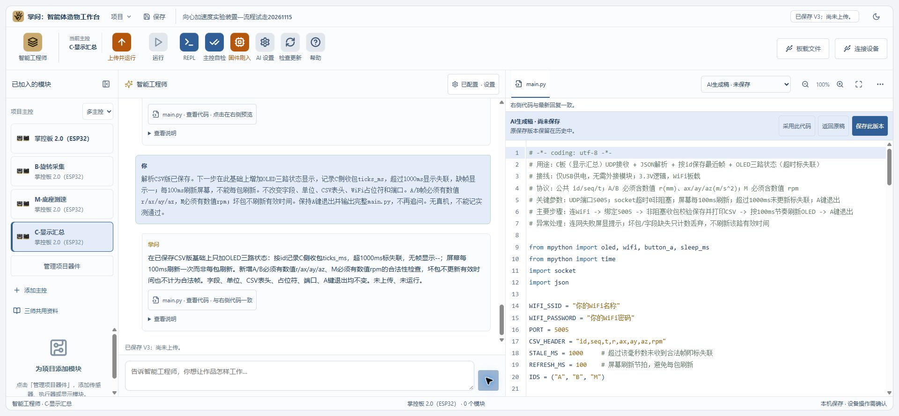
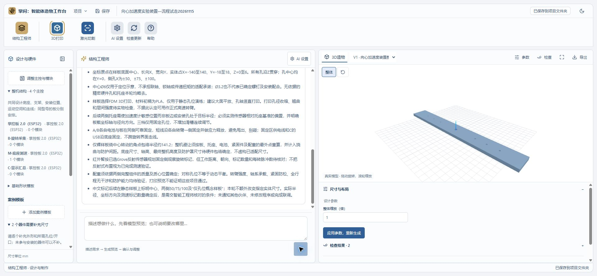

# 掌问案例 向心加速度实验装置

从研究问题到多主控开发 结构设计与实验分析

案例编写日期 2026年11月15日

## 一 案例概况与学习任务

看到视频中旋转的实验装置，学生可能首先想到“把它做出来”。在掌问中，这个项目从一个更具体的问题开始：怎样改变转速和半径，并用采集到的数据研究向心加速度？围绕这个问题，学生需要说明测什么、怎样测、装置怎样装在一起，以及哪些记录能够支持自己的结论。

本案例采用底座电机驱动水平转臂的方案。A、B两块掌控板安装在转臂两侧，采集加速度；M板固定在底座，读取红外测速脉冲；C板接收三路数据，显示状态并向电脑输出记录。电机通过独立调速模块调速，M板只负责测速。四块板属于同一个项目，分别开发，共用已保存的项目资料。

学习任务包含两组关系：保持半径不变，研究加速度与转速的关系；保持转速基本不变，研究加速度与半径的关系。作品完成的标志，既包括装置能够稳定工作，也包括学生能够解释测量方法、处理数据并说明误差。

| 角色 | 在本案例中的具体工作 | 交给下一环节的材料 |
| --- | --- | --- |
| 学习设计师 | 把视频想法变成研究问题，安排当前任务，依据反馈调整步骤，组织实验与反思 | 已确认目标、阶段任务、完成标准、实验记录要求 |
| 智能工程师 | 为各主控分别设计采集、测速、接收与显示程序，讨论通信接口并排查程序问题 | 各板保存版本、协议说明、接线条件与测试方法 |
| 结构工程师 | 设计转臂、底座、安装件和整机布局，核对固定件与运动件的关系 | 结构版本、尺寸假设、零件清单和装配待核对项 |

使用者负责确认目标、核对器件、选择并发送任务、审阅程序和设计，完成实际装配与观察。三师共用资料让各环节依据同一项目继续工作；具体任务由使用者发出。

案例依据既有视频、掌问界面试走及修复记录编写。已实际保存四板程序和转臂孔位概念样板；尚未完成实物装配、上传运行和物理实验。以下流程用于指导后续实践，对话均为可复用示例，实验表格待实测填写。

## 二 从视频观察形成项目目标

### 先说明看到了什么

新建项目后，先整理视频中的固定底座、旋转部件、传感器位置、调速方式和显示方式。可以把本机视频中的关键画面截成参考图，填写经过核对的说明后存入项目资料。画面能证明的内容与暂时看不清的内容分开记录，例如电机型号、轴径、板卡固定方式和传感器精确位置仍需补充。

向学习设计师输入的第一段话，可以是：“我想参考视频做一台向心加速度实验装置。请先帮我明确研究问题、可改变的量、需要测量的量，以及第一步该做什么。看不清的器件和尺寸请列为待确认。”

学习设计师在这里帮助学生收拢目标。若学生只说“让它转起来”，就继续讨论怎样知道转得多快、测量点离转轴多远，以及加速度读数是否可以用于比较。目标确认后，程序和结构任务都围绕这些测量条件展开。

### 把目标写到可以核对

本案例的目标可表述为：制作一套可调转速、可改变测量半径的水平旋转装置；A、B在转臂两侧采集数据，M独立测速，C统一接收和输出；能够据此组织固定半径和固定转速两组实验，并保留原始记录。

初步设置50、75、100毫米三档半径。这些数值是设计目标，实际半径应从转轴中心量到加速度传感器的敏感位置，不能直接把安装孔距或板卡中心当作测量半径。板卡位置与传感器位置的偏移，需要在结构设计时一并记录。

### 用当前任务推动制作

目标确认后，请学习设计师把制作拆成有先后依赖的任务。第一项可以是核对四板分工及器件条件，之后依次进入通信、分板程序、机械布局、静态装配和整机联调。每次只明确当前任务的做法、完成标志和需要反馈的现象。

例如：“现在没有真机。请安排我先完成软件和结构准备，并明确哪些只能记为待验证。”这一阶段完成后，应能找到已确认的目标、四板职责说明、参考图和待补资料。尚不清楚的尺寸、电平、量程和接口继续保留，避免被后续对话当成已知事实。

## 三 在一个项目中组织四块主控

### 按实物身份分别建立主控

在项目主控位置选择多主控，为四块板分别命名并加入各自器件。名称表达功能，板型表达硬件，两者同时保留。同型号的两块板也有独立身份，不能因为型号相同就合并为一个开发对象。

| 名称 | 所在位置 | 本板任务 | 对外输出 |
| --- | --- | --- | --- |
| A 旋转采集 | 转臂一侧 | 采集板载三轴加速度，标明半径和自身编号 | A板数据到C |
| B 旋转采集 | 转臂另一侧 | 独立采集，保留自己的方向和标定信息 | B板数据到C |
| M 底座测速 | 固定底座 | 读取红外脉冲并换算转速 | 测速数据到C |
| C 显示汇总 | 固定显示区 | 接收、校验、显示三路状态并输出记录 | 经USB输出到电脑 |

选中哪块主控，上方菜单、对话和代码就跟随哪块主控。各板拥有独立对话、草稿、程序历史和连接状态，操作方式与单主控一致。C承担汇总是作品中的功能分工，四块板在掌问中仍平等管理。

图1 既有试走中的四板开发界面。画面显示C板候选预览及“尚未上传”状态；后续保存版本以项目记录为准。

### 先把接口讨论清楚

本方案约定A、B、M经同一局域网用UDP向C发送数据，端口为5005。先讨论编号、序号、时间、半径和单位，再生成程序。A、B输出加速度，M输出转速；C检查来源和字段，分别显示正常、缺数据或超时。UDP送达、丢包及网络条件均需实测。

若换用Mosaico、micro:bit或其他板，仍按独立实物加入同一项目，但要重新核对传感器、网络或通信能力、接口电平和运行方式。本案例的四板程序不能直接视为异构板通用程序；混用方案需逐板适配并另做联调。

## 四 分板开发并保留真实状态

### 从接收骨架逐步增加功能

可以先请智能工程师为C编写最小接收程序，只验证能否收到和区分A、B、M。再分别开发M的脉冲计数、A的加速度采集和B的独立采集。各模块工作条件明确后，逐步补上C的字段检查、状态显示和CSV输出。

给C的示例任务是：“请先讨论四板数据协议，不生成代码。确定协议后，再分步生成C的UDP接收、解析输出和显示功能。网络参数使用占位符，当前没有真机，不记录测试通过。”先讨论后实现，可以减少各板独自采用不同字段和单位的问题。

给M的任务应说明红外模块的实际资料，要求先核对供电、信号电平、接线和每转脉冲数，再设计计数。M不承担电机驱动。给A、B的任务应标明各自编号、轴向、采样间隔、实际半径和量程检查要求。复制A程序到B后，仍需分别核对编号、方向与版本。

### 每次生成后核对实际交付

有代码候选时，查看代码后保存到当前主控；只有讨论或方案时，继续完善需求。若回复不完整，保留当前版本，把任务拆成小步继续。手工修改后确认保存，避免把编辑器中的未保存内容当成后续测试依据。

原试走已经保存A V6、B V3、M V3、C V4。它们说明程序准备已经进行到相应版本，不代表程序运行成功。网络名称、密码和C的IP仍有占位符，红外参数、加速度单位和量程也需要结合实物核对。

### 把测试要求交回学习设计师

四板程序准备后，将已保存版本和未验证项反馈给学习设计师，请它安排测试顺序。例如：“四板程序已保存，网络参数还未填写。请先列每块板的最小测试，再列三路数据到C的联调。每项说明看什么现象，以及异常时应反馈什么。”

测试应关联对应主控；涉及A、B、M、C一起工作的条目关联整机或全部参与者。完成标志写成可观察的现象，例如“C能区分三路编号”“拔掉A后只显示A超时”。没有设备时，记录“暂时无法测试”及原因，后续接实物继续同一项任务。

## 五 把分板方案落实为整机结构

### 先画清固定部分和运动部分

结构工程师需要读取同一项目的全部主控、器件资料和已确认目标。A、B及随臂电池属于运动部分；电机、M、红外传感器、C和调速旋钮属于固定部分。转臂围绕转轴运动，线束不能因旋转缠绕。左右对称布置只是起点，还要考虑各完整组件的质量和重心。

可以发送：“请按四板方案规划整机，列出底座、转臂、轴连接、A/B托座、电池固定、测速支架、C显示区和防护空间。已知尺寸先建预览；没有实物依据的配合尺寸请列出，不把概念孔当作已验证安装孔。”

### 从孔位样板逐步补齐零件

既有试走生成了一件280×36×6毫米转臂孔位概念样板，两侧分别安排50、75、100毫米位置，中心有定位示意孔。它用于讨论布局，尚未证明电机轴配合、传感器半径、连接强度或转动平衡。

图2 既有试走的转臂孔位概念样板。当前只有概念件预览，完整底座、轴连接、板卡托座、电池固定和防护仍待设计。

补齐电机轴径、安装孔、板卡及电池尺寸后，再逐件完善模型。安装件应保留USB插拔、接线、拆装和测量空间，并明确每个安装位对应哪块主控。3D打印或激光切割的工艺选择，也要结合实际材料、连接方式和承载条件确定。

学习设计师在这一阶段帮助学生判断下一步应补资料、改布局还是做静态试装。几何检查只说明软件中的检查结果；加工配合、紧固、全行程、平衡和防护仍由实物验证后记录。

## 六 通过装配与联调逐项形成证据

### 先完成静态装配检查

制造和装配后，在断电状态检查轴连接、紧固件、板卡和电池固定，手动转动核对间隙、线束和防护。测量并记录各档实际半径。运动部件和供电条件由现场教师或具备相应经验的人员确认后，再制定低速试验条件。

将检查结果反馈给学习设计师时，写出具体对象和现象。例如：“A托座能固定，但电池与底座在转动时接近。请把当前任务改为调整安装位置；现有程序保持，暂不做旋转实验。”结构师据此修改相关部件，调整后重新检查。

### 再从单板走向整机

先分别确认板卡自检和各自最小程序，再验证A到C、B到C、M到C的通信。C能够区分三路数据后，检查超时、错误数据和恢复显示，最后进入受控的低速旋转联调。上传成功、程序运行、实际效果和实验测量分别记录。

| 测试对象 | 实际要看的现象 | 未达到时优先反馈 |
| --- | --- | --- |
| A与B采集 | 编号正确，轴向可解释，读数未超量程 | 当前板、程序版本、姿态、原始读数 |
| M测速 | 每转脉冲数明确，计数与参考观察一致 | 标记数量、安装位置、计数与时间窗口 |
| 三路到C | 来源不混淆，接收持续，超时能被识别 | 哪路丢失、网络条件、序号与接收记录 |
| 整机低速联调 | 无干涉，固定可靠，采集和测速可连续记录 | 转速条件、振动或接触位置、停机后检查结果 |

### 让反馈决定下一步

例如C收到M却收不到B，应先把B的当前程序、网络配置和现象交给智能工程师排查；若数据都有但转臂干涉，就交给结构工程师处理。学习设计师负责解释当前阻塞影响哪些后续任务，并在修正后安排复测。

每条观察保留参与主控的保存版本和结构版本。修改了参与板程序、相关器件或结构后，核对哪些旧观察需要重测。只修改B时，不必把全部记录重做；涉及整机关系的结论仍需重新确认。联调通过后，才进入物理实验。

## 七 设计两组可比较的实验

### 先明确测量对象与单位

匀速圆周运动的理论关系为：

$$a = ω²r = (2πn / 60)²r$$

其中r为实际测量半径，单位米；n为转速，单位转每分钟；a的单位为米每二次方秒。理论值用于与校准后的测量结果比较。若r保持不变，应考察a与n²的关系；若n保持不变，再考察a与r的关系。

实验前核对加速度单位、零偏、轴向和量程。测量时使用可解释的径向分量，明确符号和处理方法；不能把三轴读数直接合成一个数就认定为向心加速度。A、B在相对两侧时，局部轴方向可能不同，应分别标定后比较。

### 固定半径改变转速

选定一档实际半径，在已确认的装置条件和量程范围内取至少三档转速。每档稳定后划定采集时间窗口，记录M测得的转速与A、B对应数据；建议每档重复三次，保留重复间差异。转速不是只记录旋钮位置，应以测量值为依据。

### 固定转速改变半径

依次使用三档半径，每次更换位置后重新测量有效半径并检查固定和平衡。调回相同目标转速，确认各档实际转速处于事先约定的允许范围，再比较加速度。超出范围就重新采集，不能把转速变化造成的差异归到半径上。

### 把三路记录组成同工况数据

原方案的C输出按来源分行，表头为id、seq、t、r、ax、ay、az、rpm。A/B行和M行不会天然构成同一时刻的一组测量；各板本地时间也不能直接当作同一时钟使用。

基础实验可先采用稳定时间段比较：标明每个工况的开始与结束，保留C端接收时间或其他可核验的对应依据，按窗口分别统计A、B与M，并检查窗口内的转速波动和缺帧。若需研究瞬态变化，应先补充时钟同步、采样率及配对方法，再实施相应程序。

可以向学习设计师发送：“请按两组控制变量实验，给我一份工况表和记录要求。A/B/M是分行数据，请先说明如何对应稳定区间；缺测和超量程怎样标记，不要生成模拟实验结论。”

## 八 从数据整理走向有依据的结论

### 同时保留原始记录和分析记录

原始数据按工况保存，整理时记录所用程序版本、结构版本、实际半径、时间窗口和处理方法。缺帧、坏包、转速波动或量程异常分别标出；剔除数据时说明理由，保留原记录。

| 工况 | 实测半径 米 | 转速均值及波动 | A径向加速度 | B径向加速度 | 状态与重复次数 |
| --- | --- | --- | --- | --- | --- |
| 固定半径 低速 | 待实测 | 待实测 | 待实测 | 待实测 | 待记录 |
| 固定半径 中速 | 待实测 | 待实测 | 待实测 | 待实测 | 待记录 |
| 固定半径 高速 | 待实测 | 待实测 | 待实测 | 待实测 | 待记录 |
| 固定转速 半径一 | 待实测 | 待实测 | 待实测 | 待实测 | 待记录 |
| 固定转速 半径二 | 待实测 | 待实测 | 待实测 | 待实测 | 待记录 |
| 固定转速 半径三 | 待实测 | 待实测 | 待实测 | 待实测 | 待记录 |

上表为实验记录模板，所有数值均待实测；加速度填写单位统一为m/s²。固定半径工况绘制a随n²变化的图，固定转速工况绘制a随r变化的图。需要作图和拟合时，可将数据交给表格或分析工具，再把处理方法和结果带回掌问讨论，不把建议当作软件已经完成的分析。

### 用差异寻找下一项验证

将整理结果和图表交给学习设计师，请它逐项核对控制变量、重复性和理论关系。A、B差异较大时，先检查有效半径、轴向、标定、安装振动和数据窗口，再决定是否合并。偏离理论值时，也应分别检查测速参数、转速波动、零偏与量程，避免直接修改数据使图线符合预期。

智能工程师根据证据修改采样、计数或记录程序；结构工程师处理安装偏移、晃动或干涉。学习设计师帮助学生选择一个可检验的原因，写出下一步做法和完成标准。修改后在相同条件下复测，保留前后版本和结果。

成果中的结论应限定条件，例如“在本次装置、半径和转速范围内，测得的数据呈现何种关系”，并给出数据依据与误差说明。暂时没有数据时，成果可以是实验方案和待验证清单，结论栏保留待完成。

## 九 整理作品成果与学习过程

### 项目最后应留下什么

完成后，将研究问题、装置分工、四板程序版本、通信约定、结构与装配记录、联调观察、原始数据、分析图表和结论整理到同一项目。补充实物照片及制作中发生的修改，说明为什么修改、依据什么现象以及怎样复测。

可以请学习设计师：“根据已保存资料整理成果总结，分别说明已经完成、仍受阻和待验证的部分。列出每个主要结论的依据；缺少实测的数据不要补写。最后给我几个能检查自己是否理解测量原理的问题。”使用者审阅后再保存最终总结。

### 学习设计师贯穿项目的作用

立项时，学习设计师帮助学生从模仿外形转到明确研究问题；开发时，把整机目标分成当前能够完成的任务；装配时，根据资料缺口和实物反馈调整顺序；实验时，帮助学生控制变量、对应数据并核对结论；总结时，将作品版本、观察和学生的解释联系起来。

教师可据此观察学生能否讲清四块板为何分工、测量半径怎样确定、为什么要比较a与n²，以及出现异常时怎样用证据判断。作品运行和理解原理分别评价，不以代码长度或模型回复数量代替学习成果。

### 本案例当前的实际进展

2026年11月15日的掌问界面试走已确认项目目标V1，分别保存A V6、B V3、M V3、C V4，生成转臂孔位概念样板并保留结构V2，保存一条因缺少实物而暂时无法测试的观察和一份无真机过程日志。原试走发现的问题随后完成产品修复及隔离软件回归，原项目和历史记录保持。

上述记录证明掌问已承载本案例的软件准备与流程记录。完整整机结构、制造装配、真实模型再次完整试走、板间通信、上传运行和物理实验仍需后续实践验收。本案例据此给出从零推进到实验分析的实施路径，尚无可宣称的实测成功或教学成效数据。

### 案例编写依据

用户提供的向心加速度实验装置视频；2026年11月15日《无真机流程演练日志》及试走截图；《掌问向心加速度案例流程试走报告》；同日《视频案例试走问题修复记录》。本案例中的任务话术、实验步骤和记录模板为教学实施示例，未作为既有对话逐字引用。

原试走方案曾将C称为“主控”，本文统一按接收汇总功能说明，项目内四块主控仍平等管理。视频未能确认的器件型号和配合尺寸继续按待核对处理。上传能力沿用原演练约定视为可用，本轮文稿编写没有实际上传或运行硬件。

可下载[Word案例](case.docx)。
