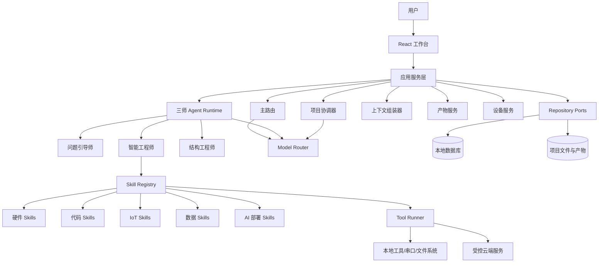
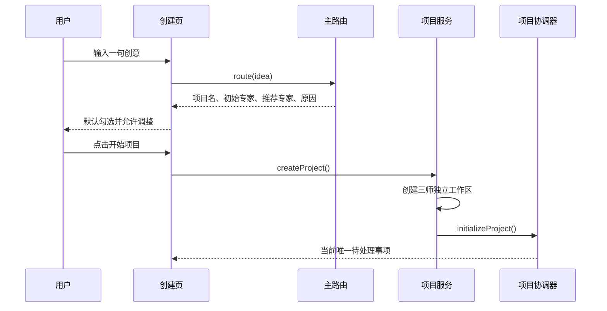

# 掌问 · 三师系统框架 V1.0

## 1. 结论

掌问采用“五个系统角色、三个用户可见专家”的架构：

### 用户可见
- 问题引导师 `problem_guide`
- 智能工程师 `smart_engineer`
- 结构工程师 `structure_engineer`

### 用户不可见
- 主路由 `entry_router`
- 项目协调器 `project_coordinator`

智能工程师通过 Skill Registry 扩展硬件、嵌入式、IoT、数据与 AI 部署能力，不使用子 Agent。

本次改造保留既有基础设施：
- Tauri 2 + Rust + React + TypeScript + Vite
- Local-first 混合架构
- Agent Registry
- Skill Registry
- Model Router
- Tool Runner
- 项目上下文、产物、任务和设备能力
- 中央主对话 + 右侧工作/产物/设备
- ESP32 + MicroPython 作为 MVP 技术基线

本次不重新发明底层框架，只重构专家域、路由、协调、共享上下文与迁移兼容。

---

## 2. 总体架构



### 核心原则

1. Agent 负责专业对话和专业产物。
2. Skill 负责边界明确、可验证、可复用的执行能力。
3. 项目协调器负责状态和依赖，不替专家生成专业内容。
4. 主路由只决定当前输入交给谁，不管理长期项目状态。
5. 确定性状态由数据库和规则引擎维护，不能仅依赖 LLM 记忆。
6. LLM 输出必须经过 JSON Schema 验证、重试和降级处理。
7. 用户确认过的事实才进入项目共享事实库。
8. 三位专家保持独立对话，不建立专家群聊。
9. 右侧“工作”只突出一个当前待处理事项。
10. 上游事实或产物变更后，通过依赖图标记下游产物过期。

---

## 3. 分层设计

### 3.1 表现层

负责：
- 项目创建
- 专家推荐与调整
- 三师独立对话
- 结构化问题卡、方案卡和确认卡
- 项目总览
- 工作/产物/设备侧栏
- 当前唯一待处理事项

表现层不得：
- 硬编码专家路由结果
- 自行修改项目事实
- 直接判断产物是否过期
- 直接执行设备工具

### 3.2 应用服务层

建议服务：
- `ProjectApplicationService`
- `ConversationApplicationService`
- `RouterApplicationService`
- `ExpertApplicationService`
- `CoordinatorApplicationService`
- `ArtifactApplicationService`
- `DeviceApplicationService`
- `SkillApplicationService`

应用服务负责事务边界和用例编排，不保存领域状态。

### 3.3 领域层

核心聚合：
- Project
- ExpertWorkspace
- ConversationThread
- SharedFact
- ProjectDecision
- Task
- PendingItem
- Artifact
- ArtifactDependency
- Handoff
- Device
- SkillRun
- ToolRun

### 3.4 Agent Runtime

统一执行链：

```text
用户消息
→ 获取当前专家
→ 组装最小必要上下文
→ 加载专家提示词
→ 检索公共知识库
→ 调用模型
→ 校验结构化响应
→ 生成聊天消息/草稿/Skill调用/交接请求
→ 保存运行记录
→ 触发项目协调器
```

### 3.5 Skill Runtime

Skill 不是 Agent，不拥有独立人格、长期对话和私有记忆。

每个 Skill 必须声明：
- `id`
- `ownerExpert`
- `name`
- `description`
- `inputSchema`
- `outputSchema`
- `requiredTools`
- `riskLevel`
- `confirmationPolicy`
- `timeoutPolicy`
- `retryPolicy`
- `artifactTypes`

### 3.6 项目协调器

建议采用“规则优先、模型辅助”。

确定性职责：
- 任务状态变更
- 依赖检查
- 产物过期传播
- 唯一待处理事项选择
- 专家状态计算
- 交接状态管理
- 冲突登记

模型辅助职责：
- 从专家输出中提取候选事实
- 对冲突生成用户可理解的说明
- 建议任务优先级
- 生成交接摘要

LLM 不能直接覆盖已确认事实，也不能绕过用户确认。

---

## 4. 三师边界

### 问题引导师

负责：
- 创意引导
- 问题定义
- 需求澄清
- 项目立项
- 实验方案
- PBL 与课程设计
- 教案、任务单、评价量规

主要产物：
- `project_brief`
- `project_proposal`
- `experiment_plan`
- `teaching_design`
- `lesson_plan`
- `learning_task`
- `assessment_rubric`

### 智能工程师

负责：
- 硬件选型
- BOM、IO Map、接线
- 电气兼容
- Arduino/MicroPython/STM32 等代码
- 代码审查与 Mock 测试
- IoT
- 数据采集与分析
- AI 模型部署和视觉推理
- 项目打包

主要产物：
- `hardware_plan`
- `bom`
- `io_map`
- `wiring_table`
- `electrical_check`
- `source_code`
- `iot_contract`
- `data_analysis`
- `ai_deployment`
- `mock_test_report`
- `project_package`

### 结构工程师

负责：
- 外观
- 内部结构
- 安装与装配
- 公差与可打印性
- STL/STEP/3MF
- 打印参数

主要产物：
- `appearance_concept`
- `structure_spec`
- `dimension_sheet`
- `assembly_plan`
- `stl_model`
- `step_model`
- `three_mf_model`
- `print_profile`
- `printability_report`

---

## 5. 项目创建流程



要求：
- 用户可调整专家。
- 未加入的专家工作区可延迟创建。
- 项目创建后自动进入初始专家对话。
- 用户明确指定专家时优先尊重。
- 多领域但不清晰时进入问题引导师。
- 明确技术任务时进入智能工程师。
- 明确实物结构任务时进入结构工程师。

---

## 6. 项目共享上下文

共享上下文分为五层：

1. `confirmedFacts`：已确认事实
2. `decisions`：项目决策
3. `artifactReferences`：正式产物引用
4. `openQuestions`：未决问题
5. `currentPendingItem`：唯一突出事项

不得将整个聊天记录直接作为共享上下文。

上下文组装器应根据当前专家和任务，只注入：
- 项目摘要
- 当前任务
- 必要的已确认事实
- 必要的上游产物
- 当前设备信息
- 未解决的相关冲突

---

## 7. 产物与版本

产物状态：
- `draft`
- `pending_confirmation`
- `confirmed`
- `outdated`
- `archived`

规则：
- 草稿可由所属专家更新。
- 正式产物必须版本化。
- 专家不能直接改写其他专家产物。
- 下游通过引用使用上游产物。
- 上游新版本确认后，依赖旧版本的下游产物标记为 `outdated`。
- 旧版本保留，不覆盖、不删除。

---

## 8. 当前唯一待处理事项

协调器从候选事项中选择一项：

优先级：
1. 安全风险
2. 阻塞多个专家
3. 跨域冲突
4. 必须由用户确认
5. 缺少关键输入
6. 普通任务

同优先级排序：
- 影响专家数更多者优先
- 创建时间更早者优先
- 位于关键路径者优先

右侧只突出该事项，其余进入队列。

---

## 9. UI 框架

### 左侧
- 项目总览
- 已参与专家
- 项目资源

专家状态：
- 未开始
- 等待依赖
- 进行中
- 待用户确认
- 已完成
- 产物已过期

### 中央
- 项目总览，或
- 当前专家独立对话

要求：
- 中央区域常驻。
- 需求澄清、方案生成、方案修改、确认和立项书均由对话驱动。
- 问题使用聊天消息内的选项卡。
- 方案使用结构化方案卡。
- 方案修改基于当前版本增量更新，保留未修改内容。

### 右侧
- 工作
- 产物
- 设备

要求：
- 工作页只突出一个当前事项。
- 产物页是辅助浏览，不替代中央对话。
- 设备页展示连接、串口、固件、在线状态和日志。

---

## 10. 旧四专家迁移

| 旧角色 | 新角色 |
|---|---|
| 创想家 | 问题引导师 |
| 教育家 | 问题引导师 |
| 开源硬件设计师 | 智能工程师 |
| 3D结构设计师 | 结构工程师 |

迁移原则：
- 使用稳定的新专家 ID。
- 保留 `legacyExpertType`。
- 创想家和教育家的历史对话不直接混成一个线程。
- 两类旧线程迁移为问题引导师工作区内的独立归档线程。
- 旧产物保留原创建角色元数据，同时映射新所有者。
- 旧项目可正常打开。
- 数据迁移需幂等、可回滚、可审计。

---

## 11. MVP 边界

当前必须：
- 三师 Agent
- 主路由
- 项目协调器
- 共享上下文
- 产物版本与依赖
- 当前唯一事项
- 硬件选型、BOM、IO、接线
- MicroPython 生成、审查、Mock 测试、打包
- 基础 MQTT/HTTP
- 预训练模型部署方案
- 结构需求、参数化结构方案、STL 输出和打印建议

当前不承诺：
- 完整在线 GPU 模型训练平台
- 全自动复杂 CAD
- 无人工确认的电气执行
- 无人工确认的设备烧录
- 完整制造交付闭环

---

## 12. Codex 实施顺序

1. 扫描现有仓库并形成影响清单。
2. 固化专家 ID 和旧角色映射。
3. 重构领域模型和数据库迁移。
4. 重构 Agent Registry 和 Skill Registry。
5. 实现主路由结构化输出。
6. 实现项目协调器的确定性状态机。
7. 实现上下文组装器。
8. 实现产物依赖和过期传播。
9. 改造项目创建流程。
10. 改造三师独立对话。
11. 改造右侧唯一待处理事项。
12. 补充迁移、领域、流程和 UI 测试。

每一步都应保证可运行、可回滚，避免一次性推翻现有项目。
