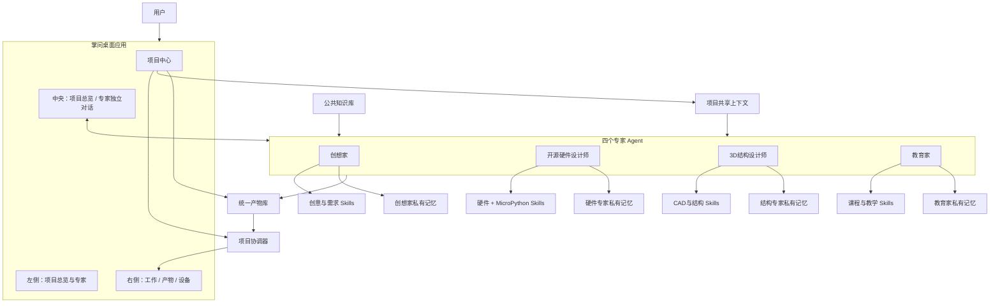

# 掌问四专家业务模型 PRD 与架构改造任务

版本：v1.0
任务编号：ZW-UX-002
执行工具：Codex
最终验收：用户手工验收
适用范围：当前掌问本地桌面应用

---

# 1. 改造目标

将现有“单一主对话 + 通用方案流程”调整为：

```text
一个项目中心
+ 四个用户可见专家 Agent
+ 四套独立 Skill
+ 四个独立对话窗口
+ 四份独立私有工作记忆
+ 一套公共知识库
+ 一份项目共享上下文
+ 一个统一产物库
+ 一个用户不可见的项目协调器
```

四个专家分别为：

1. 创想家；
2. 开源硬件设计师；
3. 3D 结构设计师；
4. 教育家。

用户创建项目时，只需输入一句创意。系统自动生成项目名称并推荐专家，用户可选“调整专家”，然后点击一次“开始项目”。

项目创建后：

- 每个已选专家拥有独立对话；
- 每个专家拥有独立 Skill；
- 每个专家拥有独立草稿、任务状态和私有记忆；
- 每个专家生成独立产物；
- 所有专家共用公共知识库和项目共享上下文；
- 所有正式产物进入统一项目产物库；
- 项目协调器负责共享事实、版本、依赖、冲突与当前唯一待处理事项。

---

# 2. 不可违反的产品原则

## 2.1 中央区域

- 中央区域始终是项目总览或当前专家对话；
- 不允许方案、代码、CAD、教案或设备页面替换中央工作区；
- 切换专家时保留各自草稿、滚动位置、消息和流式状态；
- 切换项目时保留各项目独立状态；
- 不通过刷新整个应用解决状态问题；
- 不通过卸载整个 MainConversation / Center Shell 解决切换问题。

## 2.2 用户心智模型

普通用户只需要理解：

- 当前项目；
- 参与专家；
- 当前需要做什么；
- 每个专家正在做什么；
- 已经生成了哪些成果。

普通模式不显示：

- Agent Registry；
- Skill Registry；
- Provider；
- Tool Runner；
- Artifact ID；
- 内部状态机枚举；
- 模型路由细节。

## 2.3 专家协作

- 专家不能成为四个信息孤岛；
- 不直接把某专家完整聊天记录注入其他专家；
- 专家之间通过项目共享上下文和结构化协作请求交换信息；
- 正式产物必须有所属专家、版本、依赖和状态；
- 一个产物依赖的上游版本变化时，下游产物必须标记为待检查或过期。

---

# 3. 四个专家定义

## 3.1 创想家

### 角色定位

将模糊创意转化为明确的产品目标、使用场景、功能结构和用户体验。

### 独立 Skill

- 创意理解；
- 需求澄清；
- 用户场景分析；
- 功能优先级；
- 用户旅程；
- 产品概念方案；
- 方案表达优化。

### 主要产物

- 创意说明；
- 项目目标；
- 用户需求；
- 使用场景；
- 功能清单；
- 功能优先级；
- 用户旅程；
- 产品概念方案。

### 边界

不得独立裁决：

- 电气兼容；
- GPIO；
- 供电安全；
- 结构尺寸；
- 正式课程设计。

---

## 3.2 开源硬件设计师

### 角色定位

负责从硬件选型、电气规则、接线到 MicroPython 软件实现，形成可运行的开源硬件方案。

### 主要职责

- 主控选型；
- 传感器、执行器和扩展模块选型；
- 电压、电流和 IO 电平检查；
- GPIO 与通信资源分配；
- 供电设计；
- 接线设计；
- BOM 和成本；
- MicroPython 驱动兼容性；
- **MicroPython 代码编写与维护**；
- MicroPython 项目文件生成；
- 配置文件生成；
- Mock 测试与代码审查；
- 上传前检查；
- 部署说明。

### 独立 Skill

- Hardware Search Skill；
- Compatibility Rule Skill；
- Power Budget Skill；
- GPIO / Bus Allocation Skill；
- BOM Skill；
- Wiring Skill；
- MicroPython Driver Skill；
- **MicroPython Code Generation Skill**；
- **MicroPython Code Review Skill**；
- **MicroPython Test Skill**；
- MicroPython Project Packaging Skill；
- Deployment Preparation Skill。

### 主要产物

- 开源硬件方案；
- BOM；
- IO Map；
- 接线说明；
- 供电方案；
- 兼容性报告；
- MicroPython 驱动清单；
- `boot.py`；
- `main.py`；
- `config.py`；
- 驱动文件；
- MicroPython 项目包；
- 代码测试报告；
- 部署与上传说明。

### MicroPython 强制规则

- 正式代码必须引用已确认的硬件方案与 IO Map；
- 硬件方案或 IO Map 变化后，代码产物自动标记为待检查或过期；
- 测试失败不得标记代码完成；
- 自动测试必须使用 Mock，不依赖真实设备；
- 真实上传、REPL 和固件烧录由设备层负责；
- 不允许开源硬件设计师直接执行不受控 Shell；
- 不允许自动擦除真实 Flash。

---

## 3.3 3D 结构设计师

### 角色定位

将已确认硬件和产品约束转化为可制造、可装配的结构方案。

### 独立 Skill

- 硬件尺寸读取；
- 参数化建模；
- 外壳设计；
- 支架设计；
- 装配约束；
- 开孔设计；
- 公差检查；
- STL/STEP 导出；
- 打印方向和材料建议。

### 主要产物

- 结构概念；
- 尺寸参数；
- 装配图；
- CAD 源文件；
- STL；
- STEP；
- 打印建议；
- 结构零件清单。

### 边界

- 必须读取硬件尺寸和接口位置；
- 不得自行改变主控、传感器和供电方案；
- 硬件尺寸变化后结构产物必须标记过期；
- CAD 执行必须在受控环境中完成。

---

## 3.4 教育家

### 角色定位

将当前项目转化为适合教师和学生使用的课程、任务和评价材料。

### 独立 Skill

- 学习目标；
- 课时规划；
- 教师指导；
- 学生任务；
- 安全说明；
- 评价量表；
- 拓展任务；
- 项目式学习；
- 课程标准映射。

### 主要产物

- 教师教案；
- 学生任务单；
- 课程流程；
- 实验指导；
- 安全说明；
- 评价量表；
- 拓展活动。

### 边界

- 教案引用当前已确认方案、硬件和结构版本；
- 教案变更不反向修改工程核心数据；
- 项目核心方案变化后，教案标记待检查。

---

# 4. 简化后的项目创建流程

## 4.1 用户可见流程

正常情况下只需两次操作：

```text
输入一句创意
→ 点击“开始项目”
```

完整逻辑：

```text
输入一句创意
→ 自动生成建议项目名
→ 自动推荐并默认勾选专家
→ 用户可选“调整专家”
→ 点击“开始项目”
→ 创建项目共享上下文和专家工作区
→ 进入项目总览
```

## 4.2 创建界面

```text
┌──────────────────────────────────────────┐
│ 创建新项目                               │
│                                          │
│ 你想做什么？                             │
│ ┌──────────────────────────────────────┐ │
│ │ 做一个能检测土壤湿度并自动浇水的花盆 │ │
│ └──────────────────────────────────────┘ │
│                                          │
│ 项目名称：智能自动浇花器                 │
│                                          │
│ 推荐参与专家                             │
│ ✓ 创想家                                 │
│ ✓ 开源硬件设计师                         │
│ ✓ 3D结构设计师                           │
│ ○ 教育家                                 │
│                                          │
│ [调整专家]                    [开始项目]  │
└──────────────────────────────────────────┘
```

## 4.3 专家推荐规则

| 项目类型 | 默认专家 |
|---|---|
| 纯创意或产品概念 | 创想家 |
| 电子装置 | 创想家 + 开源硬件设计师 |
| 有外壳的电子装置 | 创想家 + 开源硬件设计师 + 3D结构设计师 |
| 教学电子项目 | 创想家 + 开源硬件设计师 + 教育家 |
| 完整创客课程 | 四个专家 |
| 纯结构件 | 3D结构设计师 |
| 教案整理 | 教育家 |

推荐失败时使用安全默认：

```text
创想家 + 开源硬件设计师
```

## 4.4 创建事务

点击“开始项目”后一次性创建：

- Project；
- ProjectSharedContext；
- ProjectCoordinatorState；
- 已选 ProjectExpert；
- 每个专家独立 Conversation；
- 每个专家独立 Draft；
- 每个专家独立 PrivateMemory；
- 统一 Artifact Workspace；
- 初始项目事实；
- 初始专家任务；
- 项目总览。

关键步骤失败时整体回滚，不允许出现半创建项目。

---

# 5. 知识、上下文与记忆分层

## 5.1 公共知识库

所有专家只读访问：

- 开源硬件资料；
- 器件手册；
- 电气规范；
- MicroPython 文档和驱动知识；
- 结构设计规范；
- 教学案例；
- 课程标准；
- 平台文档；
- 历史优秀模板。

## 5.2 项目共享上下文

所有参与专家读取结构化事实：

- 项目目标；
- 用户群体；
- 使用场景；
- 核心功能；
- 预算；
- 难度；
- 时间；
- 供电；
- 尺寸；
- 安全约束；
- 已确认硬件；
- 当前 IO Map；
- 当前方案版本；
- 当前产物版本；
- 用户确认决策。

## 5.3 专家私有记忆

每个专家独立保存：

- 候选方案；
- 草稿；
- 临时计算；
- 未采用思路；
- 专业推理摘要；
- 待办任务。

其他专家不能读取原始私有记忆。

## 5.4 正式产物库

正式产物统一保存：

- 所属专家；
- 产物类型；
- 版本；
- 状态；
- 上游依赖；
- 共享上下文版本；
- 创建时间；
- 确认时间；
- 过期原因。

---

# 6. 项目协调器

项目协调器属于系统服务，不作为第五个可见专家。

## 6.1 职责

- 维护项目共享事实；
- 接收专家提交的结构化变更；
- 计算当前唯一待处理事项；
- 检查专家结论冲突；
- 管理产物依赖；
- 标记下游产物过期；
- 创建跨专家协作任务；
- 汇总项目进度；
- 驱动右侧工作栏。

## 6.2 共享事实变更

```ts
interface SharedContextChange {
  id: string;
  projectId: string;
  sourceExpertId: string;
  changeType: "proposed" | "confirmed" | "system";
  field: string;
  previousValue?: unknown;
  nextValue: unknown;
  reason: string;
  createdAt: string;
}
```

关键事实必须由用户确认后生效。

## 6.3 冲突类型

- 硬冲突：电压、电流、GPIO、尺寸、装配冲突；
- 软冲突：成本、难度、时间、课程长度；
- 语义冲突：桌面设备与便携设备等定位不一致；
- 版本冲突：下游产物引用旧版本。

硬冲突阻止确认，软冲突允许用户决定。

---

# 7. 系统框架图



---

# 8. 左侧项目结构改造

## 8.1 未选择项目

```text
+ 新建项目

最近项目
模板
硬件库
```

## 8.2 已进入项目

```text
项目名称

项目总览

参与专家
├─ 创想家
├─ 开源硬件设计师
├─ 3D结构设计师
└─ 教育家

项目资源
├─ 共享知识
├─ 硬件库
└─ 项目文件
```

规则：

- 只显示已参与专家；
- 当前专家高亮；
- 专家旁显示状态、未读和阻塞；
- 点击专家切换中央工作区；
- 不把专家当作独立项目；
- 项目创建入口只保留在左侧或中央空状态，不出现重复表单。

---

# 9. 中央区域改造

中央区域支持两种模式：

## 9.1 项目总览

显示：

- 项目目标；
- 参与专家；
- 当前唯一待处理事项；
- 专家进度；
- 冲突与依赖；
- 最新产物；
- 下一步建议。

## 9.2 专家独立对话

每个专家独立拥有：

- 消息历史；
- 草稿；
- activeQuestion；
- currentTask；
- 流式响应；
- 滚动位置；
- 产物卡；
- 专家私有记忆引用。

缓存键和流式请求至少包含：

```text
projectId + projectExpertId + conversationId
```

切换专家时：

- 不卸载项目 Shell；
- 不混用消息；
- 不混用草稿；
- 不混用 activeQuestion；
- 不混用流式请求；
- 不混用产物卡。

消息头显示专家名称，不使用模型名称替代专家身份。

---

# 10. 右侧工作栏改造

工作栏定位为“当前项目行动中心”，不再是全部待办堆叠区。

结构：

```text
当前项目
当前唯一待处理事项
专家状态
冲突与依赖
最新产物
简化项目进度
```

## 10.1 当前唯一事项

同一时刻只突出一个，例如：

- 回答创想家的使用场景问题；
- 确认硬件方案 v2；
- 检查 MicroPython 代码更新；
- 处理外壳尺寸冲突；
- 确认是否更新教案。

## 10.2 专家状态

示例：

```text
创想家             已完成
开源硬件设计师     编写 MicroPython 代码
3D结构设计师       等待硬件尺寸
教育家             尚未开始
```

点击专家状态后切换中央到对应专家对话。

## 10.3 最新产物

最多显示 3 个。

点击直接打开浮窗，不强制切换“产物”Tab。

---

# 11. 右侧产物栏与设备栏

## 11.1 产物栏

筛选：

- 全部；
- 创想家；
- 硬件；
- MicroPython 代码；
- 3D 结构；
- 教育。

产物卡显示：

- 名称；
- 所属专家；
- 版本；
- 状态；
- 依赖；
- 更新时间；
- 查看；
- 导出。

## 11.2 设备栏

设备栏继续负责：

- 串口扫描；
- 设备识别；
- MicroPython 文件上传；
- REPL；
- 固件烧录准备；
- 日志。

MicroPython 代码由开源硬件设计师生成，设备栏只负责部署，不重复生成代码。

---

# 12. MicroPython 工作流

```text
硬件方案确认
→ IO Map 确认
→ 驱动可用性检查
→ 生成 MicroPython 项目
→ Mock 测试
→ 代码审查
→ 创建代码 Artifact
→ 设备栏准备上传
```

建议项目结构：

```text
micropython/
├─ boot.py
├─ main.py
├─ config.py
├─ drivers/
├─ modules/
├─ tests/
├─ device_manifest.json
└─ README.md
```

MicroPython 代码产物必须记录：

- hardwareSolutionVersion；
- bomVersion；
- ioMapVersion；
- driverVersions；
- generatedByExpertId。

任何依赖版本变化后：

- 代码标记 `outdated`；
- 工作栏提示重新检查；
- 不允许静默继续使用旧代码。

---

# 13. 数据模型

```ts
type ExpertType =
  | "ideator"
  | "open_hardware_designer"
  | "structure_designer"
  | "educator";
```

```ts
interface Project {
  id: string;
  name: string;
  idea: string;
  status: ProjectStatus;
  activeExpertIds: string[];
  sharedContextId: string;
  coordinatorStateId: string;
  createdAt: string;
  updatedAt: string;
}
```

```ts
interface ExpertDefinition {
  id: string;
  type: ExpertType;
  name: string;
  description: string;
  icon: string;
  builtIn: boolean;
  skillIds: string[];
  supportedArtifactTypes: string[];
}
```

```ts
interface ProjectExpert {
  id: string;
  projectId: string;
  expertDefinitionId: string;
  expertType: ExpertType;
  conversationId: string;
  privateMemoryId: string;
  status:
    | "idle"
    | "waiting_user"
    | "working"
    | "blocked"
    | "completed";
  currentTask?: string;
  addedAt: string;
  removedAt?: string;
}
```

```ts
interface ProjectSharedContext {
  id: string;
  projectId: string;
  revision: number;
  goals: SharedFact[];
  constraints: SharedFact[];
  requirements: SharedFact[];
  decisions: SharedDecision[];
  activeArtifactVersions: ActiveArtifactVersion[];
  updatedAt: string;
}
```

```ts
interface ExpertConversation {
  id: string;
  projectId: string;
  projectExpertId: string;
  messages: ChatMessage[];
  draft: string;
  activeQuestionId?: string;
  activeTurnId?: string;
}
```

```ts
interface Artifact {
  id: string;
  projectId: string;
  ownerExpertId: string;
  sourceConversationId?: string;
  sharedContextRevision: number;
  type:
    | "concept"
    | "requirements"
    | "hardware_solution"
    | "bom"
    | "io_map"
    | "wiring"
    | "micropython_project"
    | "micropython_test_report"
    | "cad_model"
    | "assembly"
    | "lesson_plan"
    | "student_worksheet"
    | "assessment";
  currentVersion: number;
  status:
    | "draft"
    | "waiting_confirmation"
    | "confirmed"
    | "outdated"
    | "blocked";
}
```

```ts
interface ArtifactDependency {
  sourceArtifactId: string;
  sourceVersion: number;
  targetArtifactId: string;
  dependencyType: "hard" | "soft" | "reference";
}
```

---

# 14. API 建议

```text
POST /api/projects/suggest
POST /api/projects
GET  /api/projects/{projectId}/experts
POST /api/projects/{projectId}/experts
DELETE /api/projects/{projectId}/experts/{projectExpertId}
GET  /api/projects/{projectId}/overview
GET  /api/projects/{projectId}/shared-context
POST /api/projects/{projectId}/shared-context/changes
GET  /api/projects/{projectId}/experts/{projectExpertId}/conversation
POST /api/projects/{projectId}/experts/{projectExpertId}/conversation/turns
GET  /api/projects/{projectId}/artifacts
GET  /api/projects/{projectId}/coordinator
```

应复用现有架构，不建立重复 API。

---

# 15. 旧数据迁移

## 15.1 旧项目

- 保留原项目 ID；
- 创建默认 ProjectSharedContext；
- 将现有主对话关联到“创想家”专家；
- 根据已有产物类型创建其他专家实例；
- 无法识别的历史消息保留为 legacy；
- 不删除旧消息；
- 不覆盖旧项目。

## 15.2 旧产物

- 方案 → 创想家或项目级概念产物；
- BOM / IO → 开源硬件设计师；
- 代码 → 开源硬件设计师；
- CAD → 3D结构设计师；
- 教案 → 教育家；
- 无法识别 → legacy artifact。

## 15.3 迁移要求

- 非破坏性迁移；
- 迁移前记录 schema 版本；
- 失败时整体回滚；
- 不允许部分迁移完成。

---

# 16. 实施批次

## 批次一：PRD、Contracts 与数据库

- ExpertDefinition；
- ProjectExpert；
- SharedContext；
- PrivateMemory；
- Artifact owner；
- 依赖；
- 迁移。

## 批次二：简化项目创建

- 一句创意；
- 自动项目名；
- 专家推荐；
- 调整专家；
- 原子创建；
- 本地安全回退。

## 批次三：左侧与中央工作区

- 项目总览；
- 专家列表；
- 专家独立对话；
- 草稿隔离；
- 流式隔离；
- 专家身份显示。

## 批次四：项目协调器与右侧工作栏

- 当前唯一行动项；
- 专家状态；
- 冲突；
- 依赖；
- 最新产物；
- 简化进度。

## 批次五：开源硬件设计师 MicroPython 能力

- Skills；
- 项目结构；
- 代码生成；
- 代码审查；
- Mock 测试；
- 代码 Artifact；
- 设备栏交接。

## 批次六：迁移与回归

- 历史项目；
- 历史消息；
- 历史产物；
- 全流程测试；
- 手工验收准备。

---

# 17. 自动测试要求

## 17.1 项目创建

- 一句创意；
- 自动名称；
- 推荐专家；
- 调整专家；
- 创建事务；
- 创建失败整体回滚；
- LLM 不可用时本地回退。

## 17.2 专家隔离

- 各专家独立 conversation；
- 各专家独立 draft；
- 流式响应不串写；
- 项目切换不串写；
- 私有记忆不共享；
- 共享上下文可读取。

## 17.3 项目协调

- 已确认事实同步；
- 共享上下文版本递增；
- 硬冲突可阻塞；
- 软冲突可警告；
- 上游变化标记下游过期；
- 工作栏只突出一个事项。

## 17.4 MicroPython

- 代码由开源硬件设计师生成；
- 依赖硬件方案和 IO Map；
- 代码项目结构完整；
- Mock 测试；
- 测试失败不能完成；
- 硬件变化使代码过期；
- 设备栏可读取代码包。

## 17.5 UI

- 左侧专家导航；
- 中央总览与专家独立对话；
- 右侧唯一行动项；
- 浮窗不替换中央；
- 切换专家不丢草稿；
- 点击最新产物不强制切换 Tab。

## 17.6 验证命令

运行：

- Contracts typecheck；
- 前端 typecheck；
- 前端测试；
- Sidecar 测试；
- 数据库迁移测试；
- Tauri cargo check；
- Desktop build；
- 阶段级回归。

自动测试不得调用真实付费 LLM。

---

# 18. 用户手工验收清单

## 18.1 项目创建

- [ ] 输入一句创意；
- [ ] 自动生成项目名；
- [ ] 自动推荐专家；
- [ ] 推荐专家默认勾选；
- [ ] 可以调整专家；
- [ ] 点击一次开始项目；
- [ ] 创建后进入项目总览；
- [ ] 不出现复杂创建表单。

## 18.2 专家工作区

- [ ] 左侧显示已选择专家；
- [ ] 每个专家有独立对话；
- [ ] 每个专家有独立草稿；
- [ ] 切换专家不丢消息；
- [ ] 专家身份显示正确；
- [ ] 模型名称不替代专家名称；
- [ ] 消息和流式内容不串写。

## 18.3 开源硬件设计师

- [ ] 能生成硬件方案；
- [ ] 能生成 BOM；
- [ ] 能生成 IO Map；
- [ ] 能生成 MicroPython 项目；
- [ ] 能看到 `main.py` 等代码产物；
- [ ] 代码与当前硬件版本关联；
- [ ] 修改 IO Map 后代码标记过期；
- [ ] 设备栏能读取该代码包。

## 18.4 项目协调

- [ ] 创想家确认的需求可被硬件专家读取；
- [ ] 硬件尺寸可被结构专家读取；
- [ ] 私有草稿不会在其他专家窗口出现；
- [ ] 冲突提示清晰；
- [ ] 右侧只突出一个当前事项；
- [ ] 专家状态准确。

## 18.5 布局

- [ ] 左侧为项目总览和专家；
- [ ] 中央为总览或专家对话；
- [ ] 右侧仍为工作 / 产物 / 设备；
- [ ] 浮窗不替换中央；
- [ ] 切换右侧 Tab 不丢草稿。

---

# 19. 非范围

本任务不要求：

- 四个 Agent 自动并行执行全部任务；
- 专家之间直接自然语言聊天；
- 第三方 Agent 市场；
- 实时电商采购；
- 自动真实烧录；
- 自动真实设备连接；
- Windows 正式发布；
- ZW-017；
- 删除旧业务数据；
- 重做全部视觉品牌。

---

# 20. Codex 执行指令

```text
请读取并执行：

tasks/ZW-UX-002-four-expert-project-workspace.md

并将本文作为新的产品与架构基线。

重点要求：

1. 项目创建简化为“一句创意 + 自动项目名 + 推荐专家 + 可选调整 + 开始项目”；
2. 四个专家为创想家、开源硬件设计师、3D结构设计师、教育家；
3. 每个专家拥有独立 Agent、Skill、对话、草稿、私有记忆和产物；
4. 所有专家共用公共知识库和项目共享上下文；
5. 增加不可见项目协调器，负责共享事实、依赖、冲突和当前唯一行动项；
6. 开源硬件设计师负责 MicroPython 代码生成、审查、Mock 测试和代码 Artifact；
7. MicroPython 代码必须依赖已确认硬件方案和 IO Map；
8. 硬件或 IO Map 变化后，代码自动标记为过期；
9. 左侧改为项目总览 + 已参与专家 + 项目资源；
10. 中央改为项目总览或当前专家独立对话；
11. 右侧工作栏改为当前唯一事项 + 专家状态 + 冲突 + 最新产物；
12. 右侧一级 Tab 仍保持工作 / 产物 / 设备；
13. 旧项目、旧消息和旧产物必须非破坏性迁移；
14. 中央 Shell 保持常驻；
15. 不进入 ZW-017。

开始前先输出：

- 新旧业务模型差异；
- 可复用模块；
- 数据模型；
- 数据迁移策略；
- UI改造范围；
- 实施批次；
- 测试计划；
- 风险。

如无不可逆数据风险，直接按批次实施。

每完成一个批次：

- 更新任务文件；
- 更新 HANDOFF.md；
- 运行相关最小测试；
- 记录真实结果。

完成全部批次和阶段级回归后停止，不自动提交 Git，等待我手工验收。
```

---

# 21. Codex 完成后必须输出

1. 新旧业务模型差异；
2. 实际数据模型；
3. 数据迁移结果；
4. 项目创建新流程；
5. 左侧栏变化；
6. 中央区域变化；
7. 右侧工作栏变化；
8. 四专家 Skill 绑定；
9. MicroPython 代码工作流；
10. 产物依赖与过期规则；
11. 自动测试结果；
12. 未验证事项；
13. 用户手工验收步骤；
14. git status；
15. git diff 摘要。

完成后停止，不自动提交 Git，不进入 ZW-017。

---

## Codex 执行进度（2026-07-09）

### Batch 1：Contracts、schema v17、专家/共享上下文/协调器持久化

状态：已完成最小验证。

完成内容：

- 共享 contracts 新增四专家、项目专家状态、协调器严重级别、专家会话、共享上下文、协调器状态等类型。
- 项目持久化版本升级到 v17。
- SQLite 新增 `expert_definitions`、`project_experts`、`expert_private_memories`、`expert_drafts`、`project_shared_contexts`、`shared_context_changes`、`project_coordinator_states`。
- `conversations` 移除 `project_id UNIQUE` 限制，以支持每个项目多个专家独立会话。
- 旧项目非破坏性迁移：保留旧项目、旧会话、旧消息和旧产物；原主会话映射为创想家；按旧 Artifact source agent 补建硬件、结构、教育专家。
- ProjectRepository 支持项目建议、专家原子创建、专家草稿隔离、专家会话读取和 active expert 持久化。
- Artifact 增加所属专家、来源会话和共享上下文版本字段。
- CodeRun 增加 `STALE` 状态和硬件方案/BOM/IO Map/生成专家依赖字段。
- 前端初步接入一句创意创建、专家导航、中央项目总览/专家对话、右侧专家状态和产物专家归属。

修改文件：

- `packages/contracts/src/enums.ts`
- `packages/contracts/src/api.ts`
- `packages/contracts/src/index.ts`
- `services/local-api/zhangwen/projects/migrations.py`
- `services/local-api/zhangwen/projects/models.py`
- `services/local-api/zhangwen/projects/repository.py`
- `services/local-api/zhangwen/projects/router.py`
- `services/local-api/zhangwen/chat/router.py`
- `services/local-api/zhangwen/artifacts/models.py`
- `services/local-api/zhangwen/artifacts/repository.py`
- `services/local-api/zhangwen/code_agent/models.py`
- `services/local-api/zhangwen/code_agent/repository.py`
- `services/local-api/zhangwen/specs/repository.py`
- `apps/desktop/src/services/projectsApi.ts`
- `apps/desktop/src/hooks/useProjects.ts`
- `apps/desktop/src/components/layout/AppShell.tsx`
- `apps/desktop/src/components/layout/LeftSidebar.tsx`
- `apps/desktop/src/components/layout/CenterChat.tsx`
- `apps/desktop/src/components/right-panel/WorkTab.tsx`
- `apps/desktop/src/components/right-panel/ArtifactsTab.tsx`
- `apps/desktop/src/App.css`
- `services/local-api/tests/test_project_repository.py`
- `CURRENT_TASK.md`

测试结果：

- `pnpm --filter @zhangwen/contracts typecheck`：通过。
- `.venv\Scripts\python.exe -m pytest services/local-api/tests/test_project_repository.py -q --rootdir services/local-api`：9 passed；存在已知 Windows pytest 临时目录 cleanup `PermissionError`，测试本身通过。

安全和架构风险：

- 未调用真实 LLM、真实串口、mpremote、esptool、Flash 擦除或固件烧录。
- v17 迁移会重建 `conversations` 表以移除旧唯一约束；迁移保留原数据并由 SQLite 事务失败回滚。
- 当前仍需后续批次完成前端类型校验、专家聊天回归、协调器 UI 回归和 MicroPython 依赖过期测试。

### Batch 2-6：四专家 UI、后端兼容与阶段级回归

状态：自动化验证已完成；等待用户手工验收。

完成内容：

- `CenterChat` 专家草稿缓存键改为 `projectId + projectExpertId + conversationId`，避免不同专家/会话草稿串写。
- 新建项目成功后中央区域明确进入项目总览，避免沿用上一个项目的专家对话模式。
- 旧客户端不传 `projectExpertId` 保存草稿时，Sidecar 自动写入当前 active expert 草稿，兼容 v17 专家草稿模型。
- `migrate()` 在完成 v17 迁移后显式提交，保证独立连接读取到 `PRAGMA user_version=17`。
- MVP readiness 项目基线升级到 schema v17。
- 桌面测试已升级为 UX-002 交互：默认项目总览，选择“创想家”后进入专家独立对话，右侧 Tab/浮窗不丢草稿。
- 后端历史迁移测试统一跟随 schema v17，并保留各阶段表存在断言。

验证结果：

- `pnpm --filter @zhangwen/contracts build`：通过。
- `pnpm --filter @zhangwen/contracts typecheck`：通过。
- `pnpm --filter @zhangwen/desktop typecheck`：通过。
- `pnpm --filter @zhangwen/desktop test -- ProjectWorkspace RightPanel ProjectIsolation`：中断后续跑通过，7 files / 53 tests；存在既有 React `act(...)` 测试警告，不影响结果。
- `pnpm --filter @zhangwen/desktop test -- ProjectWorkspace ProjectIsolation DeepSeekChat RightPanel SettingsDeepSeek AppShell`：通过，7 files / 53 tests；存在 React `act(...)` 测试警告，不影响结果。
- `pnpm --filter @zhangwen/desktop test`：通过，7 files / 53 tests；同上存在 React `act(...)` 警告。
- `.venv\Scripts\python.exe -m pytest services/local-api/tests/test_project_repository.py services/local-api/tests/test_project_chat_stream.py services/local-api/tests/test_zw009_artifacts_windows.py services/local-api/tests/test_zw011_code_agent.py services/local-api/tests/test_zw012_devices.py -q --rootdir services/local-api`：28 passed；存在已知 Starlette warning 和 Windows pytest 临时目录 cleanup `PermissionError`。
- `.venv\Scripts\python.exe -m pytest services/local-api/tests/ -q --rootdir services/local-api`：107 passed；存在已知 Starlette warning 和 Windows pytest 临时目录 cleanup `PermissionError`。
- `.venv\Scripts\python.exe -m compileall services/local-api/zhangwen`：通过。
- `pnpm --filter @zhangwen/desktop build`：通过，已刷新 `apps/desktop/dist`。
- `cargo check --manifest-path apps/desktop/src-tauri/Cargo.toml`：通过。
- `git diff --check`：通过，仅 LF/CRLF 提示。

未自动验证：

- 未调用真实付费 DeepSeek。
- 未自动连接真实串口、未运行 `mpremote`/`esptool`、未擦除 Flash、未烧录固件、未覆盖设备文件。
- 未执行 `pnpm tauri:build` release 打包；本轮完成了桌面前端构建和 Cargo check。
